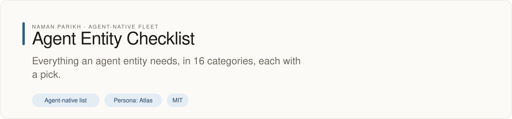

# Agent Entity Checklist

<!-- fleet:header:start -->
<p align="center"><picture><source media="(prefers-color-scheme: dark)" srcset="assets/banner-dark.svg"></picture></p>

<p align="center">
<a href="https://github.com/naman10parikh/agent-entity/actions/workflows/ci.yml"></a>
<a href="LICENSE"></a>
<a href="https://x.com/naman10parikh"></a>
<a href="https://www.linkedin.com/in/naman-parikh1/"></a>
</p>

<p align="center"><a href="#quick-start">Quick start</a> · <a href="docs/README.md">How it works</a> · <a href="AGENTS.md">AGENTS.md</a> · <a href="llms.txt">llms.txt</a> · <a href="https://github.com/naman10parikh/agent-entity/discussions">Discussions</a> · <a href="https://github.com/naman10parikh">All projects</a></p>

**Everything an agent entity needs, in 16 categories, each with a pick.**

An agent-native list: written for people and kept machine-readable for agents, with [AGENTS.md](AGENTS.md) and [llms.txt](llms.txt) telling an agent how to read and extend it.

_Agent Entity Checklist is part of an agent-native play for agent-native systems that can eventually be recursively self-improving and evolving, operated by agent employees._
<!-- fleet:header:end -->


Whatever an agent entity becomes (an agent employee, an app, an open-source project or a company), it must answer
the same questions. This list asks 16 of them, splits them into 102 components and 339 single decisions, and gives
each decision the leading open-source option, the leading closed-source option and a default pick with its reason.
It is for founders, builders and coding agents who want the whole map before they build.

<!-- fleet:use:start -->
## Use it from any coding agent

Codex, Cursor, OpenCode, GitHub Copilot and other agents read [AGENTS.md](AGENTS.md); Claude Code reads [CLAUDE.md](CLAUDE.md) and Gemini CLI reads [GEMINI.md](GEMINI.md), which import it. [llms.txt](llms.txt) maps every surface for agents that read first.
<!-- fleet:use:end -->

## Quick start

Read the checklist below, or ask the JSON (needs `jq`):

```bash
git clone https://github.com/naman10parikh/agent-entity && cd agent-entity
jq -r '.categories[] | "\(.priority)  \(.name): \(.question)"' checklist.json
jq -r '.tools | to_entries[] | select(.value.routes.remote_mcp.v == "yes") | .value.name' checklist.json
```

To change an entry, edit `checklist.json`, then render and check (Python 3.10 or later, nothing to install):

```bash
python3 scripts/render.py && python3 -m unittest discover -s tests -v
```

## How it works

- [`checklist.json`](checklist.json) is the list: categories, components, elements, and every product a pick names,
  with a source for each verdict and the date it was read.
- [`scripts/render.py`](scripts/render.py) checks the record and renders the block below and
  [PRODUCTS.md](PRODUCTS.md), where each product shows the ways an agent can use it on its own, its price, adoption,
  openness and score.
- CI runs the tests and `render.py --check` on every push and pull request. The check fails when the record breaks a
  rule or a view no longer matches it.
- Evidence ages: `python3 scripts/render.py --stale 90` lists the products whose sources were read more than 90 days
  ago, and a weekly job prints the same list in its run summary. Read a row's sources again before you buy on it.
- A pick is the default an entity gets when nobody chooses, not a claim about who uses it. Every row that names an
  alternative can be switched to it.

<!-- checklist:start -->
_Generated from [checklist.json](checklist.json) (version 1.0, evidence read 2026-09-27) by `python3 scripts/render.py`: 16 categories, 102 components, 339 elements, 159 products. Edit the JSON, never this block._

## The map

The 16 categories in 5 layers. Each category is a question every entity must answer; its components are the things you choose; each row of the checklist is one decision inside them.

| # | Category | Layer | The question it answers | Its components | Priority |
|---|---|---|---|---|---|
| 1 | [Intelligence](#1-intelligence-what-thinks-and-decides-for-it) | The entity itself | What thinks and decides for it? | Thinking, Deciding, Own models, Perceiving, Speaking and listening, Making media, Routing | P0 |
| 2 | [Harness](#2-harness-what-is-it-made-of) | The entity itself | What is it made of? | Identity, Memory, Skills, Tools, Hooks, Sub-agents, MCPs, Dispatch, Evals, Observability, Sandbox | P0 |
| 3 | [Reach](#3-reach-how-does-it-reach-the-world-and-act-in-it-as-itself) | How it meets the world | How does it reach the world and act in it as itself? | Addresses, Workstation, Proof | P1 |
| 4 | [Surfaces](#4-surfaces-how-do-people-and-other-agents-use-it) | How it meets the world | How do people and other agents use it? | For people, For agents, Docs, Devices | P1 |
| 5 | [Software](#5-software-what-are-its-doors-built-from) | How it meets the world | What are its doors built from? | Front end, Back end, Data stores, Accounts and payments, Messaging, Background jobs, Content and languages | P1 |
| 6 | [Network](#6-network-how-does-it-work-with-other-agents) | How it meets the world | How does it work with other agents? | Protocols, Discovery, Markets, Hiring other agents, Reputation | P2 |
| 7 | [Physical world](#7-physical-world-what-does-it-make-keep-move-or-do-off-the-screen-and-through-whom) | How it meets the world | What does it make, keep, move or do off the screen, and through whom? | Supply, Stock and places, Fulfilment, Physical work, Product safety, Sensors | P3 |
| 8 | [Trust](#8-trust-why-can-anyone-rely-on-it) | How it stays trusted, running and improving | Why can anyone rely on it? | Verification, Controls, Security, Safety, Records, Privacy, Compliance | P0 |
| 9 | [Operations](#9-operations-how-is-it-kept-running) | How it stays trusted, running and improving | How is it kept running? | Runtime, Build tools, Hosting and delivery, Releases, Monitoring and incidents, Cost control, Backups and recovery, Lifecycle, Workspaces | P0 |
| 10 | [Evolution](#10-evolution-how-does-it-get-better-on-its-own) | How it stays trusted, running and improving | How does it get better on its own? | Signals, Improvement loop, Fleet learning, Open-endedness, The pool of verified cases, Experiments | P0 |
| 11 | [Money](#11-money-how-does-money-come-in-go-out-and-get-counted) | The business around it | How does money come in, go out and get counted? | Accounts, Pricing, Billing, Spending, Books, Payouts | P2 |
| 12 | [Growth](#12-growth-how-do-people-find-it-and-why-do-they-stay) | The business around it | How do people find it, and why do they stay? | Brand, Content, Being found, Community, creators and paid reach, Growth loops, Sales, Support and success | P1 |
| 13 | [People](#13-people-who-stands-behind-it) | The business around it | Who stands behind it? | Core team, Experts at the edge, Advisors, Hiring, Pay and incentives, Direction, Workplace tools, Operating rules and team measures | P1 |
| 14 | [Company](#14-company-what-legal-body-does-it-live-in) | The business around it | What legal body does it live in? | Formation, Governance, Legal, Intellectual property, Insurance | P2 |
| 15 | [Funding](#15-funding-who-pays-until-it-pays-for-itself) | The business around it | Who pays until it pays for itself? | Self-funding and customers, Money without equity, Equity, Debt, Raising tools | P2 |
| 16 | [Compute](#16-compute-what-does-it-run-on-below-the-waterline) | Below the waterline | What does it run on, below the waterline? | Rented capacity, Serving and training software, Edge, Own clusters, Custom silicon, Data centres and power | P3 |

## How to read a row

- **Layer**: A group of categories that share one relation to the entity (the entity itself, how it meets the world, and so on).
- **Category**: One question every entity must answer, such as 'What is it made of?'. The buckets never change with what the entity becomes.
- **Component**: One thing you choose or build to answer the question, such as Memory.
- **Element**: One decision inside a component, such as the long-term memory store. Each element names the open-source leader, the closed-source leader and a default pick.

| Column | Means |
|---|---|
| Open source | The leading option whose code anyone can run, with its evidence. |
| Closed source | The leading hosted or enterprise option, with its evidence. Where neither side has a real option, the cell says why. |
| Pick | The default an entity gets when nobody chooses, and why. A pick is a default, not a lock: every row that names an alternative can be switched to it. |

| Priority | Means |
|---|---|
| P0 | From day one, for every entity. |
| P1 | As soon as it serves people or other agents. |
| P2 | Once it earns money or becomes a company. |
| P3 | At scale, once the work proves the need. |
| P4 | Owning the layers below the waterline: chips, buildings and power. Only when the work has proved it for years. |

## The checklist

### 1. Intelligence: What thinks and decides for it?

The models it rents, and later the small ones it trains. Rented from day one; trained only on verified cases it has the right to keep. Priority P0.

| Component | Element | Open source | Closed source | Pick, and why |
|---|---|---|---|---|
| **Thinking**: The frontier model: reads, plans, writes and handles what nobody has seen before. | **Frontier model**: The strongest general model, kept for judgement and new cases. | Open-weight leaders on the Artificial Analysis index: Xiaomi MiMo-V2.6-Pro (46), GLM-5.3 (45), Kimi K3 (44); DeepSeek V4, Qwen3.8 | Anthropic Claude Opus 5.5 (58, first of 173 models), then OpenAI GPT-6 Astra (53) | **Claude Code's default flagship (Opus 5.5 today), never a pinned model ID**. First on the independent index on 27 September 2026. Fable scores lower (53) at a higher price. Product: [Claude API (Anthropic)](https://platform.claude.com). |
| **Deciding**: Fast typed answers (yes or no, a score) on the repeated decisions inside a job. | **Decision model**: A System One model: a situation and typed questions in, probabilities out, no text. | No open model of this class; a general open model (GPT-OSS 120B) matched it on 60 test cases at about eight times the cost; a small classifier on your own cases (SetFit, GLiNER2) | Jev (TypeSafe AI), launched 15 September 2026 | **Jev at rung two, scored only on held-back cases**. 60 of 60 held-back cases set up per its docs, a third of a second, about $0.018 per 1,000 decisions; an embedding classifier beat it once labelled data existed, which is rung three. Product: [Jev (TypeSafe)](https://typesafe.ai). |
| **Own models** (P3): Rung three: small models trained on the verified record, for less still. | **Own small models**: A small model trained on verified cases so it takes a decision for less. | Open weights to start from: Qwen, Gemma, gpt-oss | Closed models tuned by their makers, who keep the weights: OpenAI's tuned models cannot be downloaded, and its self-serve fine-tuning closed to new organisations on 7 May 2026 | **Later: a small Qwen or Gemma model trained on verified cases an open model or a person produced; one trained only on a customer's own cases belongs to that customer**. A step down must pass the holdout; the frontier model keeps the new cases. The customer owns what its own cases train and runs it on any compute, its own included, while the vendor's own small models train only on de-identified cases it has the right to keep. Adapters share one open base model, since serving is the cost that stays, and until a lawyer rules they learn from open models' answers and people's corrections, never a closed model's outputs: Anthropic's terms bar using its service to train competing models. Product: [Qwen models (Alibaba)](https://qwen.ai). Sources: [1](https://developers.openai.com/api/docs/deprecations) [2](https://www.anthropic.com/legal/commercial-terms) |
| **Perceiving** (P1): Reading documents, images and signals, and searching text at scale. | **Embeddings and reranking**: Turning text into vectors for search, and re-ordering results by relevance. | Qwen3-Embedding and Microsoft harrier-oss lead the public retrieval leaderboard (MTEB); BGE rerankers | Gemini Embedding, Voyage (MongoDB), Cohere Rerank | **Qwen3-Embedding, only once retrieval is measured as the bottleneck**. Open models lead the independent retrieval leaderboard and run anywhere, including where data must stay. Product: [Qwen models (Alibaba)](https://qwen.ai). |
|  | **Document reading**: Turning PDFs, scans and forms into structured text. | markitdown (187,299 stars), Docling; MinerU is Apache 2.0 with extra terms that require a paid licence at large scale | Reducto, Azure Document Intelligence, Google Document AI, Mistral OCR | **The frontier model reads the document; markitdown for bulk conversion**. Fewer moving parts until volume calls for a pipeline. Product: [Claude API (Anthropic)](https://platform.claude.com), [MarkItDown (Microsoft)](https://github.com/microsoft/markitdown). |
|  | **Images and signals**: Understanding medical images and signals, such as ECG (electrocardiogram) traces and echo images, beside documents. | MONAI for medical imaging (Apache 2.0, 253,000 downloads a week); NeuroKit2 and WFDB for ECG signals (both MIT). MedGemma is open weights under Google's Health AI Developer Foundations licence, not an open-source licence | FDA-cleared tools per task, such as Anumana's ECG-AI (cleared for low ejection fraction, and on 8 April 2026 for cardiac amyloidosis from a standard 12-lead ECG); of the 50 newest devices on the FDA's AI list, 39 are radiology and 3 cardiovascular | **Read, never interpret: the agent reads the values the device already printed in its report and passes tracings and images to the clinician untouched; any interpretation needs FDA clearance, so it stays out of a booking job**. Booking a test needs the order and the report, not a reading of the trace. Software that analyses a medical image or signal is regulated as a device, outside the exemption for decision support (Trust: Rules of the vertical). Sources: [1](https://www.fda.gov/medical-devices/artificial-intelligence-enabled-medical-devices/list-artificial-intelligence-enabled-medical-devices) [2](https://anumana.ai/) [3](https://github.com/Google-Health/medgemma) |
| **Speaking and listening** (P1): Voice in and out, for phone calls and voice surfaces. | **Speech to text**: Transcribing calls and voice notes. | Mistral Voxtral Small (2.8% word errors); Whisper, the most used | Microsoft MAI-Transcribe-2 (2.0% word errors, $1.67 per 1,000 minutes; in preview in Azure Speech), ElevenLabs Scribe v2 (2.2%, $3.67), Deepgram Nova-3 (5.2%) | **MAI-Transcribe-2 where accuracy matters most, once it leaves preview and, with health data, Microsoft's business associate agreement covers it; Scribe v2 until then; the live-call model chosen on delay measured on the entity's own calls**. It is the most accurate and under half the price of Scribe v2. The speed figures are batch runs, not the delay on a live call, so live calls are measured, not assumed. Product: [ElevenLabs](https://elevenlabs.io), [Microsoft Foundry (MAI-Transcribe-2)](https://ai.azure.com). Runner-up: [Deepgram](https://deepgram.com). Sources: [1](https://learn.microsoft.com/en-us/azure/ai-services/speech-service/mai-transcribe) [2](https://artificialanalysis.ai/speech-to-text) |
|  | **Text to speech**: A natural voice for calls. | Chatterbox (MIT), Kokoro (Apache 2.0; no change since 6 August 2025). Fish Speech is research and non-commercial use only, so not open source | Cartesia Sonic 3.6 (first on the voice arena, score 1277) and Google Gemini 3.8 Flash TTS (1268, within the margin, at $16.5 per million characters against Cartesia's $49); ElevenLabs' best model is twelfth | **Gemini 3.8 Flash TTS or Cartesia, whichever answers faster on the entity's own test calls**. The two are tied on quality and Gemini costs a third as much; on a phone call, the delay before the first word decides. ElevenLabs is the runner-up and the most adopted (2.1 million Python downloads a week, every agent route), but its best model ranks twelfth on the voice arena and costs $50 per million characters, against Gemini's $16.50. Cartesia is the easier of the two picks for an agent to drive (a hosted MCP server, a CLI and skills), so the test call decides between them. Product: [Gemini API (Google)](https://ai.google.dev). Runner-up: [Cartesia](https://cartesia.ai), [ElevenLabs](https://elevenlabs.io). Sources: [1](https://artificialanalysis.ai/text-to-speech/leaderboard) |
|  | **Realtime voice**: Spoken conversation with low delay, end to end. | LiveKit Agents (Apache 2.0), Pipecat (BSD-2) | OpenAI Realtime, Gemini Live; Vapi and Retell for phone agents | **LiveKit Agents on a Telnyx SIP trunk (a line for phone calls over the internet) to the agent's own number (LiveKit's own US number for a first test)**. It is the most used of the two open options (869,585 PyPI plus 779,499 npm downloads a week, against Pipecat's 237,232) and keeps speech, model and voice swappable on the agent's own number. LiveKit documents Telnyx trunks step by step. ElevenLabs Agents is the runner-up; Vapi is the quickest managed path at $0.05 a minute. Product: [LiveKit Agents](https://livekit.io), [Telnyx](https://telnyx.com). Runner-up: [ElevenLabs](https://elevenlabs.io). |
| **Making media** (P1): Images and video for content, ads and product. | **Image generation**: Pictures for content, ads and product. | ComfyUI with open weights (Ideogram 4.0 open, Qwen-Image) | OpenAI gpt-image-2.5 (first on the image arena) | **gpt-image-2.5 through the gateway, paid per use**. For content and ads only; the best open-weights model is eighth on the image arena (27 September 2026). Product: [OpenAI API](https://platform.openai.com), [Vercel AI Gateway](https://vercel.com/ai-gateway). |
|  | **Video generation**: Short video for content and ads. | MiniMax H3 (the best open weights, eighth), Wan 2.2 | Google Gemini Omni 1.1 Flash (first on the video arena) | **Gemini Omni through the gateway, paid per use**. Buy per clip for content and ads; nothing to host. Product: [Gemini API (Google)](https://ai.google.dev), [Vercel AI Gateway](https://vercel.com/ai-gateway). |
| **Routing**: The right model for each piece of work, through one gateway. | **Model gateway**: One API to many models, with fallbacks. | LiteLLM (59,726 stars) | OpenRouter (Stripe agreed to buy it, August 2026), Vercel AI Gateway | **Vercel AI Gateway**. It carries Jev and open models; a gateway owned by a payments company is a concentration risk, and a retired model is swapped here by configuration and re-verified. Agents that serve customers get metered access through it. OpenRouter is the runner-up and the more agent-native (a hosted MCP server, a CLI, 19 skills, per-agent keys by API) and the most used (8 million users, 100 trillion tokens a month), but it charges 5.5% on credit and Stripe has agreed to buy it; Vercel charges no markup or platform fee, even when the entity brings its own keys. Product: [Vercel AI Gateway](https://vercel.com/ai-gateway). Runner-up: [OpenRouter](https://openrouter.ai). |
|  | **Routing rule**: Judgement on the flagship, bulk work on cheaper models, repeated decisions down the ladder once a holdout proves it. | vLLM Semantic Router (active), RouteLLM (stale since 2024) | Not Diamond, Martian, Jev Router | **The entity's own rule: route by task**. Maximum intelligence per task per token; every step down gated by a holdout. |

### 2. Harness: What is it made of?

The eleven components that turn a model into an agent. Priority P0.

| Component | Element | Open source | Closed source | Pick, and why |
|---|---|---|---|---|
| **Identity**: The self: who it is at work, its job and its grade. Its addresses and proof live under Reach; its standing under Money and Company. | **Character and boundaries**: Personality, tone and what it will never do. | SOUL.md (an open format) | Persona settings inside hosted agents (custom GPTs, Copilot Autopilot) | **SOUL.md**. Plain files anyone can read and diff. |
|  | **Operating instructions**: How it works in this job and codebase. | AGENTS.md (open standard) | Vendor instruction fields (custom GPT instructions) | **AGENTS.md plus CLAUDE.md and Claude Code's rule files**. AGENTS.md is the cross-runtime standard, in the Linux Foundation's Agentic AI Foundation since 9 December 2025; CLAUDE.md points at it. |
|  | **Name and brand**: A one-word symbolic name and a tagline; its look comes from the company's brand (Growth). | BRAND.md (an open format) | Brand kits in Figma or Canva | **BRAND.md in the agent's own folder: one symbolic word and a tagline**. Every agent gets its own brand on one design system. |
|  | **Contract and definition of done**: The job, what counts as done and how it is verified, signed with the people who do the work today. | A CONTRACT.md file with seven fields (name, owns, receives, produces, can decide, escalates, done means) | None worth naming: each hosted platform keeps its own job settings | **One-page contract per agent**. If the work cannot be verified, the agent is not built. |
|  | **Grade**: Its salary band, which also caps the compute it may spend. | A grade table | None worth naming | **The grade sets the number: the salary band, and the compute and spending caps that follow from it**. An uncapped agent on the frontier model can cost about $2,000 a month. |
|  | **Owner of record**: The person it reports to, shown on the org chart where one exists. | A field kept with the agent | The manager field in the customer's directory (Microsoft Entra, Okta) | **A named owner on each agent, the person it reports to**. Every entity needs a named person who answers for it; proving who the agent is lives under Reach: Proof. |
| **Memory**: What it keeps between runs, for itself and for each person it serves. | **Working context**: What is in front of the model now: loading, compaction and handoff. | SoL-Pi (NVIDIA) for pruning what is sent | Compaction built into Claude Code, Codex and the OpenAI Agents API | **The runtime's compaction plus a handoff file, measured as tokens saved per run**. SoL-Pi cut token traffic by 45 to 49 percent at similar accuracy in September 2026. Product: [Claude Code](https://code.claude.com). |
|  | **Long-term memory**: Facts, preferences and history that survive between sessions. | mem0 (66,067 stars), Graphiti, Letta, Supermemory (MIT) | Supermemory cloud, Zep, Mem0 Platform | **Plain files first, then Mem0's hosted memory when an agent needs a shared store; Supermemory as the close runner-up**. Every memory benchmark is run by a vendor, and Letta found a plain filesystem agent competitive, so files come first; Graphiti when facts change over time. For the hosted layer Mem0 now leads on use, about four times Supermemory's weekly downloads (620,090 against 149,990) and twice the stars, and its agent can start before any person signs up; both have a hosted MCP server, a CLI and skills and both start free. Product: [mem0](https://mem0.ai). Runner-up: [Supermemory](https://supermemory.ai). |
|  | **Shared knowledge**: The company brain: documents and notes every agent reads. | Markdown in git, Microsoft GraphRAG. Obsidian, the editor, is closed source | Glean, Notion AI | **A wiki engine over Markdown**. The Markdown stays the source of truth, and every brain also reads as a website. |
|  | **Rules from corrections**: Every correction a person made, kept as rules the next run obeys. | LEARNINGS.md files | None worth naming | **LEARNINGS.md and rule files**. A correction that vanishes trains the expert to stop correcting. |
| **Skills**: Packaged know-how it loads when a task needs it. | **Skill files**: Instructions, scripts and examples per task, loaded on demand (SKILL.md). | Agent Skills (SKILL.md, open standard) | Skill stores inside Claude and ChatGPT | **SKILL.md**. One open format read by 46 agent clients (agentskills.io, read 27 September 2026), including Codex, Copilot, Gemini CLI and Cursor. Sources: [1](https://agentskills.io/home) |
|  | **Skill library**: Where skills are found, shared and ranked. | superpowers (292,160 stars, the most-starred), ECC, anthropics/skills | ClawHub, and the skill directories inside Claude and ChatGPT | **superpowers as the base; rank the rest with a registry that scores skills by evidence**. The most-starred skills library, with a strong public record. Product: [superpowers (skills library)](https://github.com/obra/superpowers). |
| **Tools**: What it can call: command-line tools, the web, a computer. | **Command-line tools**: Deterministic programs for repeatable actions. | playwright-cli, gh | None worth naming: the leading command-line tools are open | **playwright-cli and gh**. Connect in this order: an MCP server or a CLI, then a connector, then the API, and the screen last. Both picks are widely used, with a strong public record. Product: [Playwright and playwright-cli (Microsoft)](https://playwright.dev), [GitHub (code, Apps, Actions)](https://github.com). |
|  | **Browser use**: Driving a browser: opening pages, clicking, typing and reading them. | Playwright, Stagehand, browser-use | Claude in Chrome, ChatGPT agent mode | **Stagehand for each agent; playwright-cli for the operator's own work**. Stagehand v4 is built for agents and runs on the hosted browser; browser-use leads on stars (116,499). Product: [Playwright and playwright-cli (Microsoft)](https://playwright.dev), [Stagehand (Browserbase)](https://www.stagehand.dev). |
|  | **Computer use**: Operating a desktop and its apps by looking at the screen. | Cua (26,642 stars), UI-TARS-desktop, Agent S | Claude computer use, OpenAI's computer-using agent | **The default Claude model's computer use**. Claude Opus 5 leads OSWorld 2.0 (44.3%), the harder test; the older OSWorld-Verified board is near saturation and led by other models. Cua is the open fallback. Product: [Claude API (Anthropic)](https://platform.claude.com). |
|  | **Web search and extraction**: Finding and reading pages, with typed records where they exist. | Firecrawl (AGPL-3.0, 185,489 stars, can run on your own machines), Crawl4AI (84,353), SearXNG (37,684) | Firecrawl's hosted service, Exa, Tavily | **Firecrawl with its Alexandria providers**. It is the most-starred open option, runs self-hosted or hosted, and its Alexandria providers return typed records where they exist. Product: [Firecrawl](https://www.firecrawl.dev). Runner-up: [Exa](https://exa.ai). |
| **Hooks**: Automation that fires at fixed points in its work. | **Lifecycle hooks**: Before and after a session, a tool call or a compaction. | plannotator, tdd-guard | The host runtime's own hooks (Claude Code is the reference) | **plannotator**. A widely used hooks project with a strong public record; a hook is where a rule stops being a request. Product: [plannotator](https://github.com/backnotprop/plannotator). |
|  | **Policy hooks**: Checks that block an action before it runs. | Open Policy Agent; hooks in the host runtime | None worth naming | **The rules from Trust: Controls, as data, enforced by one engine before each tool call**. A rule blocks only when false alarms are near zero, and every override writes a ledger row. |
| **Sub-agents**: Fresh-context helpers it delegates to. | **Personas**: Packaged helpers with a narrow scope. | wshobson/agents | Claude Code sub-agents and teams, OpenAI Agents API sub-agents | **wshobson/agents**. Few sub-agent listings carry scored evidence yet, so this pick is judgement, not a ranking. Product: [wshobson/agents](https://github.com/wshobson/agents). |
|  | **Parallel swarm**: Many helpers at once, briefed and verified by a lead. | ruflo (formerly claude-flow) | Claude Code agent teams, OpenAI Agents API | **Claude Code sub-agents; how many run at once is set by the machine's free memory**. Sub-agents come with the agent loop, and free memory, not a fixed count, limits how many run at once. Product: [Claude Code](https://code.claude.com). |
| **MCPs**: Servers it connects to over the Model Context Protocol. | **Connected servers**: Real servers for the systems it uses; keys held outside the agent. | github-mcp and the open server ecosystem | Vendor-hosted remote servers (Stripe, Supabase, GitHub) | **github-mcp first; each agent gets its own address and tools on its product's MCP server (Surfaces: For agents)**. The server most coding agents need first; build to the 28 July 2026 version of the standard, which keeps nothing between calls. Product: [GitHub (code, Apps, Actions)](https://github.com). |
|  | **Server registry**: Where servers are found and vetted. | The official MCP Registry | Smithery (Arcade bought it in August 2026) | **Vet servers with a registry that ranks them by evidence; listing the entity's own is under Network: Discovery**. A listing is not proof a server works: about half of the listed servers complete a handshake. |
| **Dispatch**: Who does what, and when work fires on its own. | **Agent loop**: The runtime that reads the files, calls the model and runs the tools. | OpenClaw, Hermes Agent, OpenCode, Codex CLI | Claude Code, Claude Managed Agents, OpenAI Agents API | **The Claude Agent SDK is the loop (Claude Code for the operator's own work); Managed Agents hosts it for customers who have an API account**. One loop serves the operator's own work and every agent; OpenCode is the free worker for checks in a sandbox. Product: [Claude Agent SDK](https://platform.claude.com/docs/en/agent-sdk/overview), [Claude Code](https://code.claude.com), [Claude Managed Agents](https://platform.claude.com/docs/en/managed-agents/overview). |
|  | **Work routing**: Sending each task to the right agent and skill. | LangGraph, Mastra | Claude Managed Agents, OpenAI Agents API | **The Claude Agent SDK; LangGraph or Mastra where fixed steps with approval points are needed**. PocketFlow has had no push since 26 July 2026. LangGraph offers agents more ways in (a hosted docs server, a CLI and skills), but each agent already runs the Agent SDK's loop, so a second framework comes in only where fixed steps with approval points need a graph. Product: [Claude Agent SDK](https://platform.claude.com/docs/en/agent-sdk/overview). Runner-up: [LangGraph](https://www.langchain.com/langgraph), [Mastra](https://mastra.ai). |
|  | **Schedules**: Heartbeats and routine runs (HEARTBEAT.md, cron). | cron, Temporal schedules | Claude Code routines, Inngest | **HEARTBEAT.md, started by the host's scheduler; long runs go to durable execution (Operations: Runtime)**. One heartbeat per agent; anything that must survive a crash runs as a durable task. |
|  | **Event triggers**: Work that starts when something happens in a connected system, such as a new referral or a cancelled slot, instead of polling for it. | Activepieces (MIT outside its enterprise folder, 24,753 stars); CloudEvents, the CNCF's standard event format. n8n (206,125 stars) is fair-code under its Sustainable Use License, not open source | Composio's triggers (hosted; its SDK is MIT, 1.1 million npm downloads a week); Zapier; Pipedream (Workday agreed to buy it on 19 November 2025; over 3,000 apps) | **Composio's triggers for apps connected through it, and the records system's own event feeds where they exist; each event lands in a durable queue (Operations: Durable execution) that wakes the right agent; polling only where no event exists**. Polling spends model calls on nothing and notices late; a trigger wakes the agent only when there is work. Product: [Composio](https://composio.dev). Sources: [1](https://github.com/ComposioHQ/composio) [2](https://newsroom.workday.com/2025-11-19-Workday-Signs-Definitive-Agreement-to-Acquire-Pipedream) |
| **Evals**: Proof that it works and that a change helped. | **Golden tasks and judges**: Cases with known right answers, graded pass or fail. | promptfoo, deepeval | Braintrust, LangSmith | **promptfoo in continuous integration (the checks that run on every change), pinned to a version, with Inspect as the neutral judge**. OpenAI announced on 9 March 2026 that it would buy promptfoo and keep it open source; it is still MIT and active (807,194 npm downloads a week). Inspect, from the UK AI Security Institute, is a judge no lab owns. Product: [promptfoo](https://www.promptfoo.dev), [Inspect (UK AI Security Institute)](https://inspect.aisi.org.uk). |
|  | **Held-back cases**: Cases nobody tuned on; the only ones that count. | The entity's own held-back set | Vendor graders (Managed Agents Outcomes) | **About 200 per decision**. Sixty cases cannot tell 97% from 99%. |
|  | **Public benchmarks**: Shared tests that compare models and harnesses on someone else's job. | SWE-bench, tau-bench, OSWorld, Terminal-Bench | Artificial Analysis and Arena, the hosted leaderboards | **Read them to shortlist; decide on the entity's own held-back cases**. A benchmark measures someone else's job, never the entity's own. |
|  | **Simulated environments**: Clones of the buyer's systems and simulated users, for trying work that cannot be tried live first. | tau-bench's simulated users, OSWorld, Prime Intellect's environments | Private environment vendors | **Held-back cases first; a simulated clone once live trials are too risky**. Some jobs cannot be practised on real patients or real money. |
|  | **Test suite**: Unit, integration and end-to-end tests that gate every change. | Vitest, Playwright | None worth naming: the leading test tools are open | **Vitest and Playwright**. A change ships only when the suite passes. Product: [Vitest](https://vitest.dev), [Playwright and playwright-cli (Microsoft)](https://playwright.dev). |
|  | **Fairness and bias tests**: Verifying that outcomes do not differ unfairly across groups wherever the job decides about people, such as who is offered the earliest slot. | Fairlearn (MIT, 27,000 downloads a week) for group metrics; AIF360 (Apache 2.0); deepeval's bias metric (Apache 2.0) | Governance suites with bias monitoring: IBM watsonx.governance, Fiddler | **Before any agent ranks or prioritises people, such as patients: compare outcomes on the held-back cases (waiting time, slot offered, calls made) across the groups the law protects where the data allows, plus language and insurer, with Fairlearn's metrics, before launch and after every change the loop ships; the agent never sees a protected trait its job does not need**. The framework of NIST (the US standards institute) asks for fairness to be evaluated and documented (MEASURE 2.11). Since 1 May 2025, US health programs that take federal money must not discriminate through patient care decision support tools (45 CFR 92.210), so an agent that ranks patients for care needs this verification. Product: [Fairlearn](https://fairlearn.org). Sources: [1](https://airc.nist.gov/airmf-resources/airmf/5-sec-core/) [2](https://www.ecfr.gov/current/title-45/subtitle-A/subchapter-A/part-92/subpart-C/section-92.210) [3](https://www.mcdermottlaw.com/insights/section-1557-patient-care-decision-support-tools-anti-discrimination-compliance-12-things-to-consider/) |
| **Observability**: What each run did, what it cost and what value it made. | **Traces**: Every step of every run, replayable. | Langfuse, Opik | LangSmith, Datadog LLM Observability | **Langfuse**. ClickHouse has owned Langfuse since January 2026 and the core is still MIT; write traces in the open OpenTelemetry format so the tool can be changed. Product: [Langfuse](https://langfuse.com). |
|  | **Cost and value receipts**: Cost per run beside value per token and the share a person signed off; the totals per agent are defined under Money: Books. | OpenTelemetry GenAI conventions | None worth naming | **A home-made receipt per run**. Compute spent on unverified work shows as waste, not cost of goods. |
| **Sandbox**: The sealed place where its code runs. | **Isolated runs**: A fresh machine per run for untrusted code. | E2B's own runtime (Apache 2.0; it runs in E2B's cloud or on your own machines), OpenSandbox (15,532 stars), microsandbox (8,447) | E2B, Modal, Cloudflare Sandboxes | **E2B**. It gives each run a small sealed virtual machine (Firecracker) that started in 1.6 seconds at the median in a published test (E2B says about 150 ms). It is also the open leader by use: 2.14 million npm and 1.32 million PyPI downloads a week. Daytona's core went private in June 2026. Vercel Sandbox is the runner-up: the most downloaded sandbox SDK (5.83 million a week), a CLI and a skill, and microVMs on a Vercel account, though the CLI and skill are the Vercel platform's, not the sandbox's own. E2B's only hosted MCP server is its docs server, since its control server's repository was archived, so agents drive it through its SDK or CLI. Product: [E2B](https://e2b.dev). Runner-up: [Vercel](https://vercel.com). |
|  | **Network and file limits**: What a run may reach, keep and send out. | A gate that lets a run reach only listed addresses (Envoy, Squid) | Network controls in E2B and Modal | **Deny by default, with an allow-list per agent**. What a run cannot reach, it cannot leak. |

### 3. Reach: How does it reach the world and act in it as itself?

Its own addresses, the workstation it acts through, and the proof of who it is. Own the self; rent the addresses. Priority P1.

| Component | Element | Open source | Closed source | Pick, and why |
|---|---|---|---|---|
| **Addresses**: Where people and agents reach it as itself. | **Email inbox**: Its own mailbox, readable by the agent. | Postal, Stalwart | AgentMail | **AgentMail**. An agent can do the whole job itself: AgentMail has a hosted MCP server in the official registry, a CLI, skills and an API, and creates an inbox in one call with no domain, which no long-standing mailbox offers; it is backed by Y Combinator and downloaded over 500,000 times a week. Google Workspace, the runner-up, fits when a customer wants the mailbox inside its own tenant. The free plan allows 3 inboxes; the $20 Developer plan allows 10. Product: [AgentMail](https://www.agentmail.to). Runner-up: [Google Workspace](https://workspace.google.com). |
|  | **Phone number, calls and SMS**: Its own number, inbound and outbound. | Jambonz on your own lines | Telnyx, Twilio, Plivo | **Telnyx: the agent's own number for calls and texts, bought and wired by the agent itself**. US carriers require business text numbers to be registered first (10DLC). Telnyx is the only carrier where an agent can do the whole job itself: a hosted MCP server that calls the real API (Twilio's official one only searches its docs), official skills, a CLI that buys and wires a number in one command, and a published agent sign-up; a US number costs $1.00 a month and a text from $0.004, against Twilio's $1.15 and $0.0083. Twilio is the runner-up: its software is downloaded about 18 times as often. Product: [Telnyx](https://telnyx.com). Runner-up: [Twilio](https://www.twilio.com). Sources: [1](https://github.com/team-telnyx/ai) |
|  | **WhatsApp**: Its own WhatsApp Business number. | Only unofficial libraries (whatsapp-web.js, Baileys), which break WhatsApp's terms | Meta's WhatsApp Business Platform, directly or through Telnyx, Kapso or Twilio | **WhatsApp on the agent's own Telnyx number, the same account as its calls and texts; Kapso if Meta's sign-up through Telnyx stalls**. Meta barred general-purpose assistants in January 2026 and readmitted them for a fee in March; on 9 June 2026 the European Commission ordered free access for rival AI assistants while its case runs. A business's own service agent was never the target. One number and one account for calls, texts and WhatsApp, under the same hosted MCP server, CLI and skills; Kapso is the most agent-native WhatsApp layer and the fallback. Product: [Telnyx](https://telnyx.com). Runner-up: [Kapso](https://kapso.ai). Sources: [1](https://developers.telnyx.com/docs/messaging/whatsapp/quickstart) |
|  | **iMessage**: Blue bubbles, reachable from any iPhone. | BlueBubbles, Photon's imessage-kit (both need a Mac) | Sendblue, Linq, Blooio (hosted lines); Apple Messages for Business, the only route Apple sanctions | **Sendblue for the agent's own line; apply to Apple Messages for Business; Photon only for the owner's own handle**. Hosted dedicated lines exist, so the agent's own line can run in the cloud rather than on a Mac. Product: [Sendblue](https://sendblue.com), [Photon (imessage-kit)](https://photon.codes). |
|  | **Slack, Teams, Discord and Telegram**: Its identity inside the chat apps where teams already work. | Vercel Chat SDK (15 channel adapters), grammY, discord.js, Slack Bolt | Each platform's own bot identity: a Slack app, a Teams app in the customer's Entra, a Discord or Telegram bot | **One app or bot per agent on each platform, through the Chat SDK adapters under one identity layer**. Fifteen maintained adapters, instead of writing and maintaining one per platform. Product: [Vercel Chat SDK](https://chat-sdk.dev). |
|  | **Social media handles**: Its own accounts on X, LinkedIn, Instagram, TikTok and YouTube. | Postiz (posts to many networks) | The official APIs: X (paid per use since February 2026), Instagram, TikTok, YouTube | **Company-owned accounts only, each labelled as automated, with a person approving each post; never a person's account. The posting tool is decided once, under Growth: Content (Postiz)**. X requires an automated label and LinkedIn forbids automating a member's account; nothing is posted in public without a yes. Sources: [1](https://github.com/gitroomhq/postiz-app) |
|  | **Domain and web address**: Its own name on the web and on email. | Any registrar with BIND | Cloudflare Registrar | **Cloudflare**. Sold at cost; it also holds the email settings (SPF, DKIM, DMARC) that keep its mail out of spam. Product: [Cloudflare (Registrar, DNS, R2, Tunnel)](https://www.cloudflare.com). Runner-up: [Vercel](https://vercel.com). |
|  | **Calendar**: Time others can book with it. | Cal.diy (Cal.com's open code, MIT) | Google and Microsoft 365 calendars; Cal.com hosted | **Its own Google or Microsoft 365 calendar where the customer works; hosted Cal.com for public booking links**. Meetings get booked where the customer already lives. Product: [Google Workspace](https://workspace.google.com), [Microsoft 365 and Entra](https://www.microsoft.com/microsoft-365), [Cal.com](https://cal.com). |
|  | **Meetings**: Joining calls as itself, to listen, take notes or speak. | Vexa (meeting bot) | Recall.ai | **Recall.ai, when a job needs meetings**. A meeting is a door people use. Recall.ai is the most adopted meeting-bot API ($0.50 an hour of recording, the first 5 hours free); its hosted MCP server reads bots and workspace data, while sending a bot into a call still goes through its API, through a small custom tool. Vexa is the open runner-up. Product: [Recall.ai](https://www.recall.ai). Sources: [1](https://www.recall.ai/pricing) |
|  | **Postal address**: Where mail, cheques and deliveries arrive, scanned for the agent. | None: an address needs a building and people to handle the mail | Stable (an API for scanned mail and cheque images); LegalZoom Virtual Mail, formerly Earth Class Mail (1.7 million cheques deposited); PostScan Mail (developer API) | **Stable: one address per company, not per agent; the agent reads scans through the API with a key the secrets keeper holds, and the service deposits cheques into the bank; LegalZoom Virtual Mail as the swap**. Every mailbox service needs US Postal Service Form 1583, signed by a named person who shows photo ID, so the address runs through a person like the tax number; Stable's published examples feed scanned mail to a model (updated April 2026). Product: [Stable (virtual mailbox)](https://www.usestable.com). Sources: [1](https://github.com/usestable/api-examples) [2](https://about.usps.com/forms/ps1583.pdf) [3](https://www.usestable.com/compare/stable-vs-earth-class-mail) [4](https://www.legalzoom.com/business/business-operations/lz-virtual-mail-overview.html) [5](https://www.postscanmail.com/developer-api.html) |
|  | **Fax**: Sending and receiving faxes, which payers and practices still use, for example for prior authorisations. | None found | Telnyx Programmable Fax, on the same account as calls and texts | **Telnyx Programmable Fax on a fax-enabled number, when a vertical still runs on fax, such as prior authorisations in health care**. Payers still take prior authorisation packets by fax; Telnyx buys a fax-enabled number and sends a fax by API on the same account as calls and texts. With health data, first confirm that Telnyx will sign a HIPAA (the US health privacy law) business associate agreement for fax. Product: [Telnyx](https://telnyx.com). Sources: [1](https://developers.telnyx.com/docs/programmable-fax/get-started) |
| **Workstation**: What it acts through: a computer, a browser and connectors to other apps. | **Cloud desktop**: A desktop of its own in the cloud, kept between tasks; computer use under Harness drives it. | Cua (MIT), Agent-S, E2B Desktop | Orgo (from $29 a computer a month), Windows 365 for Agents | **Orgo; Windows 365 for Agents when the customer runs Microsoft**. Orgo publishes its price, from $29 a computer a month; Cua is the open fallback. Product: [Orgo](https://www.orgo.ai), [Windows 365 for Agents](https://learn.microsoft.com/windows-365/). Runner-up: [Daytona](https://www.daytona.io). |
|  | **Signed-in browser**: A browser of its own that stays signed in and outlives any one machine; the browser tool under Harness drives it. | Steel Browser (self-hosted); Browserless (SSPL, not open source) | Browserbase, Kernel | **Browserbase**. Stagehand runs on it, its sessions stay signed in between tasks, and 10,000 companies use it. Product: [Browserbase](https://www.browserbase.com). |
|  | **Code account**: Its own account on the code host, so its commits and reviews carry its name. | Forgejo or Gitea accounts | A GitHub App or machine account | **A GitHub App per agent**. Scoped, revocable, and never a person's seat. Product: [GitHub (code, Apps, Actions)](https://github.com). |
|  | **App connectors**: Reaching every other app with the owner's grant, never its password, and never with more access than the person it works for. | Activepieces | Composio, Nango, Pipedream Connect (Workday's; its code is source-available), Arcade | **Composio**. The most downloaded of the four agent-connector SDKs, and the agent never holds the app's key; the owner consents once per app. Product: [Composio](https://composio.dev). |
|  | **Files and storage**: Its own drive for documents it makes and receives. | Nextcloud, Seafile | Google Drive, Microsoft OneDrive, Dropbox | **The customer's own drive through a connector; its own copies in the storage under Software: Data stores**. Files live where the customer already works. Product: [Composio](https://composio.dev). |
|  | **Private network access**: Reaching systems behind a buyer's firewall through an outbound tunnel or a private link, never an opening in the firewall. | frp (Apache 2.0, 109,653 stars); Headscale (BSD 3-Clause, 44,168), an open control server for Tailscale's clients; cloudflared, Cloudflare's connector (Apache 2.0, 15,936) | Cloudflare Tunnel, Tailscale, ngrok; AWS PrivateLink and Google Private Service Connect inside one cloud | **MCP tunnels: the buyer runs an outbound-only cloudflared connector next to a private MCP server with its own sign-in per server, so no inbound port opens and the agent never holds the credentials; for a health system, its own integration engine or a site-to-site VPN (virtual private network) when its security team requires one**. Hospitals keep their systems behind firewalls, and their security review decides the route. An outbound-only tunnel opens no inbound port, so the firewall stays shut. Product: [Cloudflare (Registrar, DNS, R2, Tunnel)](https://www.cloudflare.com). |
| **Proof**: How anyone knows it is this agent, acting for this person. | **Verifiable agent identity**: An identity others can verify, tied to its owner. | SPIFFE; auth.md (WorkOS); MCP client metadata documents | Microsoft Entra Agent ID; Visa and Mastercard agent key registries | **Each agent its own OAuth client and signing key; Entra Agent ID for Microsoft customers**. Card networks now verify agents by signature, and Microsoft made the agent a directory object. Product: [Microsoft 365 and Entra](https://www.microsoft.com/microsoft-365). |
|  | **Signed requests to websites**: Proving to a website that a request comes from a known agent. | Web Bot Auth (HTTP Message Signatures; an IETF working group) | Cloudflare signed agents, Visa Trusted Agent Protocol, Mastercard Agent Pay | **Sign every outbound request with the agent's own key**. Websites and card networks tell known agents from bots this way. |
|  | **Know your agent**: Proving to merchants and card networks which person or company stands behind it; who may call its own doors is under Trust: Controls (Callers it lets in). | KYAPay (Skyfire), AP2 (Google's Agent Payments Protocol) mandates | Visa Intelligent Commerce, Mastercard agentic tokens; Persona, Trulioo | **Whatever the card issuer requires: Visa Intelligent Commerce tokens, through Ramp**. Merchants and card networks now ask who stands behind an agent. Product: [Ramp (Agent Cards)](https://ramp.com). |
|  | **Scoped credentials**: The keys and tokens that prove this agent, one set each, scoped to its job. | Short-lived scoped tokens (OAuth 2.1, SPIFFE) | Issued by each service it signs in to | **One key set per agent, scoped to its job and held by the secrets keeper under Trust: Security, never by the agent**. Reach lists what the keys prove; where they are kept is decided once, under Trust. Product: [Infisical](https://infisical.com). Runner-up: [1Password (service accounts)](https://1password.com). |
|  | **Mandate**: A signed statement of what it may commit its owner to (spend, sign, accept terms), with limits and an expiry, that others can verify. | AP2's mandates (Apache 2.0): an open mandate holds the limits, a closed mandate binds one act, and the owner approves on a screen the agent cannot touch; the specification work moved to the FIDO Alliance in 2026 | Visa Intelligent Commerce and Mastercard Agent Pay (both launched April 2025; both joined AP2 in September 2025); AWS AgentCore Payments' spending limits | **A mandate per agent beside its contract and permissions file: what it may buy and up to how much, that it may not sign or accept terms unless the owner adds it, and an expiry; the owner signs it and the tool layer verifies it before each act; AP2's format when a payment network asks for one**. Scoped keys prove who is acting; a mandate proves what the owner agreed to, which is what a merchant, a card network or a court will ask for. If each agent has a permissions file and a hard spending cap, the mandate is their signed, portable form. Sources: [1](https://github.com/google-agentic-commerce/AP2/blob/main/docs/glossary.md) [2](https://github.com/google-agentic-commerce/AP2/blob/main/docs/faq.md) [3](https://eco.com/support/en/articles/15192003-mastercard-agent-pay-vs-visa-trusted-agent-2026-compared) [4](https://docs.aws.amazon.com/bedrock-agentcore/latest/devguide/what-is-bedrock-agentcore.html) |

### 4. Surfaces: How do people and other agents use it?

The doors: first-party places people go, and interfaces other agents call. Messaging channels are Reach, not surfaces. Priority P1.

| Component | Element | Open source | Closed source | Pick, and why |
|---|---|---|---|---|
| **For people**: Places a person goes to use it. | **Front door**: One presence behind every door; a manager agent routes each job and follows it to the finish. Its number and address are under Reach. | OpenClaw (one gateway, many channels), Vercel Chat SDK | Sierra (customer-facing agents across channels) | **The entity: one presence behind every door, named by its person**. One memory, and the person never has to know which agent to ask. |
|  | **Web app**: The main place to hire, watch and approve its work. | Next.js | No closed framework leads; builders such as Lovable and v0 | **A web app on the framework under Software: Front end (Next.js)**. React is used by 44.7% and Next.js by 20.8% of developers (Stack Overflow 2025 survey), and the rest of the stack assumes it. Product: [Next.js](https://nextjs.org). |
|  | **Mobile app**: iOS and Android, with push notifications. | React Native with Expo | Native Swift and Kotlin | **An Expo app, on the mobile framework under Software: Front end**. One codebase for both stores. Product: [Expo and EAS](https://expo.dev). |
|  | **Desktop app**: A native app when a job needs local files or always-on presence. | Tauri, Electron | None: native toolkits | **Electron; Tauri when install size matters**. Electron is the leader by use. Tauri has more agent doors (an llms.txt among them) and smaller installs, which is why it takes over when install size matters. Product: [Electron](https://www.electronjs.org). Runner-up: [Tauri](https://tauri.app). |
|  | **Browser extension**: Working inside the pages a person already uses. | WXT, Plasmo | None: the browser stores gate distribution | **WXT**. Level with Plasmo on use, and not tied to one UI library. Product: [WXT](https://wxt.dev). |
|  | **Embeddable widget**: A small window on someone else's site. | assistant-ui, CopilotKit | Intercom Messenger | **assistant-ui**. About four times CopilotKit's weekly downloads. Product: [assistant-ui](https://www.assistant-ui.com). |
|  | **Inside other assistants**: An app that runs inside ChatGPT and Claude. | MCP Apps (the first official MCP extension), mcp-use | ChatGPT's app directory, Claude's connectors directory | **One MCP App, submitted to both directories**. One build, two stores; an MCP App is an MCP server with a screen, built on the server under For agents. |
|  | **Live view of its work**: Streaming what an agent is doing into a web app as it works. | AG-UI, the Agent-User Interaction protocol (2.41 million downloads a week) | None found | **AG-UI when an agent streams its work into the entity's own app**. The standard way to show an agent working, so the viewer can step in. |
|  | **Editor extensions**: Working inside the code editors builders already use. | The Agent Client Protocol (ACP, Apache 2.0), started by Zed, with official SDKs in five languages; its TypeScript SDK has 7.4 million npm downloads a week. Zed itself is GPL 3.0 (90,967 stars) | Cursor (SpaceX closed its $60 billion purchase on 14 August 2026), GitHub Copilot in VS Code, JetBrains AI | **Later: one ACP adapter so a builder can call an agent from any editor that speaks it; a VS Code extension only if builders ask**. Wait until builders are customers; then one protocol reaches every editor that adopts it, where an extension reaches one. Sources: [1](https://github.com/agentclientprotocol/agent-client-protocol) [2](https://techcrunch.com/2026/08/15/spacex-officially-closes-its-cursor-acquisition/) |
| **For agents**: Interfaces other agents and programs call. | **API**: A plain HTTP API with typed inputs and outputs. | OpenAPI with Hono or FastAPI | API gateways (Kong, Apigee) | **Hono with Zod and an OpenAPI file; Scalar for the reference page**. Agents read OpenAPI, and the SDK and MCP server can be generated from it. Product: [Hono](https://hono.dev), [Scalar](https://scalar.com). |
|  | **Its MCP server**: Its tools offered to any assistant. | The official TypeScript SDK; FastMCP for Python | Hosting on Cloudflare Workers or Vercel; listing on Smithery | **One hosted MCP server per product, built with the official SDK through mcp-handler on Vercel, with an address and tools of its own for each entity (a path per entity) and its own scoped keys**. The official SDK leads by far (63.7 million downloads a week); where it is listed is decided under Network: Discovery. A door belongs to the lowest layer that uses it: one deployment per product serves hundreds of entities, while each entity keeps its own address, tools and keys. Product: [mcp-handler (Vercel) and the MCP SDKs](https://github.com/vercel/mcp-handler). |
|  | **CLI**: An installable command for builders and agents. | commander.js on npm | None: shipped through npm and Homebrew | **npm package with a bin**. commander leads by far. |
|  | **Agent card**: A public description other agents read before hiring it (/.well-known/agent-card.json since A2A 1.0). | A2A agent card | Hosted agent cards in Google Agent Engine and Microsoft Foundry | **A2A card on every agent**. So any assistant can hire it. |
|  | **Agent sign-up**: Letting another agent sign itself up and get its own key, without a person. | auth.md (WorkOS) | Firecrawl's agent sign-up, Stripe Projects | **The auth.md pattern on the entity's own API**. An onboarding an agent can finish sells to every agent that reads it. |
|  | **SDKs**: Client libraries in the languages builders use. | OpenAPI Generator, Hey API, Fern | Stainless, Speakeasy | **Hey API for a TypeScript client from the API's OpenAPI file**. Buy a generator only when shipping several languages. Product: [Hey API (openapi-ts)](https://heyapi.dev). |
|  | **Plugins and skill packages**: Its skills, hooks and server bundled for other harnesses. | Claude Code plugins, Agent Skills | ChatGPT's app directory, Claude's connectors directory | **Skills as SKILL.md inside a Claude Code plugin**. The same skills work in any tool that reads the open format. Product: [Claude Code](https://code.claude.com). |
|  | **Webhooks and events**: Telling other systems when work is done. | Svix (MIT; the Standard Webhooks scheme), Hookdeck Outpost (Apache 2.0). Convoy ships under its own licence | Svix Cloud, Hookdeck | **Svix**. One signing scheme, so one verifier covers many platforms. Product: [Svix](https://www.svix.com). |
| **Docs**: How people and agents learn to use it. | **Agent-readable docs**: llms.txt and a public AGENTS.md, so an agent calling it can read first. | llms.txt, AGENTS.md | Mintlify (generates llms.txt) | **llms.txt, plus AGENTS.md in public repositories**. Cheap. Some coding tools and agents read them; no major assistant confirms reading llms.txt. |
|  | **Docs site**: Guides and reference for people. | Docusaurus, Fumadocs, Nextra | Mintlify (20,000 companies) | **Mintlify for each product's docs: its free Starter plan includes a custom domain and a hosted MCP server, and its sites publish llms.txt and a skills index for agents; Fumadocs where the docs must live inside the product's own app**. Other agents learn a product through its docs, and Mintlify gives them every door on its free plan; 20,000+ companies use it (its homepage). Fumadocs, the open runner-up, is built for Next.js and leads Docusaurus on weekly downloads, but gives agents only what the team builds itself. Product: [Mintlify](https://www.mintlify.com). Runner-up: [Fumadocs](https://fumadocs.dev). Sources: [1](https://www.mintlify.com/pricing) |
| **Devices** (P3): Glasses, pendants, speakers and other bodies. | **Wearables and devices**: Reaching it without a screen. | Omi (an open pendant), MentraOS (glasses) | Meta's glasses and pendant | **Later: reach people through their phone channels first**. No build until a job needs hands-free. |

### 5. Software: What are its doors built from?

The building blocks behind the web and mobile surfaces. Adopt standard defaults here and keep each swappable. Priority P1.

| Component | Element | Open source | Closed source | Pick, and why |
|---|---|---|---|---|
| **Front end**: What the person sees and touches. | **Framework**: The web framework. | Next.js, React | No closed framework leads; builders such as Lovable and v0 | **Next.js**. The most used React framework (20.8% of developers, Stack Overflow 2025 survey), and the rest of the stack assumes it. Product: [Next.js](https://nextjs.org). |
|  | **UI kit and design system**: Components and design tokens. | shadcn/ui, Tailwind | Paid kits such as Tailwind Plus | **shadcn/ui with shared design tokens**. Every surface gets the same colours and typeface. Product: [shadcn/ui](https://ui.shadcn.com). |
|  | **Accessibility**: Every surface usable with a keyboard and a screen reader and readable with low vision, measured against the Web Content Accessibility Guidelines (WCAG). | WCAG 2.2 (a W3C standard); axe-core (MPL 2.0, 80.4 million npm downloads a week) and Pa11y (LGPL 3.0) to test | Deque's paid axe tools, Level Access, Siteimprove. Overlays do not make a site compliant: in 2025 the Federal Trade Commission ordered accessiBe to pay $1 million for claiming its AI widget could | **WCAG 2.2 AA, which also meets the 2.1 AA that US rules cite, on every surface people use; axe-core inside Playwright tests on every change, plus a keyboard and screen-reader pass before each launch; never an overlay**. Health systems that take HHS funding must make their web content and mobile apps meet WCAG 2.1 AA by 11 May 2027 if they have 15 or more employees and by 10 May 2028 if smaller (HHS moved both dates on 7 May 2026), so a patient-facing booking page built for them must too. The European Accessibility Act has covered e-commerce and banking in the EU since June 2025. Product: [axe-core (Deque)](https://github.com/dequelabs/axe-core). Sources: [1](https://www.hhs.gov/press-room/hhs-extends-mobile-and-web-accessibility-deadline.html) [2](https://commission.europa.eu/strategy-and-policy/policies/justice-and-fundamental-rights/disability/european-accessibility-act-eaa_en) [3](https://www.ftc.gov/news-events/news/press-releases/2025/04/ftc-approves-final-order-requiring-accessibe-pay-1-million) |
|  | **Mobile framework**: What the iOS and Android apps are built with. | React Native (MIT, 126,749 stars, 15.1 million npm downloads a week) with Expo (MIT, 52,466 stars, 10.4 million a week); Flutter (BSD 3-Clause, 179,125 stars) leads on stars but is written in Dart | Apple's SwiftUI and Xcode for iOS-only apps (Kotlin and Jetpack Compose are open source but Android-only); Expo Application Services (EAS), Expo's hosted build service | **Expo (React Native), with EAS for store builds and over-the-air updates; native Swift or Kotlin only for a feature Expo cannot reach**. One TypeScript codebase for both stores and the same React skills as the web app. TypeScript is used by 43.6 percent of developers and Dart by 5.9 percent (Stack Overflow survey, 2025), which is Flutter's cost for a TypeScript team. Product: [Expo and EAS](https://expo.dev). Sources: [1](https://survey.stackoverflow.co/2025/technology) |
| **Back end**: Logic, APIs and the language it is written in. | **Runtime and language**: Where server code runs. | Node.js with TypeScript, Bun | Edge runtimes inside the platforms (Cloudflare Workers, Vercel Functions) | **TypeScript on Node.js; Bun for command-line tools**. Node.js is used by 48.7% of developers (Stack Overflow 2025 survey). Product: [Node.js](https://nodejs.org), [Bun](https://bun.sh). |
| **Data stores**: Where the product's data lives. | **Database**: The system of record. | Supabase (110,814 stars), PocketBase, Appwrite; PostgreSQL underneath | Firebase (Google) among backend platforms; among databases alone, Oracle (first of 438 on DB-Engines, September 2026) and Microsoft SQL Server (30.1% of developers, the most used closed database); MongoDB Atlas | **Supabase (Postgres)**. Supabase is the open-source leader among backend platforms built on Postgres: 110,814 GitHub stars, and its code library is downloaded 30.2 million times a week, 2.7 times Firebase's 11.1 million (npm, 20 to 26 September 2026); nearly 10 million developers build on it (June 2026). Among databases the open leader is PostgreSQL, which Supabase runs (55.6% of developers, Stack Overflow 2025 survey). Product: [Supabase](https://supabase.com). Sources: [1](https://supabase.com/blog/supabase-series-f) [2](https://db-engines.com/en/ranking) |
|  | **Cache and limits on callers**: Fast shared storage and abuse limits, because each web request may run on a fresh server that remembers nothing. | Redis, Valkey | Upstash Redis | **Upstash Redis**. Nothing can be kept in a server's memory between requests on Vercel. Product: [Upstash](https://upstash.com). |
|  | **Vector store**: Embeddings for product search. | pgvector, Milvus, Qdrant, Chroma | Pinecone | **pgvector inside Supabase for product search; memory's store follows Harness: Memory**. One database fewer. Product: [pgvector](https://github.com/pgvector/pgvector), [Supabase](https://supabase.com). |
|  | **File storage and delivery**: Uploads, exports and assets, served fast (a CDN). | SeaweedFS, RustFS (MinIO is archived) | AWS S3, Cloudflare R2 | **Cloudflare R2**. No charge when files are downloaded. Product: [Cloudflare (Registrar, DNS, R2, Tunnel)](https://www.cloudflare.com). |
|  | **Search**: Search over the product's content. | Meilisearch, Typesense, Elasticsearch | Algolia | **Postgres full-text search and pgvector first; Meilisearch when a separate engine is needed**. One database until search is the bottleneck. Product: [Supabase](https://supabase.com), [Meilisearch](https://www.meilisearch.com). |
| **Accounts and payments**: Signing people in, and taking their money. | **Sign-in and user accounts**: Log-in, sessions, roles and single sign-on. | Supabase Auth (MIT; it ships inside every Supabase install, 30.6 million downloads a week), Better Auth (MIT; the most downloaded stand-alone library, 10.35 million a week), Keycloak, Authentik | Clerk, Auth0 and Okta, WorkOS | **Supabase Auth for products on a Supabase stack; Better Auth for a product that does not run on Supabase; WorkOS when an enterprise wants its own single sign-on and directory sync**. One system fewer: users stay in the product's Postgres, the database's row-level security (rules that keep each customer's rows apart) works with no token bridge, and its OAuth 2.1 server signs agents in over MCP. Better Auth would need a bridge to that security. Product: [Supabase](https://supabase.com), [Better Auth](https://www.better-auth.com), [Clerk](https://clerk.com). Sources: [1](https://supabase.com/docs/guides/auth/oauth-server/mcp-authentication) |
|  | **Payment gateway**: Checkout, subscriptions and payouts. | None: card acquiring is regulated | Stripe | **Stripe**. Businesses on Stripe processed $1.9 trillion in 2025, about 1.6% of world GDP (its annual letter). When the buyers are health systems, which pay invoices by bank transfer, card fees barely matter. Product: [Stripe (Payments, Billing, Tax, Radar, Issuing, Atlas, Projects)](https://stripe.com). Sources: [1](https://stripe.com/annual-updates/2025) |
|  | **Storefront for goods**: A catalogue, a cart and orders, for an entity that sells goods. | Medusa (36,489 stars; MIT outside its enterprise files), Saleor (23,383; BSD-3-Clause) | Shopify, BigCommerce | **Later, from the first goods sale: Shopify for a small shop; Medusa when the store's code and data must be the entity's own**. A store starts on Shopify in a day, and Shopify's API library gets 637,740 npm downloads a week against Medusa's 195,917; Medusa keeps the store the entity's own once goods become a real line of business. Product: [Shopify](https://www.shopify.com), [Medusa](https://medusajs.com). |
| **Messaging**: The product's own outbound email and notifications (not the agent's inbox). | **Transactional email**: Receipts, alerts and sign-in links. | Nodemailer (the open library for sending mail, 25.8 million downloads a week), Postal, useSend; React Email for templates | Resend, Amazon SES, Postmark | **Resend**. The most downloaded client for a hosted email service: 12.9 million a week, against SendGrid 5.3 million and Postmark 1.2 million. Product: [Resend](https://resend.com). |
|  | **Push and in-app notifications**: Reaching people on phone and in the app. | Novu, ntfy | Knock, OneSignal, Firebase Cloud Messaging | **Expo push for the app; Novu when an inbox with preferences is needed**. Push rides on the mobile stack under Software: Front end. Product: [Expo and EAS](https://expo.dev), [Novu](https://novu.co). |
| **Background jobs**: Work that must not run inside a web request. | **Queues and schedules**: Retries, fan-out and scheduled work for the app. | BullMQ, Trigger.dev self-host | Inngest, Trigger.dev | **Trigger.dev, the engine under Operations: Durable execution**. One tool for the app's jobs and the agents' long runs; the choice and its reasons live in Operations. Product: [Trigger.dev](https://trigger.dev). |
| **Content and languages**: Words and pages the team edits without code, in many languages. | **Content management**: Pages, posts and help articles edited without code. | Strapi, Ghost, Payload | Sanity | **MDX files in the repo; Payload when non-engineers need an editor**. Agents and people edit the same files. Product: [Payload CMS](https://payloadcms.com). |
|  | **Languages**: Translation and local formats. | next-intl | Crowdin, Lokalise | **next-intl**. i18next leads overall; next-intl fits the Next.js App Router. Product: [next-intl](https://next-intl.dev). |

### 6. Network: How does it work with other agents?

The protocols it speaks, where others find it, the markets it is hired in, and the reputation it carries between them. Priority P2.

| Component | Element | Open source | Closed source | Pick, and why |
|---|---|---|---|---|
| **Protocols**: The shared languages for tools, agents and payments. | **MCP (tools)**: How an agent connects to tools and data. | Model Context Protocol (open) | None: vendors adopted MCP | **MCP, built to the version chosen under Harness: MCPs**. Every major lab and editor ships a client. |
|  | **A2A (agents)**: How agents hire and talk to other agents. | Agent2Agent protocol (open) | Hosted A2A in Google Agent Engine, Microsoft Foundry and AWS Bedrock AgentCore | **A2A, through the card each agent publishes (Surfaces: For agents)**. Google proposed it on 9 April 2025 and 1.0 shipped on 12 March 2026; use it when another company's agent must hire this one, and treat every message as untrusted. |
|  | **Payments between agents**: How an agent pays or gets paid by another agent or a merchant. | x402 (the Linux Foundation's x402 Foundation, announced 2 April 2026 and running since 14 July 2026), AP2 | Stripe's agentic commerce suite (the Agentic Commerce Protocol, ACP, for ChatGPT); Google and Shopify's UCP (the Universal Commerce Protocol) | **x402 for machine payments; ACP and UCP when selling through ChatGPT or Google**. All are live; x402's founding members include Coinbase, which gave the protocol, Stripe, Cloudflare and Amazon Web Services. Sources: [1](https://www.linuxfoundation.org/press/linux-foundation-announces-operational-launch-of-x402-foundation-to-standardize-internet-native-payments-for-ai-agents-and-applications) |
| **Discovery**: Where other agents and people find it. | **Registries and directories**: Listings of agents and servers by what they do. | The official MCP Registry, the AGNTCY Agent Directory | Microsoft Agent 365, Smithery (Arcade) | **List each agent's server in the official registry; the agent card itself is under Surfaces**. Listings are where agents look first, but a listing is not proof a server works. Product: [The official MCP Registry](https://registry.modelcontextprotocol.io). |
| **Markets**: Where agents are hired and bought. | **Agent marketplaces**: Places where other agents hire an agent and pay per task. | ERC-8004 registries on Ethereum | Coinbase's Agentic.Market (x402 services, April 2026) | **Later: list once other agents actually hire it**. No neutral market exists yet, and the record has to come first. |
| **Hiring other agents**: Contracts, budgets and verification when one agent hires another. | **Delegation contracts**: The job, the cap and the verification, agreed before another agent starts. | A2A tasks with AP2 mandates | None worth naming | **The job, the cap and the verification agreed before another agent starts, each hop with its own scoped grant**. Credentials leak across delegation hops in A2A as specified (A2ABreak, September 2026). |
|  | **Disputes and escrow**: Holding payment until another agent's work passes its verification, and settling a disagreement when it does not. | ERC-8004's validation registry, where independent validators confirm work (a draft Ethereum standard, on mainnet since February 2026; its validation part is still being revised); escrow contracts built on OpenZeppelin (MIT, 27,254 stars) | Card holds: Stripe authorises a payment and captures it later, usually holding it for 7 days online; freelance marketplaces such as Upwork hold milestone payments and mediate disputes | **Inside one company's own fleet, no escrow: the job, the cap and the verification are agreed first and nothing is paid until the verification passes. With another company's agent: authorise at hire, capture only after the verification, and a named person decides disputes; on-chain escrow only when a buyer pays in stablecoins**. Nobody offers a neutral referee between agents yet: a June 2026 study found ERC-8004's reputation records can be manipulated at little cost. Paying only after the verification is an escrow any company can run today. Sources: [1](https://eips.ethereum.org/EIPS/eip-8004) [2](https://arxiv.org/html/2606.26028v1) [3](https://docs.stripe.com/payments/place-a-hold-on-a-payment-method) |
| **Reputation**: The record that travels with it between customers and markets. | **Portable record**: How the record travels: a public page and a signed export, with the owner's permission. The record itself is under Trust: Records. | ERC-8004's reputation registry | None: no neutral reputation layer exists | **A public record page and a signed export; with health data, counts, never cases**. Nobody offers one; a June 2026 study found ERC-8004's registry cannot yet serve as a trust signal. |

### 7. Physical world: What does it make, keep, move or do off the screen, and through whom?

Goods, stock, places, deliveries, and the hands and machines that move them. It is P0 for a business that sells goods and P3 for everything else, where the answer is none, just as Compute's answer is to rent everything. Priority P3.

| Component | Element | Open source | Closed source | Pick, and why |
|---|---|---|---|---|
| **Supply**: Where the goods come from: suppliers, makers and the orders placed with them. | **Finding suppliers**: Finding, comparing and vetting the makers and wholesalers it buys from. | None: suppliers are companies, found with web search and a browser | Faire (wholesale from over 100,000 brands); Alibaba.com for factories | **Later, from the first job that sells goods: the agent finds and compares suppliers with its browser; orders go direct to the maker or its distributor once proven, with Faire for first small orders**. In Project Vend's first phase the agent found suppliers well with web search; the second added a browser to compare suppliers and delivery times and a customer relationship management (CRM) tool for suppliers and orders, and weeks that lost money largely stopped. Sources: [1](https://www.anthropic.com/research/project-vend-1) [2](https://www.anthropic.com/research/project-vend-2) [3](https://www.faire.com/how-faire-works) |
|  | **Made to order**: Goods made per order on someone else's machines, so nothing sits in stock. | None: making needs machines and staff | Printful (prints mainly in its own facilities); Printify (sends each order to one of many print providers) | **Later, when a job needs custom goods: Printful, since it prints mainly in its own facilities rather than passing orders to a network of printers**. In Project Vend's second phase a second agent designed custom merchandise and had it made to order, and many items sold at a profit. Product: [Printful](https://www.printful.com). Sources: [1](https://www.anthropic.com/research/project-vend-2) [2](https://printify.com/printify-vs-printful/) [3](https://www.shopify.com/blog/printful-vs-printify) [4](https://www.printondemandbusiness.com/printful-vs-printify/) |
|  | **Purchase orders and reorders**: Placing orders with suppliers, reordering before stock runs out, and receiving the goods. | Odoo Community's purchase app (LGPL-3.0, 54,706 stars), ERPNext (GPL-3.0, 39,599 stars) | NetSuite (Oracle); Odoo Enterprise | **Later, from the first goods sale: orders kept beside the stock record, each one a spend under the card's hard cap that waits for a person's yes until the agent's ordering beats an eval on margin and empty shelves**. Project Vend's second phase gave the agent no payment access, so a person verified every purchase, and the agent was still ready to sign an onion futures contract, banned by US law since 1958, until a person stepped in. Sources: [1](https://www.anthropic.com/research/project-vend-2) [2](https://github.com/odoo/odoo) [3](https://github.com/frappe/erpnext) |
| **Stock and places**: What it holds and where: the stock count, and the rooms and leases that keep it. | **Inventory tracking**: How much of each item it holds, where, and what each one cost. | Odoo Community (LGPL-3.0, 54,706 stars), InvenTree (MIT, 7,643 stars); Medusa's MIT core (36,489 stars) if the entity owns the store; its Enterprise Edition files are not open | Shopify's stock tracking for a store; NetSuite (Oracle) across many warehouses | **Later, from the first goods sale: one stock record in the store system (Medusa, or an existing Shopify store) that shows the agent what each item cost; Odoo Community once stock sits in more than one place**. In Project Vend's second phase the agent could always see what it paid for each item, a change made to stop it selling stock below cost as it had in the first phase. Shopify has slightly more agent doors and is used whenever the business already sells on it; Medusa is open source, so the entity keeps its own stock record. Product: [Medusa](https://medusajs.com). Runner-up: [Shopify](https://www.shopify.com). Sources: [1](https://www.anthropic.com/research/project-vend-2) [2](https://github.com/odoo/odoo) [3](https://github.com/inventree/InvenTree) [4](https://github.com/medusajs/medusa) |
|  | **Storage and premises**: Warehouse, shop or storage space, the lease that holds it, and the zoning that allows it. | None: a lease is a contract and zoning is local law | Space in a fulfilment partner's warehouse (ShipBob runs 50+ centres); a unit leased from a landlord | **None of its own: stock sits with a fulfilment partner. A lease only when a job needs a room, with zoning checked first and a named person signing, never the agent**. The US Small Business Administration (SBA) warns that zoning can restrict or ban a kind of business in an area, even one run from home; a lease binds the company, so a person signs it. Sources: [1](https://www.sba.gov/counseling/launch-your-business/) [2](https://www.shipbob.com/) |
| **Fulfilment**: Getting goods to customers and back: labels, packing, delivery and returns. | **Shipping and labels**: Rates, labels and tracking with the carriers. | Karrio (LGPL-3.0 outside its enterprise folder, 794 stars), which drives the carriers' own APIs | EasyPost (92,303 weekly downloads of its npm package, against 67,244 for Shippo's), Shippo | **Later, from the first parcel: carrier accounts in the entity's own name, driven through EasyPost, with Karrio as the open fallback; each label a spend under the cap**. Carriers change their own interfaces (the US Postal Service retired its Web Tools APIs on 25 January 2026) and a label API absorbs that; Karrio is small (794 stars), so it stays the fallback, and accounts in the entity's own name keep either one swappable. Product: [EasyPost](https://www.easypost.com), [Karrio](https://www.karrio.io). Sources: [1](https://www.usps.com/business/web-tools-apis/) [2](https://api.npmjs.org/downloads/point/last-week/@easypost/api) [3](https://github.com/karrioapi/karrio) [4](https://www.netsuite.com/portal/resource/articles/ecommerce/ecommerce-fulfillment.shtml) |
|  | **Fulfilment partner**: Someone else's warehouse and staff storing, packing and shipping each order, or a supplier shipping direct. | None: a warehouse with staff | ShipBob (50+ fulfilment centres); suppliers that dropship | **Later, from the first goods sale: dropshipping first, so nothing is stocked; ShipBob, driven by its API, once the entity holds stock**. NetSuite: in-house fulfilment means hiring staff and running a building, while a partner or dropshipping needs neither, and an agent has no hands. Product: [ShipBob](https://www.shipbob.com). Sources: [1](https://www.netsuite.com/portal/resource/articles/ecommerce/ecommerce-fulfillment.shtml) [2](https://www.shipbob.com/) |
|  | **Returns and exchanges**: Return labels, checking what comes back, then a refund, an exchange or restocking. | Medusa's returns and exchanges (MIT core, 36,489 stars) | Loop; Happy Returns, a UPS company | **Later, from the first goods sale: the store's own return flow; a refund is paid only after the item is checked in, and above a set amount only with a person's yes**. US shoppers were expected to return $849.9 billion of goods in 2025: 15.8 percent of retail sales and 19.3 percent of online sales (National Retail Federation and Happy Returns, October 2025). Sources: [1](https://nrf.com/media-center/press-releases/consumers-expected-to-return-nearly-850-billion-in-merchandise-in-2025) [2](https://github.com/medusajs/medusa) [3](https://www.loopreturns.com/) [4](https://www.netsuite.com/portal/resource/articles/ecommerce/ecommerce-fulfillment.shtml) |
| **Physical work**: Hands and machines for work off the screen: people hired per task, and robots. Staff it employs sit under People; other agents it hires sit under Network. | **People hired per task**: People paid per task to deliver, restock, inspect or fetch off the screen. | None: people; no open marketplace leads | RentAHuman (Y Combinator; an agent hires a person with one MCP call and pays through escrow); DoorDash Drive and Uber Direct for deliveries by API | **Later, from the first job that needs hands: a named local contractor on a direct contract for recurring work, as Project Vend used Andon Labs; a courier API or RentAHuman for one-off tasks; pay released only when a person confirms the work**. Both phases of Project Vend still needed people to stock the shelves and deliver; in the first, the agent even claimed it would deliver in person in a blazer and tie. Sources: [1](https://www.anthropic.com/research/project-vend-1) [2](https://www.anthropic.com/research/project-vend-2) [3](https://www.ycombinator.com/companies/rentahuman) [4](https://rentahuman.ai/) [5](https://www.npmjs.com/package/@doordash/sdk) [6](https://www.npmjs.com/package/uber-direct) |
|  | **Robots**: Arms, drones and lab kits that act on the world. | LeRobot (Apache-2.0, 27,808 stars) on ROS 2, the Robot Operating System (Apache-2.0); PX4 for drones (BSD-3-Clause); Opentrons for labs (Apache-2.0); openpi's pi0 models are open weights | Industrial arms from makers such as FANUC and ABB (542,076 industrial robots were installed worldwide in 2024); Emerald Cloud Lab runs over 200 kinds of experiment by remote control | **Later: rent the outcome, not the machine (a courier, a cloud lab); LeRobot on ROS 2, proven in simulation first, only when a job needs an arm the entity owns; nothing moves without a person's yes**. Physical acts cannot be undone. A simulator such as robosuite (MIT) can lift a cube on 2 CPUs, while WetRobo's lab arm kit can go no further without the hardware. Product: [LeRobot (Hugging Face)](https://github.com/huggingface/lerobot). Sources: [1](https://ifr.org/ifr-press-releases/news/global-robot-demand-in-factories-doubles-over-10-years) [2](https://www.emeraldcloudlab.com/how-it-works/run/) [3](https://github.com/huggingface/lerobot) [4](https://github.com/ros2/rclcpp) [5](https://github.com/PX4/PX4-Autopilot) [6](https://github.com/Opentrons/opentrons) [7](https://github.com/Physical-Intelligence/openpi) |
| **Product safety**: Keeping what it sells safe: cover when a product causes harm, the rules goods must meet, and recalls. Licences and permits sit under Company. | **Product liability cover**: Insurance for injury or damage caused by a product it sells; the company's other cover sits under Company. | None: insurance is regulated | Chubb, Hiscox, Liberty Mutual and NEXT Insurance, the panel Marsh and Amazon chose for Amazon sellers | **Later, before the first physical product ships: product liability cover from one of those insurers, sized to what each marketplace requires**. The US Small Business Administration (SBA) lists product liability cover for any business that makes, wholesales, distributes or sells a product; Amazon requires it within 30 days of passing $10,000 in sales in one month. Sources: [1](https://www.sba.gov/counseling/launch-your-business/) [2](https://sellercentral.amazon.com/help/hub/reference/external/G200386300) [3](https://affinity.marsh.com/amazonsellers/home.html) |
|  | **Safety standards and recalls**: The safety rules its goods must meet, the certificates that prove it, and pulling recalled goods. | None: the standards are law; recalls from the US Consumer Product Safety Commission (CPSC) are open data through its API | Testing labs such as UL Solutions, Intertek and SGS | **Later, from the first physical product: sell only goods whose maker supplies the required certificate, and name a responsible person before selling in the European Union (EU); check stock against the CPSC's recalls daily and pull any match at once**. Since 8 July 2026 regulated US imports must file their certificate electronically; the EU's General Product Safety Regulation has applied since 13 December 2024 and needs a responsible person in the EU; the CPSC listed 459 recalls from 1 January to 24 September 2026. Sources: [1](https://www.cpsc.gov/Newsroom/News-Releases/2026/CPSC-Implements-Mandatory-eFiling-for-Certificates-of-Compliance-Targeting-Dangerous-Foreign-Imports) [2](https://trade.ec.europa.eu/access-to-markets/en/news/eus-general-product-safety-regulation-gpsr-new-era-consumer-protection) [3](https://www.obelis.net/news/new-regulation-for-general-products-applies-from-december-2024/) [4](https://www.saferproducts.gov/RestWebServices/Recall) |
| **Sensors**: Sensors, cameras and building systems in its own places, read as inputs. Evolution's physical-world signals are the same readings used to improve the work; Surfaces' devices are what people wear or carry to use it. | **Sensors and cameras**: Sensors and cameras in its own places, such as stock levels, temperatures and doors, read as inputs. | Home Assistant (Apache-2.0, 91,178 stars); Frigate for cameras (MIT, 36,140 stars) | Samsara ($1.9 billion in annual recurring revenue, fiscal 2026); AWS IoT | **Later, read-only by default, when an agent runs a physical place: Home Assistant as the hub, each reading written into the trace as an event**. Read-only by default is the safe method for these inputs: a machine completes work only under a rule the buyer approved in advance. Product: [Home Assistant](https://www.home-assistant.io). Sources: [1](https://github.com/home-assistant/core) [2](https://github.com/blakeblackshear/frigate) [3](https://www.samsara.com/company/news/press-releases/q4-fiscal-year-2026-results) |
|  | **Building systems**: Heating, locks, alarms and access control, read through the building's own system. | VOLTTRON (Apache-2.0); OpenRemote (AGPL-3.0) | Johnson Controls, Siemens and Honeywell building platforms | **Later, when an agent works in a managed building: read through the building's own system, read-only; a command to a lock, a door or the heating waits for a person's yes**. Safety-critical physical systems stay read-only: a wrong command to a lock or the heating harms people, not just data. Sources: [1](https://github.com/VOLTTRON/volttron) [2](https://github.com/openremote/openremote) |

### 8. Trust: Why can anyone rely on it?

Verifying every output, the controls around every action, security, the records it leaves, privacy and compliance. Verification is the part nobody has solved; it lives here. Priority P0.

| Component | Element | Open source | Closed source | Pick, and why |
|---|---|---|---|---|
| **Verification**: Whatever says the work was right: a rule, a decision model, a person, an expert. | **Rule verifiers**: Deterministic verifiers that never need a model. | Zod and JSON Schema; Open Policy Agent | None worth naming | **Schemas and rule files, verified before anything leaves**. The cheapest verifier never needs a model. |
|  | **Decision-model verifiers**: The checklist run on every output in one call. | A frontier model as judge (deepeval, Inspect) | Jev | **Jev, confirmed on about 200 held-back cases per decision: made-up ones first, then real de-identified ones; with health data, only under a signed business associate agreement**. One call runs the checklist on every output. Made-up cases are only a start: 60 cases cannot tell 97% from 99%, so real held-back cases decide. Product: [Jev (TypeSafe)](https://typesafe.ai). |
|  | **Human review queue**: Uncertain cases routed to a person, whose answer becomes training. | Label Studio, Argilla | gotoHuman | **Answers the verifier is unsure of (scored between 0.3 and 0.7) go to a person; each answer becomes a labelled case in the pool (Evolution: Signals)**. The person sees only what the verifier cannot settle, and every answer grows the held-back set the next eval runs on. |
|  | **Expert sign-off**: A named expert signs the work in regulated jobs. | The entity's own experts at the edge | Expert marketplaces (Mercor, Surge AI) | **A named senior person on the customer's staff signs off on the routine work; specialists sign off on their own cases (their contracts and pay: People: Experts at the edge)**. In regulated work a named person must stand behind the output. |
| **Controls**: Limits on what it may do, and who must say yes. | **Permissions**: Least agency: each tool and each account scoped to the job. | Open Policy Agent, Cerbos | Microsoft Entra Agent ID, Okta for AI agents | **Scoped per job and written into the contract; revoked when the job ends**. Least agency: an agent never holds more access than the person it acts for. |
|  | **Approvals**: A person says yes to anything risky or leaving the building. | LangGraph interrupts, Temporal signals | gotoHuman | **A hard stop before anything that signs, pays or sends, unless a standing rule the owner approved covers that kind of act; signing always needs a person, and so does a payment above the owner's line. No answer means no**. Every act that cannot be undone goes through it or through a rule a person approved, and an approval nobody answers does nothing. |
|  | **Spending caps**: Hard limits at the payment rail and in the grade. | None: enforced by the card network | Card issuers' controls (Ramp, Stripe Issuing, Mercury) | **The rule: a cap per agent, sized by its grade and enforced at the payment rail (Money: Accounts) and on compute (Operations: Cost control)**. A limit the card network enforces cannot be talked around. |
|  | **Autonomy ladder**: How far it may act alone, per kind of action: watch, suggest, propose, act with a veto, act and report. A run of verified approvals moves it up; any miss moves it down. | An in-house ladder (no standard exists) | None worth naming | **The ladder, per action and per agent: signing never climbs past propose, paying climbs only below the owner's line, and sending can climb under a standing rule**. Autonomy is earned per action, never granted to an agent as a whole. |
|  | **Kill switch**: One control that stops everything, on the owner's side. | None: composed from the pieces | Microsoft Agent 365 (a registry that can stop every agent) | **An in-house stop: one call revokes the agent's keys, turns off its flag and ends its runs**. Firing an agent takes one action: it empties the agent's grants, zeroes its spending cap and leaves a marker that every gate checks first, so the agent can no longer take work, delegate, send or spend. Enterprise buyers expect one place to see and stop every agent. |
|  | **Recourse**: Anyone affected by what it did can contest the outcome and reach a person, on any channel at any step; staff and experts can raise a concern about it, anonymously if they wish. | GlobaLeaks (AGPL-3.0, 1,517 stars) for the anonymous concerns channel; contests run through the entity's own review queue | Hosted ethics lines such as NAVEX EthicsPoint; for customer contests, the help desk under Support | **'Talk to a person' works on every channel at every step and hands the case, with its history, to a staff member. Anyone affected can contest any decision or refusal; each contest is logged, answered within two working days and counted on the record, and an upheld one becomes a held-back case. Inside, a named address and an anonymous form reach a founder who does not own that agent; GlobaLeaks when the team needs a formal channel.**. NIST's AI Risk Management Framework asks for ways for users and affected people to report problems and appeal outcomes (MEASURE 3.3), and for appeal and override in monitoring plans (MANAGE 4.1); ISO/IEC 42001 asks for a way to report concerns (A.3). A contest that reaches a person also catches what the verifiers missed. Sources: [1](https://airc.nist.gov/airmf-resources/airmf/5-sec-core) [2](https://www.konfirmity.com/blog/iso-42001-controls) [3](https://github.com/globaleaks/globaleaks-whistleblowing-software) |
|  | **Callers it lets in**: Who may call an entity's MCP server, API and agent card, with what scopes and limits. | The MCP authorization specification (OAuth 2.1); Supabase Auth's OAuth 2.1 server and Better Auth's MCP plugin, each of which signs MCP callers in; Upstash's rate limiter | Clerk, WorkOS AuthKit and Stytch Connected Apps, each of which can sign callers in to your own MCP server | **Every door signs its callers in: OAuth 2.1 on the MCP server, as the MCP specification requires, with the product's own sign-in service (Software: Accounts and payments) handing out the tokens, and a key per caller on the API; scopes per tool, limits per caller (Upstash), and every call written to the record; an unknown agent gets only public, read-only tools**. Other agents calling the entity is half of the model, and nothing else decides who may. The sign-in service a product already runs can sign these callers in (Supabase Auth has an OAuth 2.1 server for MCP, Better Auth an MCP plugin), so no second service is needed. Limits per caller stop one agent from spending another's budget, and the record shows who called what. Product: [Upstash](https://upstash.com). Sources: [1](https://modelcontextprotocol.io/specification/2025-06-18/basic/authorization) [2](https://supabase.com/docs/guides/auth/oauth-server/mcp-authentication) [3](https://www.better-auth.com/docs/plugins/mcp) [4](https://clerk.com/docs/nextjs/guides/ai/mcp/build-mcp-server) [5](https://workos.com/docs/authkit/mcp) [6](https://stytch.com/connected-apps) |
| **Security**: Keeping secrets secret and instructions honest. | **Secrets keeper**: Where keys live, rotated and injected at run time, never in a prompt. | Infisical, OpenBao | 1Password, HashiCorp Vault (now under a licence that is not open source, the BSL), Doppler | **Infisical as the store, with Infisical's open-source Agent Vault as the broker that attaches keys on the way out**. Storing a key and letting a model use it without reading it are two jobs; 1Password and Naive now sell the second. Agent Vault, open source since March 2026, is such a broker: a proxy that adds the real key to allowed calls, revocable per session. 1Password is the runner-up: its broker is a preview for Business customers and its MCP server a desktop experiment. Product: [Infisical](https://infisical.com). Runner-up: [1Password (service accounts)](https://1password.com). |
|  | **Prompt-injection defence**: Spotting instructions planted in untrusted input. | NVIDIA NeMo Guardrails. Meta's Llama Prompt Guard is open weights under Meta's licence, not open source | Lakera (Check Point), Protect AI (Palo Alto Networks) | **Jev as a verifier before each tool call; with health data, only under a signed business associate agreement**. Verifying each tool call before it runs stops a planted instruction before it can act. Product: [Jev (TypeSafe)](https://typesafe.ai). |
|  | **Red-teaming and scanning**: Attacking it before others do: planted instructions, data theft, tool misuse. | promptfoo red-teaming (MIT), garak, strix | Lakera (Check Point), Protect AI (Palo Alto Networks) | **promptfoo red-team runs in CI, pinned to a version**. OpenAI announced on 9 March 2026 that it would buy promptfoo and keep it open source; pin the version and watch the licence. Product: [promptfoo](https://www.promptfoo.dev). |
|  | **Supply chain**: Third-party code, skills and hooks installed only in isolation. | AgentShield, OpenSSF Scorecard | Snyk (with Invariant), Socket | **Third-party skills, hooks and servers installed only in a sandbox, after a scan**. Only about half of listed MCP servers complete a handshake, and one scanner gave a setup with a hidden key only a C, not a fail. |
|  | **Staff access and devices**: Single sign-on and two-factor sign-in for every person with access, secured laptops and phones, a regular review of who can reach what, and access removed the day someone leaves. Vendor staff who touch its systems are logged too. | Keycloak (Apache 2.0, 37,017 stars) for single sign-on; Fleet (MIT outside its ee/ folder, 6,923 stars) on osquery (Apache 2.0 or GPL 2.0, 23,588 stars) for device checks | Okta (used by more than 20,000 customers, 2026); Google's Access Transparency and Access Approval, which log and gate Google staff access to its agent platform's runtime, sessions and memory | **Google Workspace as the one staff sign-in, with passkeys or security keys required, and single sign-on from it wherever a tool offers it; two-factor sign-in on every tool that does not. Production keys stay in Infisical and nobody copies them out. The compliance tool's device agent checks disk encryption, screen lock and updates, and runs a quarterly access review and the leaver checklist. Vendor access logs turned on wherever offered. Okta and Fleet once the team outgrows a review done by hand, or a buyer requires them.**. Buyers' security questionnaires ask for two-factor sign-in, encryption and access reviews, and the Cloud Native Computing Foundation requires enforced access controls on a project's code, such as two-factor sign-in, before it can graduate. Product: [Google Workspace](https://workspace.google.com). Sources: [1](https://github.com/cncf/toc/blob/main/.github/ISSUE_TEMPLATE/template-graduation-application.md) [2](https://www.okta.com/newsroom/press-releases/okta-brings-first-class-identity-to-ai-agents-with-agent-sso/) [3](https://docs.cloud.google.com/gemini-enterprise-agent-platform/scale) [4](https://github.com/keycloak/keycloak) [5](https://github.com/fleetdm/fleet) [6](https://github.com/osquery/osquery) |
|  | **Security monitoring**: Watching live behaviour for attacks and for an agent acting outside its job: sign-ins from new places, denied tool calls, planted instructions, spending near a cap. Every alert reaches a named responder. | Wazuh (GPL 2.0, 17,013 stars) for logs and alerts across machines and cloud accounts; Falco (Apache 2.0, 9,420 stars) for behaviour inside containers. Security Onion is under the Elastic License, so it is source-available, not open source | CrowdStrike Falcon, whose AI Detection and Response module watches AI use ($5.3 billion in annual recurring revenue at the end of fiscal 2026, up 24%); Microsoft Agent 365 with Defender for agents (out 1 May 2026, $15 per user a month) | **Rules over the records the entity keeps anyway: the traces, the policy hook's denials, Jev's injection flags, the secrets broker's log and the card's declines, with any hit paging the same on-call phone as an outage. Turn on the alerts the code host and the cloud already offer. A managed detection service or a hosted SIEM (security information and event management) when a buyer asks for round-the-clock monitoring, or at the SOC 2 audit (an independent audit of a company's security controls).**. The 2026 list of agent risks from OWASP (the Open Worldwide Application Security Project) adds rogue agents (ASI10), agents acting beyond their objectives, and NIST's AI Risk Management Framework asks for monitoring plans that include incident response (MANAGE 4.1). The signals sit in the entity's own logs; a rule turns them into a page. Sources: [1](https://genai.owasp.org/resource/owasp-top-10-for-agentic-applications-for-2026/) [2](https://airc.nist.gov/airmf-resources/airmf/5-sec-core) [3](https://futurumgroup.com/insights/crowdstrike-q4-fy-2026-earnings-extend-arr-scale-and-ai-security-focus/) [4](https://www.crowdstrike.com/en-us/platform/falcon-guardian-aidr/) [5](https://github.com/wazuh/wazuh) [6](https://github.com/falcosecurity/falco) [7](https://github.com/Security-Onion-Solutions/securityonion) |
|  | **Vulnerability disclosure**: A public, safe way for anyone to report a security hole, a named person who answers, and a promise of how fast. | security.txt (RFC 9116, an Internet Engineering Task Force standard) on every domain; a SECURITY.md from the templates in the Open Source Security Foundation's (OpenSSF) disclosure guide (CC BY 4.0) | HackerOne ($81 million in bounties paid through it in 2025) | **security.txt pointing to a monitored security address, and a SECURITY.md with GitHub's private vulnerability reporting turned on in every public repository; acknowledge within two working days, fix or explain within 90 days. A paid bug bounty only after the first penetration test and SOC 2, when someone can triage the reports.**. OpenSSF Scorecard marks down a project with no SECURITY.md, and since 11 September 2026 the EU Cyber Resilience Act makes makers of installable software sold in the EU report actively exploited holes, with a final report due 14 days after the fix. Sources: [1](https://www.rfc-editor.org/rfc/rfc9116) [2](https://github.com/ossf/oss-vulnerability-guide) [3](https://github.com/ossf/scorecard/blob/main/docs/checks.md) [4](https://github.com/cncf/toc/blob/main/.github/ISSUE_TEMPLATE/template-graduation-application.md) [5](https://digital-strategy.ec.europa.eu/en/policies/cra-reporting) [6](https://www.hackerone.com/report/hacker-powered-security) |
|  | **Encryption and customer-held keys**: Data encrypted in transit and at rest everywhere, the most sensitive fields encrypted again by the entity, and the buyer's own key when a contract asks for it. | OpenBao (MPL 2.0, 8,131 stars; the open fork of Vault), whose transit engine encrypts fields without the app holding the key; age (BSD 3-Clause) and SOPS (MPL 2.0) for files | Google Cloud KMS and AWS KMS (key management services); Google's agent platform takes customer-managed keys for its runtime, sessions and memory | **Encryption in transit and the providers' encryption at rest by default (Supabase, Cloudflare R2, the model providers). With health data, patient identifiers encrypted again with one key per customer in a cloud key service that the app can use but never read out, so a copied database is unreadable. Customer-held keys when a buyer's contract asks; OpenBao once the entity runs its own servers.**. Under the HIPAA breach rule, health data encrypted to the US health department's (HHS) guidance is not 'unsecured', so losing it does not trigger breach notices; buyers' questionnaires ask for encryption beside two-factor sign-in and access reviews. Sources: [1](https://www.hhs.gov/hipaa/for-professionals/breach-notification/index.html) [2](https://docs.cloud.google.com/gemini-enterprise-agent-platform/scale) [3](https://github.com/openbao/openbao) [4](https://github.com/FiloSottile/age) [5](https://github.com/getsops/sops) |
|  | **Fraud and abuse prevention**: Stopping spam, fake sign-ups, stolen cards, bots, and people who talk the agent into refunds, discounts or free work. | Osprey (Apache 2.0), the rules engine Discord built against spam and bots, now developed in the open by ROOST (Robust Open Online Safety Tools) and used by Bluesky; ALTCHA (MIT, 2,781 stars) to challenge bots on forms; the disposable-email-domains list (CC0). Marble's fraud engine is under the Elastic License, so it is source-available, not open source | Stripe Radar (a 32% average cut in fraud, trained on Stripe's network, which processed $1.9 trillion in 2025; it also flags free-trial abuse and tells bad bots from agent purchases) | **Stripe Radar on every card payment when Stripe is the processor; ALTCHA and the disposable-email list on public sign-up forms; per-caller rate limits in Upstash. Discounts, refunds and free work come only from a rule table, and anything above a set amount goes for approval. Osprey once there are enough users to write rules against.**. In Anthropic's Project Vend (June 2025) customers talked the shop agent into discount codes and free items, including a 25% staff discount when 99% of its customers were staff. A rule the agent cannot argue with, plus a model that scores every payment, closes both doors. Product: [Stripe (Payments, Billing, Tax, Radar, Issuing, Atlas, Projects)](https://stripe.com), [ALTCHA](https://altcha.org). Sources: [1](https://www.anthropic.com/research/project-vend-1) [2](https://stripe.com/radar) [3](https://github.com/roostorg/osprey) [4](https://github.com/altcha-org/altcha) [5](https://github.com/disposable-email-domains/disposable-email-domains) [6](https://github.com/checkmarble/marble) |
|  | **Penetration test and vulnerability scans**: An outside firm attacks the product at least once a year and automated scans run more often, with findings fixed on a deadline and a summary shared with buyers. | ZAP (Apache 2.0, 15,838 stars) and Nuclei (MIT, 31,577 stars) for automated scans; the test itself is a service | An independent testing firm, chosen per test; a paid bug bounty later (Trust: Vulnerability disclosure) | **An independent penetration test of the product, its doors (API, MCP server, CLI) and its agent paths (planted instructions, tool misuse) before the first real customer data and every 12 months after; automated scans at least monthly; findings that matter fixed within 90 days; the summary letter on the trust page**. MVSP, the baseline for enterprise-ready products written with Google, Salesforce, Okta and others, asks for a penetration test by a security vendor at least once a year and fixes within 90 days. HHS's proposed update to the HIPAA Security Rule (27 December 2024) would require vulnerability scans every 6 months and a penetration test every 12 months; HHS's page still describes it as proposed (read 27 September 2026). Sources: [1](https://mvsp.dev/mvsp.en/index.html) [2](https://www.hhs.gov/hipaa/for-professionals/security/hipaa-security-rule-nprm/factsheet/index.html) [3](https://www.hhs.gov/hipaa/for-professionals/security/laws-regulations/index.html) |
| **Safety**: Keeping what it says, and what people send through it, safe for everyone it serves, children included. | **Harmful output and misuse filtering**: Refusing harmful requests and blocking harmful answers on every surface, going in and coming out, against a policy written for the job. | gpt-oss-safeguard (OpenAI, Apache 2.0 weights; 38,209 downloads of the 20-billion-parameter model in 30 days), which reads a written policy at run time; Qwen3Guard (Apache 2.0); NeMo Guardrails (Apache 2.0) to wire them in. Llama Guard 4 and ShieldGemma are open weights under Meta's and Google's own licences, not open source | Amazon Bedrock Guardrails (AWS says it blocks up to 88% of harmful content); the model providers' own safety training | **The frontier model's own refusals, then gpt-oss-safeguard verifying what goes in and what comes out against the entity's written policy; with health data, hosted under a business associate agreement before any patient text reaches it. In health care the first rule is fixed, not generated: a message that describes an emergency (chest pain, fainting, trouble breathing) gets a set reply to call 911 and pages a person, and the agent never gives medical advice.**. People probe a new agent at once: in Anthropic's Project Vend (June 2025) staff immediately asked the shop agent for sensitive items and for instructions for harmful substances. NIST's AI Risk Management Framework asks that a system fail safely (MEASURE 2.6), and a line patients call will hear emergencies, where only a fixed reply is safe. Product: [gpt-oss-safeguard (OpenAI)](https://huggingface.co/openai/gpt-oss-safeguard-20b). Sources: [1](https://huggingface.co/openai/gpt-oss-safeguard-20b) [2](https://huggingface.co/Qwen/Qwen3Guard-Gen-8B) [3](https://huggingface.co/meta-llama/Llama-Guard-4-12B) [4](https://huggingface.co/google/shieldgemma-2-4b-it) [5](https://github.com/NVIDIA-NeMo/Guardrails) [6](https://aws.amazon.com/bedrock/guardrails/) [7](https://www.anthropic.com/research/project-vend-1) [8](https://airc.nist.gov/airmf-resources/airmf/5-sec-core) |
|  | **Reports and moderation**: Report, block and human review for anything people can post or send through it, and a published way to reach the operator. | Coop (Apache 2.0) from ROOST (Robust Open Online Safety Tools), a review console with queues, routing and enforcement rules, used in production by Notion; Ozone (Bluesky, MIT or Apache 2.0); Meta's Hasher-Matcher-Actioner in ThreatExchange (BSD) for matching known abuse images | Hive's moderation models, priced per use; the moderation filters in the big clouds, such as Amazon Bedrock Guardrails | **A report and a block control wherever people can post or message, with reports and the verifier's flags landing in the human review queue and answered within one working day. A one-to-one service, such as a scheduling line, needs only block, report and a published contact; Coop once people can publish to each other.**. Apple's App Review Guidelines (1.2) require every app with user content to filter objectionable material, take reports with timely responses, block abusive users and publish contact details. Coop, open since February 2026, gives a small team a free review console with child-safety workflows built in. Sources: [1](https://developer.apple.com/app-store/review/guidelines/) [2](https://github.com/roostorg/coop) [3](https://github.com/bluesky-social/ozone) [4](https://github.com/facebook/ThreatExchange) [5](https://thehive.ai/pricing) |
|  | **Minors and age assurance**: Knowing when a user may be a child, and changing what it collects, shows and does for them: a parent's consent, no tracking, a person in the loop. | None: age assurance rests on app-store signals and identity checks, not on code anyone can run | Apple's Declared Age Range API and Google Play's age signals, which state app-store laws now lean on: Texas's App Store Accountability Act applies to new Apple accounts after a court lifted its injunction, and California, Louisiana and Utah laws take effect in 2026 and 2027 | **In health care the agent follows the customer's own rules for minors, which usually route through the parent or guardian on file, and never gathers a child's details on its own. Consumer products say 18 and over in their terms and read the app store's age signal wherever an app ships; anything aimed at children waits for a lawyer and for verified parental consent.**. The Federal Trade Commission's amended children's privacy rule (COPPA) took effect on 23 June 2025 with compliance due by 22 April 2026, and Apple's guideline 1.2.1(a) already requires age limits based on verified or declared age for creator content. Sources: [1](https://www.davispolk.com/insights/client-update/ftc-prioritizes-coppa-enforcement-new-compliance-obligations-take-effect) [2](https://www.federalregister.gov/documents/2025/04/22/2025-05904/childrens-online-privacy-protection-rule) [3](https://developer.apple.com/news/?id=sg176nne) [4](https://developer.apple.com/news/?id=2ezb6jhj) [5](https://www.mcdermottlaw.com/insights/app-store-accountability-acts/) [6](https://technologylaw.fkks.com/post/102lxsp/countdown-to-jan-1-2026-mobile-developers-must-adopt-apple-google-apis-to-com) [7](https://developer.apple.com/app-store/review/guidelines/) |
| **Records**: What it did, kept so anyone can verify. | **Audit log**: An append-only log of every action that moved money or changed state. | Langfuse traces. immudb moved to the Business Source License, so it is source-available | WorkOS Audit Logs | **An append-only table plus the traces**. An append-only log of every grant, cap, firing and edit lets anyone verify what happened. |
|  | **The record**: The verified history of its work for one customer, which belongs to that customer, and the scorecard the buyer sees from it: the share an expert signed off, the cost per signed-off piece, one weekly number that improves without a person. | In-house trace and eval formats | None: nobody sells a verified work record | **An in-house record**. Trust lets a customer hand over more. |
|  | **System card**: One public page per agent: what it is for and not for, what it runs on, how it scores on held-back cases, its known failures, and what a person verifies. | CHAI's Applied Model Card (Coalition for Health AI), a free template and schema under a permissive licence, built to support the US health IT transparency rule (HTI-1) | None worth naming: frontier labs publish system cards for their own models, not for what others build on them | **A CHAI-format card per agent, generated from its contract and its latest held-back results so it never drifts, published on the trust page with links to the cards of the models it runs on.**. Health AI makers now publish these 'nutrition labels': CHAI opened a public registry of them on 27 August 2026. NIST's AI Risk Management Framework asks that knowledge limits and human oversight be written down (MAP 2.2). Sources: [1](https://github.com/coalition-for-health-ai/mc-schema) [2](https://www.chai.org/workgroup/applied-model) [3](https://www.chai.org/blog) [4](https://airc.nist.gov/airmf-resources/airmf/5-sec-core) |
|  | **Content credentials**: Machine-readable marks on every image, sound and video it makes, and a visible notice on anything that could pass for a real person or event. | C2PA (Coalition for Content Provenance and Authenticity), an open standard, with the c2pa-rs library (MIT or Apache 2.0); Google's SynthID Text (Apache 2.0) for text; Meta's AudioSeal and Video Seal (MIT) | Google SynthID (over 100 billion images and videos and 60,000 years of audio watermarked) | **A C2PA manifest on every generated image, clip and video, naming the agent and the model, with any provider watermark left intact, and a visible AI label on synthetic voices and faces. Calls open by saying the caller is an AI (AI rules); media marks start with the first agent that publishes images, audio or video.**. Article 50 of the EU AI Act has applied since 2 August 2026: systems that generate audio, images, video or text must mark their output in a machine-readable, detectable way, and deep fakes must be disclosed. The EU's Digital Omnibus amendments deferred only certain specific duties, and the Commission's code of practice shows how to comply. Product: [C2PA tools (Content Authenticity Initiative)](https://opensource.contentauthenticity.org). Sources: [1](https://artificialintelligenceact.eu/article/50/) [2](https://www.morganlewis.com/blogs/sourcingatmorganlewis/2026/08/eu-ai-acts-transparency-rules-what-went-into-effect-on-2-august) [3](https://digital-strategy.ec.europa.eu/en/policies/code-practice-ai-generated-content) [4](https://blog.google/innovation-and-ai/products/identifying-ai-generated-media-online/) [5](https://github.com/contentauth/c2pa-rs) [6](https://github.com/google-deepmind/synthid-text) [7](https://github.com/facebookresearch/audioseal) [8](https://github.com/facebookresearch/videoseal) |
| **Privacy**: What it may see, keep and share. | **Sensitive data handling**: Keeping personal and business-confidential data out of logs, prompts and tools that do not need it. | Presidio (now a community project, MIT) | Private AI, Skyflow, Google Cloud Sensitive Data Protection | **Presidio at every boundary: logs, prompts and exports**. Personal data that never enters a prompt cannot leak from it. Product: [Presidio (Microsoft)](https://microsoft.github.io/presidio/). |
|  | **Data residency**: Where data is stored and processed, pinned to a region when a law or a buyer requires it. | Self-hosting in the region | Region pinning on every major cloud and model provider | **US regions by default; pinned per contract**. A residency law is one of the three reasons to own compute. |
|  | **Data rights**: Written permission for anything it keeps, per contract. | None: a contract clause | None: a contract clause | **Contract clause per customer**. In healthcare the record belongs to the health system, so the contract asks explicitly. |
|  | **Retention and deletion**: How long each customer's data is kept, and deleting it on request. | None: a policy | None: a policy | **A retention window per customer and a way to delete on request, before any real customer data**. Without a window, nothing is ever deleted and a deletion request has nowhere to go. |
|  | **Consent records**: What each person agreed to and when: how their data is used, sharing it with named AI vendors, and calls and texts. Verified before every use and revocable at any time. | None maintained for consent records: Ethyca has archived Fides (Apache 2.0), whose last release was on 1 June 2026. CookieConsent (MIT, 5,686 stars) covers website cookie banners only | OneTrust consent and preferences, across web, mobile and connected TV | **One consent table in the database: the person, the purpose (data use, a named AI vendor, calls, texts), the words they saw, the channel, the time and any withdrawal. Every call, text and vendor hand-off checks it first, and a STOP reply or a spoken 'stop calling' withdraws consent at once. In health care, patient data reaches a vendor under a business associate agreement, not consent; consent covers calls, texts and any use beyond the patient's care.**. The Federal Communications Commission ruled on 8 February 2024 that AI-generated voices are 'artificial' under the Telephone Consumer Protection Act, and breaking that Act costs $500 to $1,500 per unwanted call or text. Apple's App Review Guidelines (5.1.2(i)) also require explicit permission before personal data is shared with third-party AI. Sources: [1](https://www.fcc.gov/document/fcc-makes-ai-generated-voices-robocalls-illegal) [2](https://developer.apple.com/app-store/review/guidelines/) [3](https://github.com/ethyca/fides) [4](https://pypi.org/project/ethyca-fides/) [5](https://github.com/orestbida/cookieconsent) [6](https://www.onetrust.com/solutions/consent-and-preferences/) |
|  | **Incident and breach notices**: Telling customers, affected people and regulators what happened, each on its deadline, when data leaks or an incident harms someone. | PagerDuty's incident response guide (Apache 2.0) for the process; the deadlines are law and contract, not code | Breach counsel and forensics through the cyber insurer's panel; the online breach report of the US Department of Health and Human Services (HHS) for health data | **A written breach runbook beside the on-call one: who decides, who writes, who tells whom, by when. With patient data the entity is the health-care customer's business associate: it tells that customer without unreasonable delay, within the clock their agreement sets and never later than the law's 60 days, and names each affected patient; the customer tells patients, HHS and, above 500 people in a state, the media. Other customers get the notice their data processing agreement promises. Rehearse it once before any real customer data.**. The HIPAA breach rule gives a business associate at most 60 days from discovery to tell the health-care provider, gives patients the same 60-day limit, and sends breaches of 500 or more to HHS within 60 days; data encrypted to its guidance is exempt. Healthcare breaches cost the most of any industry in IBM's 2025 report, $7.42 million on average. Sources: [1](https://www.hhs.gov/hipaa/for-professionals/breach-notification/index.html) [2](https://www.bakerdonelson.com/webfiles/Publications/20250822_Cost-of-a-Data-Breach-Report-2025.pdf) [3](https://airc.nist.gov/airmf-resources/airmf/5-sec-core) [4](https://github.com/PagerDuty/incident-response-docs) |
|  | **Access and export requests**: A person or a customer asks for a copy of everything held about them, or an export to take elsewhere: find it in every store and hand it over in a usable form, on deadline. | None maintained: Ethyca has archived Fides (Apache 2.0), the open privacy-request engine, whose last release was on 1 June 2026. At small scale an export script over the entity's own stores does the job | OneTrust (privacy, consent and AI governance in one platform) | **For patients the health-care customer answers, since HIPAA makes it responsible; the entity returns everything it holds on a patient within five working days of that customer's request, as an electronic copy, from one export script that searches the database, traces, memory and files by patient. The same script serves other customers' exports and their users' requests.**. HIPAA gives patients a right to a copy: the health-care provider must act within 30 days, with one 30-day extension, in the electronic form asked for when it can be produced. Deletion on request sits under Retention and deletion. Sources: [1](https://www.law.cornell.edu/cfr/text/45/164.524) [2](https://github.com/ethyca/fides) [3](https://pypi.org/project/ethyca-fides/) [4](https://www.onetrust.com/) |
|  | **Data map and risk analysis**: A list of every kind of sensitive data the product handles and a diagram of where it enters, which vendor sees it and where it rests, with a written risk analysis against it, reviewed at least yearly. | Diagrams as code in the repo (Mermaid, MIT, 90,448 stars); the traces show every store an agent touched | Privacy platforms such as OneTrust (privacy, consent and AI governance); the SOC 2 compliance tool (Vanta or Drata) holds the risk assessment | **Before real customer data: one list of data types (such as patient identifiers, call audio, card data, keys) and one diagram per product, generated from the vendor list and the traces where possible; with health data, the HIPAA risk analysis written against it and redone every year and after any new vendor or model**. HIPAA's Security Rule requires an accurate and thorough assessment of the risks to electronic patient data, and HHS's proposed update would require a technology asset inventory and a network map of how that data moves, at least every 12 months. MVSP asks every enterprise vendor for a list of sensitive data types and an up-to-date data-flow diagram. Sources: [1](https://www.hhs.gov/hipaa/for-professionals/security/laws-regulations/index.html) [2](https://www.hhs.gov/hipaa/for-professionals/security/hipaa-security-rule-nprm/factsheet/index.html) [3](https://mvsp.dev/mvsp.en/index.html) |
| **Compliance** (P2): The paperwork buyers and laws require. | **Security certification (SOC 2 or ISO 27001)**: The audit health systems and enterprises ask vendors for. | CISO Assistant, Comp AI, Probo | Vanta, Drata | **MVSP (Minimum Viable Secure Product) as the baseline before the audit; then Vanta or Drata, with an independent audit firm**. $25,000 to $50,000 in the first year and three to four months to a first report; never the compliance tool's own auditor (in March 2026 a leak alleged that Delve's audit reports were not genuine). MVSP says smaller companies not yet ready for SOC 2 can measure themselves against it. Vanta is the more used and Drata the more agent-usable (a hosted MCP server, where Vanta's is in beta and for admins only); both sell by quote, so the price on the day decides. Product: [Vanta](https://www.vanta.com), [Drata](https://drata.com). Runner-up: [Drata](https://drata.com). Sources: [1](https://mvsp.dev/mvsp.en/index.html) |
|  | **Health data rules (HIPAA)**: Business associate agreements before any patient data. | None: a legal agreement | Every vendor that could see patient data must sign | **Signed before real patient data**. List every vendor that could see patient data and sign each agreement before the first record; Common Paper publishes a template. |
|  | **Rules of the vertical**: The job's own regulator, such as the FDA's rules for clinical software in healthcare. | None: a regulation | Each vertical's regulator | **In health care, scheduling and admin sit outside the FDA's rules; any agent that suggests a clinical order is verified by a lawyer first**. The FDA revised its clinical decision support guidance in January 2026. |
|  | **Agent certification**: A standard written for AI agents that a buyer can verify. | None | AIUC-1 (Sierra certified, September 2026) | **AIUC-1 for agents sold to health systems**. The first standard written for agents; health systems will ask. |
|  | **Being buyable**: The security questionnaire, the list of subprocessors and a public trust page; the data processing agreement itself is under Company: Legal. | CISO Assistant (policies and questionnaires) | Vanta Trust Center, SafeBase (Drata) | **A trust page with the list of subprocessors and a standard questionnaire, kept in the compliance tool**. A health system asks for these before it signs. Product: [Vanta](https://www.vanta.com). |
|  | **AI rules**: Laws on AI systems, such as the EU AI Act. | None: laws | The EU AI Act; US state AI laws | **Disclose AI in every reply and bio; keep the event log high-risk rules ask for**. Admin work is unlikely to count as high-risk, but health and hiring decisions can, and the log costs little. |
|  | **AI risk management**: A register of what could go wrong with each agent, an impact assessment before it acts on people, and the management system buyers verify: the NIST AI Risk Management Framework now, ISO/IEC 42001 when asked. | The AI Risk Management Framework from NIST, the US National Institute of Standards and Technology (free, and a framework, not software); CISO Assistant (AGPL-3.0 outside its enterprise folder, 4,460 stars) ships it with ISO/IEC 42001 and the EU AI Act among 200+ frameworks | ISO/IEC 42001 certification by an accredited auditor (Anthropic holds it, certified by Schellman; more than 350 organisations held it by April 2026, by one outside count); Vanta automates the evidence | **Map each agent to the NIST framework in the SOC 2 compliance tool: a risk register, an impact assessment before any agent decides about people, and a yearly review. ISO/IEC 42001 after SOC 2, when a buyer asks; the same tool maps both.**. NIST asks for risk work sized to a stated risk tolerance and for impacts on people to be assessed (GOVERN 1.3, MAP 5.1); ISO/IEC 42001 turns this into 38 auditable controls, impact assessment among them (A.5), and buyers' certification path runs SOC 2 and ISO 27001 first, the AI standard next. Product: [Vanta](https://www.vanta.com). Sources: [1](https://airc.nist.gov/airmf-resources/airmf/5-sec-core) [2](https://www.konfirmity.com/blog/iso-42001-controls) [3](https://www.anthropic.com/news/anthropic-achieves-iso-42001-certification-for-responsible-ai) [4](https://aicompliancevendors.com/blog/iso-42001-certified-companies-list) [5](https://github.com/intuitem/ciso-assistant-community) |
|  | **Vendor review**: Checking every model and data provider before it sees anything, and again after each model change: its terms, whether it trains on the entity's data, how long it keeps it, where it runs, its audit report and a signed agreement. | The Cloud Security Alliance's AI Controls Matrix v1.1 and its AI questionnaire, AI-CAIQ (free frameworks, not software; 22 June 2026, 320 questions); CISO Assistant's third-party risk module (AGPL-3.0) | Vanta's vendor risk management, inside the compliance tool (Vanta passed $300 million in yearly revenue by April 2026) | **One vendor list that is also the trust page's subprocessor list and the business associate agreement list. Before use: terms read, training on the entity's data off, the shortest retention offered, region, audit report and signed agreement on file. After each model change: re-run the held-back cases and re-read the terms, because a new model version is a new vendor decision.**. NIST's AI Risk Management Framework asks for policies on third-party AI risk and for pre-trained models to be monitored (GOVERN 6.1, MANAGE 3.2), and ISO/IEC 42001 covers suppliers (A.10); in health care no vendor may see patient data before its business associate agreement is signed. Sources: [1](https://cloudsecurityalliance.org/artifacts/ai-controls-matrix-v1-1) [2](https://cloudsecurityalliance.org/blog/2026/07/14/ai-controls-matrix-v1-1-strengthening-the-foundation-for-trustworthy-ai) [3](https://airc.nist.gov/airmf-resources/airmf/5-sec-core) [4](https://www.konfirmity.com/blog/iso-42001-controls) [5](https://github.com/intuitem/ciso-assistant-community) [6](https://tech-insider.org/vanta-vs-drata-vs-secureframe-2026/) |
|  | **Platform rules**: The terms of every channel, store and provider it depends on, who re-reads them, and the fallback when one shuts it out. | None: each platform writes its own terms. Channels no single company controls, such as email on the entity's own domain and its own web chat, are the fallback | Meta's WhatsApp Business terms; Apple's and Google's store rules; X's automation rules; US carriers' registration for business texts (10DLC); each model provider's usage policy | **A register of every channel and provider, the clause that could cut it off, an owner who re-reads it each quarter, and a second channel wired before launch (a text or email behind every WhatsApp or iMessage flow). The texting registration (the 10DLC brand and campaign) and Meta's business verification are done once per company through Telnyx, with the company's legal name, tax number and address first. On WhatsApp the agent acts as a business's own customer-service agent, which the 2026 ban did not target.**. Meta changed WhatsApp's Business terms on 15 October 2025 and shut general-purpose AI assistants out from 15 January 2026, let them back for a fee in March 2026, and was ordered by the European Commission in June 2026 to restore free access. A channel can close within weeks, so the fallback must already work. The texting registration belongs to the company, not the customer, and takes one to two weeks, so start it early. Product: [Telnyx](https://telnyx.com). Sources: [1](https://ec.europa.eu/commission/presscorner/detail/en/ip_26_1276) [2](https://www.reuters.com/world/eu-regulators-order-meta-allow-rival-ai-chatbots-free-access-whatsapp-2026-06-09/) [3](https://www.geradinpartners.com/geradin-partners-secures-landmark-interim-measures-for-interaction-in-meta-ai-whatsapp-case/) [4](https://devcommunity.x.com/t/whats-the-point-of-the-automated-tag-does-it-matter/258639) |
|  | **Customer screening**: Checking customers and payees against sanctions and export lists in each market it sells into, and verifying who they are wherever money moves. | Moov Watchman (Apache 2.0): the US Treasury's sanctions lists (OFAC), the US Consolidated Screening List (which carries the export lists), and EU, UK and UN lists, with 0.99 precision on 472,477 labelled names. OpenSanctions' code is MIT but its data is CC BY-NC 4.0, so commercial use needs a paid licence | Persona for know-your-customer (KYC) and know-your-business (KYB) checks, now sold for the owners of agent funds; Stripe Connect verifies the accounts it pays out to (11 million onboarded) | **While Stripe moves the money, its checks on payers and on the payees paid through Connect do the know-your-customer work. Add a sign-up block for comprehensively sanctioned countries and regions, and a Watchman check on each new business customer and each expert the entity pays; Persona only when an entity must verify people itself.**. Sanctions and export lists apply per market even to software sold online, and wherever an agent moves money the owners of the funds must pass KYC and KYB checks. Product: [Stripe (Payments, Billing, Tax, Radar, Issuing, Atlas, Projects)](https://stripe.com), [Watchman (Moov)](https://github.com/moov-io/watchman). Sources: [1](https://github.com/moov-io/watchman) [2](https://github.com/opensanctions/opensanctions) [3](https://withpersona.com/lp/know-your-agent/) [4](https://stripe.com/radar) |
|  | **Open-source trust signals**: For an entity that is an open-source project: the public scores and badges that tell users its code is maintained and safe to depend on. | OpenSSF (Open Source Security Foundation) Scorecard (Apache 2.0, 5,713 stars) run as a GitHub Action; the OpenSSF Best Practices badge (passing, silver, gold; its site's code is MIT); Sigstore's cosign (Apache 2.0) for signed releases | None that users see: the signals are public by design. Socket and Snyk score packages privately for their customers | **Every public repository runs the Scorecard Action with its badge in the README, earns the passing Best Practices badge before a 1.0 release, signs releases with cosign, and keeps a SECURITY.md (see Vulnerability disclosure).**. Scorecard scans the 1 million most critical open-source projects every week and publishes the scores, so a project is graded whether or not it looks; the Cloud Native Computing Foundation requires the passing badge before a project can graduate. Product: [OpenSSF Scorecard](https://scorecard.dev), [Sigstore cosign](https://www.sigstore.dev). Sources: [1](https://github.com/ossf/scorecard) [2](https://github.com/cncf/toc/blob/main/.github/ISSUE_TEMPLATE/template-graduation-application.md) [3](https://github.com/ossf/scorecard-action) [4](https://github.com/ossf/best-practices-badge) [5](https://github.com/sigstore/cosign) |

### 9. Operations: How is it kept running?

Where it runs, how changes ship, how failures are caught, what it costs, and how it starts, moves and retires. Priority P0.

| Component | Element | Open source | Closed source | Pick, and why |
|---|---|---|---|---|
| **Runtime**: Where the entity's loop runs, always on. | **Always-on host**: Keeps the agent loop running between messages and across restarts. | LangGraph, Letta, Cloudflare Agents SDK, self-hosted | Claude Managed Agents ($0.08 per session-hour, idle time free), OpenAI Agents API, Cloudflare | **Claude Code on a subscription for internal work and every prototype; Claude Managed Agents for agents that serve customers, on an API account opened when the first customer signs**. Agents that serve customers run in the cloud, and Managed Agents costs the least to integrate. Its API account is the one place a per-token key is allowed, and only for a customer's live work. Product: [Claude Code](https://code.claude.com), [Claude Managed Agents](https://platform.claude.com/docs/en/managed-agents/overview). |
|  | **Durable execution**: Long jobs that survive crashes and resume where they stopped. | Temporal, Vercel Workflows (Apache 2.0), Trigger.dev, Hatchet, DBOS; Restate is source-available (Business Source License), not open source | Temporal Cloud (Temporal was valued at $12.55 billion in September 2026), Inngest, Cloudflare Workflows | **Trigger.dev for agent runs and app jobs; Temporal if a customer's workload outgrows it**. Each Trigger.dev task runs with no time limit, so an agent run of hours is one task, and the same tool runs app jobs. Temporal leads on use (4.63 million npm plus 8.30 million PyPI downloads a week, against 1.13 million) but needs its own cluster or Temporal Cloud; Vercel Workflows, generally available since 16 April 2026, runs inside Vercel's function limits. Product: [Trigger.dev](https://trigger.dev). Runner-up: [Temporal](https://temporal.io). Sources: [1](https://trigger.dev/product/ai-agents) [2](https://vercel.com/blog/a-new-programming-model-for-durable-execution) |
|  | **Provider limits and capacity**: What happens when a provider's limit is hit, and who gets capacity first. | LiteLLM (fallbacks and limits) | Anthropic's priority tier, OpenRouter | **Fallbacks through the gateway; on a hard limit, pause and resume, never quietly downgrade judgement work**. A hard limit, such as a plan's five-hour usage window, passes with time, while a quiet downgrade lowers the quality of judgement work. Product: [Vercel AI Gateway](https://vercel.com/ai-gateway). |
|  | **Load and capacity tests**: Proving the doors and the loop hold at a launch spike and at ten times today's work, before customers find the limit. | k6 (AGPL 3.0, 31,668 stars; tests written in JavaScript); Locust (MIT, 28,183 stars, 2.2 million downloads a week; tests written in Python) | Grafana Cloud k6, BlazeMeter | **k6 in CI (continuous integration) before each launch and before each new customer goes live, run against a stub model for volume plus a small sample of real model calls; plan capacity around the model provider's rate limit (Operations: Provider limits and capacity). AGPL is fine for a tool the entity runs and never ships**. Google's launch checklist asks for a load test, the launch spike and ten times growth. For an agent the first ceiling is usually the model provider's limit, and a full-scale test with real model calls costs real money, so the stub carries the volume. Product: [k6 (Grafana)](https://k6.io). Sources: [1](https://sre.google/sre-book/launch-checklist/) |
| **Build tools**: What builds and changes the entity: the coding harness, where its model calls come from, the code host, review and design tools. | **Coding harness**: The agent that writes and changes the code. | OpenCode, Codex CLI, OpenHands | Claude Code | **Claude Code**. A widely used coding agent that can build and change a whole product end to end. Product: [Claude Code](https://code.claude.com). |
|  | **Model calls for tests and prototypes**: Where prototype, test and eval runs get their model calls: subscription plans, never per-token API keys. | Open-weights models on a local machine (Ollama, llama.cpp): free and weaker, for offline checks | The Claude subscription through `claude -p` (Claude Code run from a script) or a Claude Code routine in the cloud; a ChatGPT plan through Codex CLI (`codex exec`), included in every ChatGPT plan; a Google AI plan through Gemini CLI (higher limits on Pro and Ultra) | **`claude -p` on a Claude subscription for every prototype, test and eval; `codex exec` on a ChatGPT plan as the second pool and a second opinion; a per-token API key only for a customer's live work, and only when the owner says yes**. A plan is a flat fee, so a test run costs nothing extra, and one rule covers every coding harness: draw on the credits the plan includes. Nothing uses an API key unless the owner asks. Product: [Claude Code](https://code.claude.com), [Codex (OpenAI)](https://developers.openai.com/codex). Sources: [1](https://help.openai.com/en/articles/11369540-using-codex-with-your-chatgpt-plan) [2](https://blog.google/innovation-and-ai/technology/developers-tools/gemini-cli-code-assist-higher-limits/) |
|  | **Code host**: Its repository, reviews and history. | Forgejo, Gitea | GitHub | **GitHub**. One place for the code, reviews and history; Forgejo if the entity ever self-hosts. Product: [GitHub (code, Apps, Actions)](https://github.com). |
|  | **Code review**: Reviewing what agents write, at the speed they write it. | PR-Agent (MIT), now run by its community, no longer by Qodo | CodeRabbit, Greptile, Claude Code review | **Claude Code review on every pull request**. When agents write the code, review, not writing, is the limit. Product: [Claude Code](https://code.claude.com). |
|  | **Design tools**: Mock-ups and design review before building. | Penpot | Figma | **Figma with the entity's design tokens; Google Stitch for quick prototypes**. Design review before building saves rework. Product: [Figma](https://www.figma.com). |
| **Hosting and delivery**: Where the surfaces run and how a change reaches them. | **Hosting**: Where the web app and services run. | Coolify, Dokploy | Vercel | **Vercel**. Each change merged to the main branch goes live; build once per verified batch. Product: [Vercel](https://vercel.com). |
|  | **Continuous integration**: Tests and checks on every push. | Jenkins, Woodpecker CI | GitHub Actions | **GitHub Actions**. It runs beside the code host with no extra account. Product: [GitHub (code, Apps, Actions)](https://github.com). |
| **Releases**: Versions, gradual rollout and rolling back. | **Feature flags**: Turning features on for some people first. | GrowthBook, flagd | LaunchDarkly | **PostHog feature flags**. One event stream for flags, analytics and experiments; a flag is how a new version reaches a slice of the work. Product: [PostHog](https://posthog.com). |
|  | **Versions and rollback**: Every change to the entity is a version that can be undone. | Git | Versions and canaries inside agent platforms (Microsoft Foundry, AWS AgentCore) | **Each version a git commit of the harness, shipped to a slice of work behind a flag, with one-step rollback; the promotion gate is under Evolution**. The improvement loop depends on it. |
|  | **Support and deprecation policy**: How long each version of its API, MCP server, CLI and SDK is supported, and how a breaking change is announced. | Semantic Versioning (a standard); the Deprecation and Sunset HTTP headers (IETF standards: RFC 9745, March 2025, and RFC 8594); Changesets (MIT, 6.1 million npm downloads a week) to write the changelog | Model and API vendors' published policies: Anthropic gives at least 60 days' notice before retiring a public model and dates each active model's earliest retirement | **Semantic versions on every door; a breaking change announced in the changelog and in the Deprecation header at least 90 days ahead; the previous major version kept for 12 months, matching the MCP specification's window; the protocol versions each agent serves shown on its record**. Agents call its doors without reading a blog, so the warning has to travel in the response itself. The CNCF (Cloud Native Computing Foundation) asks graduating projects to publish how long each release is supported, and the MCP specification of 28 July 2026 gave deprecated features 12 months. Sources: [1](https://www.rfc-editor.org/rfc/rfc9745.html) [2](https://docs.claude.com/en/docs/about-claude/model-deprecations) [3](https://github.com/cncf/toc/blob/main/.github/ISSUE_TEMPLATE/template-graduation-application.md) |
|  | **Stage gates and launch review**: A written go or no-go before each step up: from made-up cases to real users, from working hours to round-the-clock cover, and before each new customer, checked against a list and signed by the owner and a second person. | Google's launch coordination checklist and production readiness review, free in the SRE book; MVSP (Minimum Viable Secure Product) as the security floor | None: a checklist and two signatures | **Three gates per product, each a checklist in the repo. Real users: the verifier agrees with people on the held-back cases, business associate agreements signed when it handles health data, the kill switch tested, a service level written, a backup restored once. Round-the-clock: a rota staffed, runbooks written, paging tested, a restore drill timed. Each new customer: a load test, the security questionnaire answered, recovery targets agreed. The entity's record shows the last gate it passed**. Google's SRE book makes a production readiness review a prerequisite before its SRE team takes responsibility for a service in production, and its launch checklist covers capacity, failover, monitoring, security and rollout. A second signer turns the go or no-go into a check, not one person's call. Gates kept in separate records leave no single place that says a product passed them. Sources: [1](https://sre.google/sre-book/evolving-sre-engagement-model/) [2](https://sre.google/sre-book/launch-checklist/) [3](https://mvsp.dev/mvsp.en/index.html) |
| **Monitoring and incidents**: Knowing it broke before a customer does. | **Errors and crashes**: Stack traces and crash reports. | GlitchTip. Self-hosted Sentry is source-available (Functional Source License), not open source | Sentry | **Sentry**. A widely used default; scrub personal data before any event leaves. Product: [Sentry](https://sentry.io). |
|  | **Uptime and status page**: Checks from outside and a public status page. | Uptime Kuma, Gatus, Upptime | Better Stack, Pingdom, Atlassian Statuspage | **Better Stack: the checks, a public status page and phone alerts, which an agent sets up and reads through its hosted MCP server or API; Uptime Kuma, self-hosted, where a company must run its own**. The test is whether an agent can use it on its own. Better Stack has a hosted MCP server with tools for monitors, incidents and status pages and a supported API; it is free for personal projects and $29 a month per responder, billed yearly, for a business. Uptime Kuma, the open runner-up, has only an internal API its project does not support, so an agent reaches it only through the screen; ntfy carries phone alerts where Uptime Kuma runs. Product: [Better Stack](https://betterstack.com). Runner-up: [Uptime Kuma](https://uptime.kuma.pet). Sources: [1](https://betterstack.com/docs/getting-started/integrations/mcp/) [2](https://betterstack.com/pricing) |
|  | **On-call and incidents**: Who is woken, and the write-up after. | Keep, OneUptime (Grafana OnCall is archived) | PagerDuty, incident.io | **A written runbook and a phone alert at first; incident.io once there is a rota and a paying customer**. For an agent an incident is usually a wrong action, not downtime, so the kill switch matters more than paging. Google's SRE book sets response times of 5 minutes for user-facing services and 30 for others. Product: [incident.io](https://incident.io). Sources: [1](https://sre.google/sre-book/being-on-call/) |
|  | **Service levels**: A written promise of response and correction times, with a remedy when they are missed. | None: a promise | Set inside the support tool (Zendesk, Fin) | **Targets per grade, measured from the inbox and shown on the record page**. A regulated buyer needs a written remedy before it signs. |
| **Cost control**: Budgets per agent, and what each outcome costs. | **Compute budgets**: Spend per agent against its grade, in near real time. | LiteLLM budgets per key | Anthropic task and session budgets, OpenRouter limits per key | **A server-side stop at the grade's compute cap**. A dashboard warning is not a cap. |
| **Backups and recovery**: Getting back what was lost. | **Backups**: Copies of data and memory, tested by restoring them. | restic, pgBackRest, WAL-G | Supabase backups with point-in-time recovery, AWS Backup | **Supabase backups for records, restic for memory and files, git for every harness**. A backup counts only once it has been restored; test one every quarter. Product: [Supabase](https://supabase.com), [restic](https://restic.net). |
|  | **Disaster recovery and failover**: Bringing the service back after a region, a provider or the database fails: written recovery targets, a standby and practised drills. | CloudNativePG (Apache 2.0, 9,367 stars) and Patroni (MIT, 8,749) for Postgres failover; Velero (Apache 2.0, 10,315) to restore whole clusters | Supabase point-in-time recovery; AWS Elastic Disaster Recovery for whole servers | **Written recovery targets per customer before any real customer data; a restore drill each quarter that brings one whole agent back on a fresh machine (harness from git, memory from restic, records from point-in-time recovery) and times it; a model provider outage pauses judgement work and resumes it, never a quiet switch to a weaker model; a second region only when a contract asks**. Backups bring back data; only a practised restore brings back the service. Google's launch checklist asks what happens when a machine, rack or cluster fails, SOC 2's availability criteria cover disaster recovery and continuity plans, and a health system's security questionnaire asks for both. Sources: [1](https://sre.google/sre-book/launch-checklist/) [2](https://secureframe.com/hub/soc-2/trust-services-criteria) |
| **Lifecycle**: Starting, moving and retiring an agent. | **Onboarding**: Hiring an agent into a workspace with its contract. | None worth naming | Microsoft Entra Agent ID and Okta for AI Agents (identity at hire) | **An agent platform that hires each agent into a workspace with a written contract**. A contract at hire is enough until an enterprise asks for its own identity system; then map it to Entra or Okta. |
|  | **Stack provisioning**: Creating a new company's software accounts (hosting, database, analytics, errors) in one step. | None | Stripe Projects (generally available; 49 providers) | **Stripe Projects where the provider is on it, with the keys moved straight into the secrets keeper (Trust: Security), never left in files; for every other provider a person does the one-time sign-up, card or code, and the agent finishes through the provider's MCP server or CLI**. The accounts land in the company's own name, each provider bills at its own rate, and the command line suits agents. Stripe Projects lists 49 providers; for the rest the split is the same: a person does each one-time step and the agent does everything after it. Product: [Stripe (Payments, Billing, Tax, Radar, Issuing, Atlas, Projects)](https://stripe.com). Sources: [1](https://stripe.com/blog/stripe-projects-adds-new-agents-providers-developer-controls) |
|  | **Handoff and retirement**: Moving its work, memory and record when it changes owner or stops. | None worth naming | None worth naming | **Handoff moves the record and memory to a new owner; retirement revokes every key, exports the memory and record, and archives**. Stopping an agent is one action (Trust: Kill switch); a handoff also needs its memory and record exported, handed to the new owner and archived. |
|  | **Agent inventory and access reviews**: One roster of every agent it runs, with its owner, grants and status, and a review of each grant on a schedule. | None built for agents leads; Backstage's software catalogue (Apache 2.0, 34,513 stars) can list agents beside services | Microsoft Agent 365 (one registry of every agent; generally available 1 May 2026 at $15 per user a month); AWS AgentCore Registry | **A registry per organisation listing each agent's owner, grants and last review date; every grant reviewed each quarter and at every change of owner, and unused grants removed; mirrored into Agent 365 when a customer runs Microsoft**. NIST's AI Risk Management Framework asks for an inventory of AI systems (GOVERN 1.6), and an unreviewed grant is how an agent ends up with more access than its job. A roster alone is not enough: each grant also needs its scheduled review. Sources: [1](https://airc.nist.gov/airmf-resources/airmf/5-sec-core/) [2](https://www.microsoft.com/en-us/security/blog/2026/05/01/microsoft-agent-365-now-generally-available-expands-capabilities-and-integrations/) [3](https://docs.aws.amazon.com/bedrock-agentcore/latest/devguide/what-is-bedrock-agentcore.html) |
|  | **Bring-up order**: The order of a new company's one-time human steps, and how long each takes, so the slow ones start first. | None: a checklist | None: a checklist | **Start every slow step on day one, in this order: formation and the tax number (the same day online with a US Social Security number, 4 to 8 weeks by fax without one); the bank account and the card issuer's identity checks, and Ramp's early access; the texting registration (one to two weeks) and Meta's business verification; the postal address (USPS Form 1583); then everything that needs only a key, the same day (Operations: Provisioning)**. Identity checks and one-time codes gate everything after them and take days, so a company that starts them last waits weeks with nothing to show; each step's own row holds its detail. |
| **Workspaces**: The container its agents live in, one per person or company. | **Workspaces and tenancy**: Keeping each customer's agents, data and bills apart. | Database rules that keep each customer's rows apart (Supabase row-level security), Keycloak | Clerk Organizations, WorkOS | **An organization per customer in the sign-in layer, with the database keeping each customer's rows apart**. The agent is the unit and the workspace the container; no memory is shared across customers. |
|  | **Deployment modes**: Its own cloud, the buyer's cloud, or sealed off on open-weight models; what stays separate per customer and what is shared on purpose. | Self-hosting on Kubernetes | Claude Managed Agents with self-hosted workers, AWS Bedrock AgentCore | **The entity's own cloud first; the buyer's cloud when a contract asks**. A security team asks four things first: separation, revocation, what it can reach, and whether its data trains a model. |
|  | **One account per company**: Whether each company gets its own account with each provider, and how its keys are kept apart from every other company's. | None: a rule | Providers' own sub-accounts, for example AgentMail's pods | **One account or sub-account per company with each provider (its own payments account, phone sub-account, inbox pod, database project and code organisation), under the operator's master accounts where the provider offers them, with one scoped key per entity held by the keeper; keys never cross companies**. Each company's payments account and texting brand carry its own tax number, and a leaked key must reach one company only. |

### 10. Evolution: How does it get better on its own?

The signals it learns from, the loop that turns them into proven changes under a written contract, lessons shared across the fleet, and the search for what should exist next. Every feature ships with its trace and its eval so this can attach. Priority P0.

| Component | Element | Open source | Closed source | Pick, and why |
|---|---|---|---|---|
| **Signals**: Where the evidence of right and wrong comes from. | **Correction capture**: Capturing every edit, redo and override a person makes to the work, as data. | Langfuse annotations and datasets | LangSmith, Braintrust feedback | **Every edit captured in the trace beside the draft it changed**. The richest signal is the edit a person had to make anyway. |
|  | **Product analytics**: What people did with the product: accepted, redid, ignored, left. | PostHog | Amplitude, Mixpanel | **PostHog**. Product analytics, flags and replays in one open-source tool. Product: [PostHog](https://posthog.com). |
|  | **Asking people**: Surveys and conversations that say why people did what the numbers show. | Formbricks | Typeform, Tally | **PostHog surveys in the product; a weekly session with the person at a design partner who uses it most**. Numbers say what happened; people say why. Product: [PostHog](https://posthog.com). |
|  | **Agent usage**: Which agents call its API, MCP server and CLI, and whether their calls succeed. | None leads | None leads | **A PostHog event on every call from an agent**. Agents are users now, and their failed calls are feedback too. Product: [PostHog](https://posthog.com). |
|  | **Expert labels**: The answers from the review queue (Trust: Verification) and experts' grades of hard cases, kept as labelled cases. | None leads: a plain labelled-case format kept beside the traces | Labelling services: Scale AI, Surge AI, Mercor | **Every expert answer saved as a labelled case in the pool**. The verifier is the scarce part, and its answers become the pool. |
|  | **Failures and incidents**: Every failure or incident, turned into a test case. | Langfuse datasets built from failed traces | Braintrust, LangSmith datasets | **Each incident written up and added to the held-back cases**. A failure fixed without a test comes back. |
|  | **Outside signals**: What the market, the press and the owner's saved posts say. | Firecrawl, RSS readers | Meltwater, Brandwatch | **An ingestion pipeline that turns outside sources into notes the entity can search**. What the market says reaches the entity as searchable notes, and the same notes give the improvement loop new challenges (Evolution: New challenges). |
|  | **Physical-world signals**: Sensors, devices and events off the screen. | Home Assistant, ROS 2 | Samsara, AWS IoT | **Readings from the sensors chosen under Physical world, read-only by default**. A machine completes work only under a rule the buyer approved in advance. |
|  | **Business outcomes**: The real result of each job (the test happened, the invoice was paid, the case was closed), logged with a reason and joined to its trace. | PostHog (MIT outside its enterprise folder) events, or Langfuse scores on the trace | Paid (billing on agent outcomes; $21 million raised, led by Lightspeed); outcome-priced vendors such as Fin record each resolution as the billable event | **Each job's outcome read back from the system of record a set time after the job (for example kept, cancelled or no-show; paid or unpaid) with a reason code; a daily report shows it beside the verified score, and the improvement loop stops when the score rises while outcomes do not**. A verifier can be satisfied while the customer never arrives. The outcome is the anchor against gaming the metric, the first of the four ways an improvement loop fails (Evolution: Guardrails). Sources: [1](https://paid.ai/blog/company) [2](https://fin.ai/learn/ai-customer-service-cost-savings-industry) |
| **Improvement loop**: Proposals, gates, promotion and rollback, every night. | **Self-improvement contract**: A manifest saying what may change, how each change is tested and how it is undone, with a level a tool verifies. | None published: a manifest file kept in the repository | None: managed harnesses wrap their own loops (Microsoft, AWS) | **A written self-improvement contract in the repository, graded from level 0 (evals exist) and 1 (evals gate merges) to 2 (a scheduled loop proposes changes) and 3 (the loop improves itself), aiming at level 3**. A level that is verified by a tool, never asserted, is the difference between a claim and a loop. |
|  | **Loop engine**: The loop itself: review, propose, validate, ship, archive and invent the next objective, run by an improver separate from the doer. | RRSI (a September 2026 Google Research method for improving harnesses), Stanford's Meta-Harness, AutoAgent | Microsoft Agent Optimizer, AWS AgentCore recommendations | **An improver separate from the doer, following RRSI's rules, run in E2B**. The improver never grades its own work, and it runs in a sandbox branched from production. Product: [E2B](https://e2b.dev). |
|  | **Proposals**: Candidate changes to prompts, skills, tools and rules. | GEPA (a method that improves prompts by reflecting on past runs) with DSPy; the karpathy/autoresearch loop | Google AlphaEvolve (open to all Google Cloud customers since 9 July 2026) | **GEPA against the entity's held-back cases; the autoresearch loop for cheap metrics**. GEPA beat reinforcement learning by 6 percent on average with up to 35 times fewer trial runs. Product: [GEPA](https://github.com/gepa-ai/gepa). |
|  | **Selection**: Which candidates survive: ranked by performance and novelty, with a noise floor and a cost rule. | RRSI's selection code | None found | **Performance and novelty together, with a noise floor**. Extra tokens must buy measured gain, and parts that stop helping are pruned. |
|  | **Promotion gates**: A change ships only if held-back cases improve. | The Darwin Godel Machine (research) | None: nobody sells harness self-improvement | **A gate that promotes a change only when held-back cases improve, with the loop's level (0 to 3) verified by a tool**. Three guards from the September 2026 papers: evolve on tasks kept apart from the evals you report, change one module at a time, and reject extra tokens that buy no gain. |
|  | **Guardrails**: Limits on the loop itself: no self-merge, a cost budget per run, no secrets in its context. | None found | None found | **A person merges every change, and the loop never sees a secret**. It guards against the four ways a loop fails: gaming the metric, a wrong target, loops fighting each other, and measurements drifting from reality. |
|  | **Signal vetting**: Verifying where each correction, memory and lesson came from, and whether it is sound, before it trains the agent or spreads to others. | cleanlab (Apache 2.0, 11,676 stars) to flag suspect labels; Argilla (Apache 2.0) for a second person's look | Input scanners for planted instructions: Lakera Guard (bought by Check Point, September 2025), Protect AI (bought by Palo Alto Networks, July 2025) | **Every correction, memory and lesson carries its source (who, which case, when) and waits in quarantine until it passes a rule check, an injection scan for anything from outside (Trust: Prompt-injection defence) and, for a correction that would change a rule, a second expert; a cap on how much any one source can add; a lesson reaches other agents only after it beats the held-back cases**. Anthropic, the UK AI Security Institute and the Alan Turing Institute found that about 250 poisoned documents could plant a backdoor in models from 600 million to 13 billion parameters, whatever their size (October 2025). OWASP lists data poisoning (LLM04) and memory poisoning (ASI06), and a loop that learns from every correction learns from a bad one too. Sources: [1](https://www.anthropic.com/research/small-samples-poison) [2](https://arxiv.org/abs/2510.07192) [3](https://genai.owasp.org/llm-top-10/) [4](https://genai.owasp.org/resource/owasp-top-10-for-agentic-applications-for-2026/) |
| **Fleet learning** (P2): One agent's lesson reaches all of them, without moving anyone's data. | **Job recipes**: The job's method as data, re-fitted by corrections; it travels between customers, their data never does. | None leads: a recipe kept as versioned files | None worth naming | **A recipe per job, kept as versioned data and re-fitted by corrections**. The method can travel between customers; each customer's record and verified cases do not. |
|  | **Lesson propagation**: Carrying the lesson, never the customer's data. | Skill hubs in Hermes Agent and OpenClaw (no gate) | Anthropic's Dreams for Managed Agents memory stores | **Lessons shared as versioned skills and rules, each passing a held-back gate**. The standard travels, the data does not. |
| **Open-endedness** (P2): Searching for what should exist next, not only improving what exists. | **Archive of variants**: Keeping many good-in-a-niche variants as stepping stones. | OpenEvolve, ShinkaEvolve (Sakana) | Google AlphaEvolve | **An archive of variants, each kept with the niche it is best at**. A variant that is best at one niche today can lead somewhere better later. |
|  | **New challenges**: Harder tasks and new environments, so the loop never runs out of room. | Prime Intellect's environments hub | None worth naming | **Outside signals (Evolution: Outside signals) turned into new challenges for the loop**. Jeff Clune's third rule of open-ended search: generate the environments, not only the solutions. |
|  | **Proposing new jobs**: Reading the record for work nobody asked for, and proposing it for a person to approve. | None worth naming | None worth naming | **The entity proposes; a person approves**. Reading the record for work nobody asked for is how one contract becomes a company. |
| **The pool of verified cases** (P2): De-identified verified cases and corrections the entity has written rights to keep. | **Collection with rights**: Keeping verified cases as reusable tests and training environments, only where the contract grants it. | The verifiers format (Prime Intellect), Hugging Face datasets | Scale AI's data engine | **Each held-back verification case written as a test case in Prime Intellect's open format (verifiers)**. So a case can later test or train a model, and be shared once the rights allow it. Product: [verifiers (Prime Intellect)](https://github.com/PrimeIntellect-ai/verifiers). |
|  | **De-identification**: Removing anything that identifies a person before a case is kept. | Microsoft Presidio, Philter | Google Cloud Sensitive Data Protection, AWS Comprehend Medical, Private AI | **The Privacy tool (Presidio), with an expert's spot check before a case is kept**. Tools catch most identifiers; a person verifies the rest before a case is kept. Product: [Presidio (Microsoft)](https://microsoft.github.io/presidio/). |
| **Experiments** (P1): Testing one version against another on live work. | **A/B tests**: Two versions of a prompt, skill or page, judged on outcomes. | PostHog experiments, GrowthBook, Langfuse prompt versions | Statsig (OpenAI), LaunchDarkly | **PostHog experiments with Langfuse prompt versions, judged by the promotion gate**. One analytics stack; PostHog is already the default under Product analytics. Product: [PostHog](https://posthog.com), [Langfuse](https://langfuse.com). |

### 11. Money: How does money come in, go out and get counted?

The accounts it holds, pricing, billing, spending, the books and payouts. Priority P2.

| Component | Element | Open source | Closed source | Pick, and why |
|---|---|---|---|---|
| **Accounts** (P1): What it holds in its own name: a bank account, a card with a hard cap, a wallet, and a key to get paid. | **Card with a hard cap**: A card whose limit the card network enforces. | None: card issuing is regulated. The rails are open standards: Visa Intelligent Commerce and Mastercard Agent Pay tokens | Ramp Agent Cards (Visa tokens, MCP and the Ramp CLI), Mercury agent cards (API and CLI), Stripe Issuing for agents, Agentcard (agentcard.sh; MCP and a CLI) | **Ramp Agent Cards once Ramp's early access for company-owned agents opens: a single-use card for each purchase, locked to one merchant and one amount, reached over MCP or the Ramp CLI. Until then, Mercury agent cards for recurring charges, with the keeper filling the checkout, and Agentcard's Vault for one owner's own purchases; Stripe Issuing when the company issues cards to its customers' employees under its own brand**. Ramp costs nothing for the core platform and unlimited virtual cards, and each card is a single-use Visa network token with a hard cap per purchase and every action in Ramp's audit log; company-owned agents are in limited early access, so apply now. Agentcard, the runner-up many agent builders use, is live today with a hosted MCP server, a CLI and a skill, and its Vault also keeps the card from the agent (free up to 5,000 users), but its Issuing, which gives each agent a card of its own, costs $5,000 a month. A Mercury agent reads its card's full number by API; only a person can create one or raise its limit. Product: [Ramp (Agent Cards)](https://ramp.com), [Mercury](https://mercury.com), [Stripe (Payments, Billing, Tax, Radar, Issuing, Atlas, Projects)](https://stripe.com). Runner-up: [Agentcard (agentcard.sh)](https://agentcard.sh). Sources: [1](https://ramp.com/blog/virtual-cards-for-ai-agents) [2](https://docs.ramp.com/developer-api/v1/build-for-ai-agents) [3](https://support.mercury.com/hc/en-us/articles/51299754284948) [4](https://stripe.com/blog/giving-agents-the-ability-to-pay) [5](https://www.agentcard.sh) |
|  | **Bank account**: Where money lands and is held. | None: a bank is a regulated service | Mercury, Meow (run over MCP); Brex now belongs to Capital One | **Mercury**. More than 300,000 customers and a conditional national bank charter (April 2026); Meow is the agent-operable alternative. Product: [Mercury](https://mercury.com). |
|  | **Crypto wallet**: A wallet it holds for stablecoin payments. | Safe smart accounts, Coinbase AgentKit | Coinbase Agentic Wallets (split keys, session caps), Turnkey | **Coinbase Agentic Wallets, once a customer pays in stablecoins or an agent trades**. The keys live with the keeper, never in the agent's environment. Product: [Coinbase Developer Platform (Agentic Wallets, x402)](https://docs.cdp.coinbase.com). |
|  | **Account for getting paid**: A key that only this entity can use to take payments. | None acquires money; Hyperswitch routes payments across card processors | Stripe | **Stripe with a restricted key**. Never the account's main key. Product: [Stripe (Payments, Billing, Tax, Radar, Issuing, Atlas, Projects)](https://stripe.com). |
| **Pricing**: What a customer pays and for what. | **Business model**: What it sells (software, work done as a service, or outcomes) and how it is delivered. | None: a decision | Precedents: Sierra and Fin (formerly Intercom; owned by Salesforce since 10 September 2026) sell outcomes; most AI software sells seats | **Sell the outcome, delivered by a forward-deployed team; the shape of the price is decided under Pricing: Price model**. The order of exposure: sell the outcome first, and any platform behind it later. |
|  | **Price model**: Priced like a hire: a setup fee, a base at the agent's grade quoted yearly and billed monthly, and a bonus when it beats agreed numbers. | None: a business decision | Outcome pricing: Fin (formerly Intercom; owned by Salesforce since 10 September 2026) charges $0.99 per resolved conversation; the Fin agent reached about $110 million a year by April 2026 | **Priced like a hire**. A setup fee, a base at the grade and a bonus on agreed numbers; never flat, never uncapped. Sources: [1](https://www.salesforce.com/news/press-releases/2026/09/10/salesforce-completes-acquisition-of-fin) |
| **Billing**: Metering usage and outcomes, invoicing and collecting. | **Metering and invoicing**: Counting what each agent did and billing it. | Lago, OpenMeter (Kong) | Stripe Billing with Metronome, Orb | **Stripe Billing meters; one billable event per verified output**. Build the event, buy the invoice: the verified record is where billing starts. Product: [Stripe (Payments, Billing, Tax, Radar, Issuing, Atlas, Projects)](https://stripe.com). |
|  | **Sales tax and VAT**: Collecting and filing tax on what is sold. | None maintained: tax rates are paid data that change often | Anrok, Stripe Tax, Avalara | **Stripe Tax first; Anrok once sales span several states**. Whether an AI employee is taxable differs by state, so classify it before the first invoice. Product: [Stripe (Payments, Billing, Tax, Radar, Issuing, Atlas, Projects)](https://stripe.com), [Anrok](https://www.anrok.com). |
|  | **Merchant of record**: A reseller that sells on its behalf and carries sales tax and VAT, for products sold to people worldwide. | Polar (Apache 2.0) | Paddle, Stripe Managed Payments | **Not for invoices to businesses; Polar for a self-serve product sold worldwide**. A product invoiced business to business needs none. Stripe Managed Payments is the runner-up because it keeps everything in the one Stripe account, but it adds 3.5% on top of Stripe's 2.9% plus 30 cents; Polar is open source, reachable by MCP, CLI, skills and API, and costs 5% plus 50 cents on its free plan (3.8% plus 40 cents at $20 a month). Stripe's ticks here are Stripe as a whole: its MCP server names no Managed Payments tools. Product: [Polar](https://polar.sh). Runner-up: [Stripe (Payments, Billing, Tax, Radar, Issuing, Atlas, Projects)](https://stripe.com). |
|  | **Refunds, disputes and collections**: Chasing unpaid invoices, retrying failed payments, refunds, and answering card disputes. | Lago (AGPL 3.0, 10,627 stars) handles retries and dunning (reminders to pay); Kill Bill (Apache 2.0) has an overdue module | Stripe Billing and Invoicing: reminders, retries of failed payments and dispute handling in the same ledger as the invoice | **Stripe Invoicing's reminders and retries; invoices due in 30 days; no charge for a job that failed its verification, so refunds stay rare; a dispute answered with the signed record as evidence; the agent may draft a refund and a person approves it; in health care, never collect patients' debts**. Billing starts from the verified record (Money: Billing), so the same record settles an argument. Build the meter; buy invoicing, tax and collections. Product: [Stripe (Payments, Billing, Tax, Radar, Issuing, Atlas, Projects)](https://stripe.com). Sources: [1](https://github.com/getlago/lago) |
| **Spending**: Controlled spend across vendors and employees. | **Spend management**: Cards, receipts and approvals for the company's spending. | None: card issuing is regulated | Ramp ($44 billion, its last closed round, June 2026), Brex (now Capital One) | **Mercury's cards first, from the bank account; the company opens Ramp when its first entity needs a card (Money: Accounts), and spending that needs approvals moves to Ramp then**. Same login and business check as the bank; one Ramp account then serves both the entities' cards and approvals. Product: [Mercury](https://mercury.com), [Ramp (Agent Cards)](https://ramp.com). |
| **Books**: Accounting, reporting and the numbers per agent. | **Accounting**: The books, closed monthly. | ERPNext, beancount, hledger | QuickBooks Online, Xero; Rillet and Digits, built on AI | **QuickBooks Online kept by an accountant who serves startups; a ledger per agent, built in-house**. Cost from traces and revenue from Stripe give each agent its own profit and loss; the CPA (Pilot, Kruze) also files the taxes. Product: [QuickBooks Online (Intuit)](https://quickbooks.intuit.com). |
|  | **Treasury**: Where cash waits, and what it earns while it waits. | None: a regulated service | Mercury Treasury; Meow (run over MCP) | **Only after a raise; until then cash stays in the bank**. Operating cash needs no yield; a raise does. |
|  | **Reporting**: Cost, revenue and margin per agent, in the daily brief. | Metabase | Looker, Tableau | **A daily brief built in-house**. One page a day: cost, revenue and margin per agent. |
|  | **Tax filings**: Income, franchise and payroll returns, beyond sales tax. | None: government filings | Startup CPAs (certified public accountants) such as Pilot and Kruze, who also claim the research credit; the payroll provider files payroll returns | **A startup CPA files the federal return (Form 1120), a Delaware corporation's franchise tax and annual report by 1 March each year on the assumed par value method, and any state tax on the business, such as Washington's business and occupation tax on gross receipts; payroll returns through the payroll provider; the research credit taken against payroll tax while there is no profit**. Delaware's default method can bill a startup with millions of authorised shares far more than the $400 minimum under the assumed par value method. A qualified small business can apply up to $500,000 a year of research credit to payroll taxes, and since the July 2025 tax law domestic research costs are deducted in the year they are spent. Sources: [1](https://corp.delaware.gov/frtaxcalc/) [2](https://www.irs.gov/businesses/small-businesses-self-employed/qualified-small-business-payroll-tax-credit-for-increasing-research-activities) [3](https://www.striketax.com/journal/r-d-tax-credits-for-startups-and-small-businesses-what-you-need-to-know) [4](https://www.kbkg.com/research-and-development/everything-you-need-to-know-about-rd-tax-credits) |
|  | **Budget, burn and runway**: The monthly plan against the actuals: what the company spends, what it earns, and how many months of cash are left, reviewed every month. | A spreadsheet or a plain-text ledger (beancount, hledger) with a forecast beside it | The startup CPA's (certified public accountant's) monthly close in QuickBooks Online, with a forecast built on it (Pilot, Kruze) | **A monthly budget per line, in this order (compute, accounts, experts, people, trust, growth), against actuals from the monthly close; burn and months of runway in the daily brief; the raise sized from it: months to the next milestone times monthly spend**. YC's seed guide sizes a round by the months of operation it funds, usually 12 to 18, and says the amount must be tied to a believable plan; investors' data-room lists ask for basic financials including the burn rate. Cost and margin per agent do not show the company's months of cash. Sources: [1](https://www.ycombinator.com/library/4A-a-guide-to-seed-fundraising) [2](https://investordatarooms.com/data-room-for-investors-checklist/) [3](https://www.hustlefund.vc/post/angel-squad-angel-investing-due-diligence-checklist-step-by-step) |
| **Payouts**: Paying experts and partners their share. | **Revenue shares**: Experts get a share of what the agents they trained earn. | None: a contract | Stripe Connect | **Hourly pay at a fair rate, plus a share of what the agents they trained earn, once a lawyer clears it**. No market standard exists for experts' revenue share, and in health care, payments to clinicians tied to business they can steer are restricted. |

### 12. Growth: How do people find it, and why do they stay?

Marketing, distribution, sales and support. Marketing buys the first try; only the product keeps a customer. Priority P1.

| Component | Element | Open source | Closed source | Pick, and why |
|---|---|---|---|---|
| **Brand**: Its name, look, voice and the page that explains it. | **Name, look and voice**: The brand every surface shares. | BRAND.md and a shared set of design tokens; Penpot | Figma, Canva | **The company's BRAND.md on one shared set of design tokens, used by every surface it sells through**. One brand for the company and its products on one design system; each agent keeps its own name inside it; buy nothing. |
|  | **Homepage**: The one page that says what it does and for whom. | Astro, Ghost, Payload CMS | Framer ($2 billion, August 2025) | **A page in the entity's own Next.js app on Vercel (Software), with no separate site builder**. A site builder adds a second stack for no gain. Product: [Next.js](https://nextjs.org), [Vercel](https://vercel.com). |
| **Content**: What it publishes, and where. | **Content engine**: Posts, clips and articles made from real work. | Activepieces pipelines (MIT outside its enterprise folder); MoneyPrinterTurbo for short video. n8n is fair-code, not open source | No closed tool leads; many single-purpose tools | **The entity's own content agent**. It drafts from real work, and the owner approves every post before it goes out. |
|  | **Social publishing**: Scheduling and posting across networks. | Postiz (AGPL, active) | Buffer, Hootsuite | **Postiz, hosted or self-hosted, posting through each network's official API, with a person approving each post (Reach: Social accounts)**. The most used open scheduler (36,415 stars), with an MCP server, a CLI and skills for the agent and one queue for every network; Mixpost has slowed. Product: [Postiz](https://postiz.com). |
| **Being found**: Search, answer engines, launches and listings. | **Search engines**: Showing up in ordinary search results. | None leads: the site framework does it (sitemaps, structured data) | Ahrefs, Semrush | **Crawlable pages, sitemaps and structured data on the record pages**. Buy a tool only once organic search becomes a channel. |
|  | **Answer engines**: Being quoted when people ask ChatGPT, Claude, Gemini or Perplexity. | llms.txt (cheap, but no proven effect on being quoted) | Profound ($1.8 billion, September 2026), Peec AI | **Record pages written as the facts answer engines quote; Peec to measure once a page is worth tracking**. About 10 percent of 300,000 domains publish llms.txt, and no major platform confirms using it. Product: [Peec AI](https://peec.ai). |
|  | **Launches**: Launch days on the sites builders read. | GitHub releases | Product Hunt, Hacker News (Show HN), X | **One release at a time from the owner's account; Show HN for developer tools; Product Hunt only for consumer apps**. A launch speaks in the owner's name, so each post needs the owner's yes. |
|  | **Listings**: App stores, cloud marketplaces and vendor programmes where people buy. | Not applicable | Epic's app marketplace, AWS Marketplace, Salesforce AgentExchange; Claude's and OpenAI's app directories | **Epic's marketplace for a product sold to health systems; the assistants' directories through the MCP App under Surfaces; a cloud marketplace when a buyer asks**. Epic's marketplace is where health systems look; the reported fee (about $1,900 a year) is not on Epic's public pages, so confirm it before paying. |
|  | **Events**: Conferences, trade shows and meetups, when they are the best place to meet buyers or builders. | None: events are places | The shows themselves: HIMSS for health IT (Epic reported its agents' results at HIMSS26, March 2026); AGNTCon and MCPCon for agent builders (22 to 23 October 2026, San Jose); Luma to host meetups | **One at a time, each once there is something to show: a health IT show once a health product has a record, an agent builders' conference once an open-source release ships; nothing booked without the owner's yes**. An event costs days of founder time, the scarcest input before the first customer; buyers of health IT and the records vendors meet at HIMSS. Sources: [1](https://www.healthcareitnews.com/news/epic-highlights-ai-systems-success-metrics-himss26) [2](https://aaif.io) |
| **Community, creators and paid reach**: People who talk about it, and people paid to. | **Community**: Where users meet and help each other. | Discourse, Forem, Apache Answer | Discord, Circle | **Discord for builders first; a public Discourse forum once questions repeat**. Public threads can be read by search engines, answer engines and agents; a chat server mostly cannot. Discord comes first because the builders are there now; Discourse, which agents can read and act on more (a local MCP server, skills and an llms.txt), follows once questions repeat. Product: [Discord](https://discord.com). Runner-up: [Discourse](https://www.discourse.org). |
|  | **Creators**: Creators paid on results, briefed with real before-and-after clips. | None | Whop Content Rewards ($0.20 to $6 per 1,000 verified views) | **Nothing until retention is proven; then creators paid on results, for builder and consumer products, never for healthcare**. Coconote reports $6.7 million a year with 10 to 12 specialist creators, by a creator-tool vendor's own account; paying for reach before customers stay wastes it. |
|  | **Ads**: Paid reach, only once retention is proven. | None that matters | Meta Advantage+, Google Ads | **Nothing until retention is proven; then Meta Advantage+ with the entity's own creative**. Marketing buys the first try; the product keeps a customer, and support helps it do so. Never an AI actor posing as a clinician or a patient. Product: [Meta Ads (Advantage+)](https://www.facebook.com/business/ads). |
| **Growth loops**: Growth built into the product. | **Signed work**: Every piece of work carries a quiet line saying who did it. | None: a product feature | None: a product feature | **Built into every agent's output**. The strongest loop: every finished job advertises to the person who needs the next one. |
|  | **Referrals**: Customers bringing customers, tracked and rewarded. | Dub (links, conversions, partner payouts) | Rewardful | **The loops built into the product first; Dub for links and attribution**. Signed work and copying an agent bring the next customer; Dub counts them. Product: [Dub](https://dub.co). |
|  | **Lifecycle email**: Onboarding and re-engagement email. | Listmonk, Mautic | Customer.io, Loops, Mailchimp | **Product email through the email sender under Software (Resend); a lifecycle tool once a self-serve funnel exists**. Until a self-serve funnel exists, there is nothing to nurture. Product: [Resend](https://resend.com). |
| **Sales**: Finding, tracking and closing customers. | **Customer records (CRM)**: Every lead, deal and conversation. | Twenty | Salesforce, HubSpot, Attio | **Twenty**. Open and API-first, so agents read and write every record; with a single design partner, a shared document is enough. Product: [Twenty](https://twenty.com). |
|  | **Outbound**: Reaching the right people first. | None mature | Clay ($7.1 billion, September 2026) for data; Instantly, Smartlead, Apollo for sending | **None where a market runs on referrals; for builder products, only once the ideal customer is proven**. Outreach speaks in the owner's name, so nothing is sent without the owner's yes. |
|  | **Partnerships**: Design partners, the records software the customer already runs, the channels people reach it through, and the compute providers below it. | None: relationships | None: relationships | **Four kinds of partner: design partners who shape the product, the records software the customer already runs, the channels people reach the entity through, and the compute providers below it**. Four kinds, each with a win for both sides. |
|  | **Beachhead and buyer map**: Which customers it serves first, the job it does for them, and who inside each customer is measured on the result. | None: a decision | None: a decision | **One narrow segment and one job its customers name; the buyer is whoever is measured on that job's result; the verifier is the staff member who does the job today; the customer's security review is the gate; the second customer is sold on the first one's record**. Start where customers name the job and cannot keep up today. Check who else wants it: Epic's own patient agent books appointments, and Assort Health raised $120 million at $1.2 billion in June 2026 for phone agents in specialty practices. Sources: [1](https://www.mobihealthnews.com/news/assort-health-lands-120m-scale-patient-journey-ai-agents) [2](https://www.healthcareitnews.com/news/epic-highlights-ai-systems-success-metrics-himss26) |
| **Support and success**: Helping customers and keeping them. | **Help desk**: Answering customers, by agent first and person second. | Chatwoot | Fin (formerly Intercom; owned by Salesforce since 10 September 2026), Sierra, Decagon, Zendesk | **The entity's own support agent answering in a Chatwoot inbox**. Fin, Sierra and Decagon price per outcome; they are comparables, not vendors to buy. Product: [Chatwoot](https://www.chatwoot.com). |
|  | **Customer success**: Onboarding each customer, watching the account's health and earning the renewal. | None leads | Gainsight, Vitally | **A weekly proof report per agent; the forward-deployed engineer owns the account**. The renewal follows the record. |

### 13. People: Who stands behind it?

A small core team that guards the product, experts at the edge who verify and teach it, and the rules they all work by. Priority P1.

| Component | Element | Open source | Closed source | Pick, and why |
|---|---|---|---|---|
| **Core team**: Full-time people who guard the product. | **Founders and product team**: The small team that owns the product and its taste. | None: people | None: people | **The founders, with agent employees doing the build**. AI-native startups make $2 million to $4 million of revenue per person; the core team guards the product, never contractors. |
|  | **Forward-deployed engineers**: People who sit with the first customers and turn their work into agent employees. | None: people | None: people | **First hire, about $160,000 to $220,000 base**. Agent employees can do the integration half of the week. |
|  | **Maintainers and contributors**: For an open-source entity: named maintainers from more than one organisation, a contributor ladder and a CONTRIBUTING guide. | None: people. The CNCF's graduation criteria and opensource.guide set the practice; all-contributors (MIT) credits every kind of contribution | None: people | **From the first public release: a MAINTAINERS file naming at least two people, a CONTRIBUTING guide, and a person who merges every change (agent employees triage and review, never merge); a maintainer from a second organisation before any claim of neutrality**. The CNCF requires maintainers from at least two organisations and a contributor ladder that produces them. OpenSSF Scorecard gives its top contributor score only to projects with contributors from three companies, each with five of the last 30 commits. Sources: [1](https://github.com/cncf/toc/blob/main/.github/ISSUE_TEMPLATE/template-graduation-application.md) [2](https://github.com/ossf/scorecard/blob/main/docs/checks.md) [3](https://opensource.guide/starting-a-project/) |
|  | **People per product**: Which roles on each product must be people, how many, and at which stage each is filled: the owner, the verifier, the approver, on-call and support. Agents do the rest. | None: a plan. Google's SRE book (site reliability engineering, free at sre.google) gives the arithmetic for round-the-clock cover | None: a plan. PagerDuty or incident.io hold the rota once one exists (Operations: On-call and incidents) | **One page per product, kept beside its contract and reviewed at every stage gate. Prototype: the founder alone, with the lead verifier paid by the hour. Production: a named owner for each agent, the lead verifier from the customer's staff, the forward-deployed engineer (a founder until the first hire) by day, and a written response time for every hour the product is promised to work. Round-the-clock cover comes from the company's one rota (People: Experts at the edge), with the agent's own first response limited to stopping work. Support: the product's own support agent first, a person for escalations. Revisit the plan when incidents pass two per 12-hour shift**. Google's SRE book: with a primary and a secondary always on call and at most 25% of each engineer's time on call, a single-site team needs at least 8 people and a dual-site team 6 per site; typical response times are 5 minutes for user-facing services and 30 for less time-sensitive ones; an incident takes about 6 hours of work, so one 12-hour shift can absorb at most two. AI-native startups make $2 million to $4 million of revenue per person (Forbes, 31 March 2026). Sources: [1](https://sre.google/sre-book/being-on-call/) [2](https://www.forbes.com/sites/paulbaier/2026/03/31/ai-native-firms-lead-in-revenue-per-employee/) |
| **Experts at the edge**: The people whose corrections add knowledge to the system. | **Employed or contracted experts**: Specialists paid for verification, per case or per hour. | None: people; review screens such as Label Studio | Expert networks, for discovery only (GLG, Guidepoint) | **Named experts on direct contracts, paid per hour or per case at an agreed rate**. The verifier is the scarce part; expert networks teach a new vertical but never verify work. |
|  | **Crowdsourced experts**: Experts found and paid through a marketplace. | Label Studio, CVAT, Argilla (tools only) | Prolific (self-serve, a public API and an official CLI), Tendem by Toloka (a hosted MCP server), Mercor, micro1, Surge AI, Handshake AI | **A marketplace only for overflow reviewers, self-serve and driven by the agent: Prolific first, Tendem by Toloka second, with a person approving every spend; Mercor, micro1 or Surge AI only by contract for a vertical's specialists, after a vendor review**. They pay experts about $60 to $125 an hour; Scale AI lost its neutrality after Meta's stake. Only Prolific and Tendem are self-serve: Mercor, micro1, Surge AI, Handshake AI, Turing and Invisible sell through sales teams, so an agent reaches them only after a contract (Surge AI then offers an API and an official Python SDK; none of them showed an MCP server or CLI on 27 September 2026). Prolific charges companies a 42.8% platform fee, and publishing a study spends real money at once. Mercor's March 2026 breach came through a compromised open-source library. Prolific comes before Tendem, though Tendem's hosted MCP server is easier to drive, because Prolific is self-serve at a published price (a 42.8% platform fee), where Tendem quotes each task. Product: [Prolific](https://www.prolific.com), [Mercor](https://mercor.com), [micro1](https://www.micro1.ai), [Surge AI](https://www.surgehq.ai). Runner-up: [Tendem (Toloka)](https://tendem.ai). Sources: [1](https://www.prolific.com/pricing) [2](https://github.com/prolific-oss/cli) [3](https://github.com/Toloka/tendem-mcp) |
|  | **Approver roster**: The people who say yes to risky actions. | None: people | None: people | **The owner named on each agent (Harness: Identity), plus the customer's own approvers**. People manage the queue of exceptions, not the agents. |
|  | **Cover around the clock**: Enough people to answer an approval at any hour; agents do not remove this. | None: people | PagerDuty schedules | **The customer's own staff by day; one rota per company, not per product, once any product works at night, with overnight cover bought if needed**. An unanswered approval must do nothing, so someone has to be there. Google's SRE book sizes round-the-clock cover at 8 people on one site, or 6 per site on two, with at most two incidents per 12-hour shift; a small company cannot staff that per product. Sources: [1](https://sre.google/sre-book/being-on-call/) |
|  | **Expert bench per vertical**: How many experts a vertical needs and where each comes from: a lead verifier, a second rater who measures agreement, and a specialist for escalations, with the sourcing order written down. | None: people. Label Studio or Argilla hold the double-labelled cases; agreement is measured with Cohen's kappa for two raters, Fleiss' kappa for three or more | Direct contracts first. Marketplaces for the second rater and overflow: Prolific (self-serve, a 42.8% platform fee for companies, an official CLI and MCP server), Tendem by Toloka (10,000 or more vetted experts reached over MCP), Mercor and micro1 (sales-led, hourly experts), Handshake AI (hourly PhD experts) | **At least three named experts per vertical before real work: the lead verifier from the customer's own staff, a second rater who labels the same 200 held-back cases on their own, and a specialist per case for escalations, plus a backup so an approval never waits. Add a rater whenever the weekly review queue exceeds the hours the bench gives. Source in this order: the customer's staff, directly recruited specialists, then a marketplace; expert networks (GLG, Guidepoint) only to learn a new vertical**. A verifier can only be trusted to agree with people as well as people agree with each other, and measuring that takes two independent raters: many texts set 80% agreement as the minimum, and a kappa below 0.60 means inadequate agreement (McHugh, 2012). Mercor's advertised expert rate averaged $109 an hour on 26 August 2026 and its take is estimated at 30 to 35%, so demand that lasts favours direct contracts. Sources: [1](https://www.ebi.ac.uk/europepmc/webservices/rest/PMC3900052/fullTextXML) [2](https://www.prolific.com/pricing) [3](https://github.com/Toloka/tendem-mcp) [4](https://www.herohunt.ai/blog/mercor-vs-surge-vs-scale-ai-2026-buyer-guide/) |
|  | **Credential checks**: Confirming at the source that every expert who signs regulated work holds the licence they claim, before their first sign-off and again before it expires. | None: licences are held by state boards. The NPPES registry of US provider numbers is free with an API, but a provider number does not prove a licence | DocInfo (docinfo.org) to verify a doctor's licence, with the Federation of State Medical Boards' data API for volume; Nursys QuickConfirm for nurses, a primary-source equivalent for participating boards; each state bar's lookup for lawyers | **Before a person's first sign-off, verify the licence with the issuing board or its designated equivalent (DocInfo for physicians, Nursys for nurses, the state bar for lawyers); keep the licence number, state and expiry on the expert's record and re-check before expiry. An expert whose licence cannot be verified may label cases but never signs**. The NPPES registry itself says that issuing a provider number does not ensure or validate that the provider is licensed or credentialed. In regulated work a named person stands behind the output (Trust: Expert sign-off), so the name has only as much value as its licence check. Sources: [1](https://npiregistry.cms.hhs.gov/) [2](https://npiregistry.cms.hhs.gov/api/) [3](https://www.docinfo.org/) [4](https://www.fsmb.org/data-integration/) [5](https://www.nursys.com/LQC/LQCTerms.aspx) |
| **Advisors**: People who lend judgement and relationships. | **Advisors**: Named advisors per vertical. | None: people | None: people | **Advisors only where they open a door (a health system, a payer)**. Standard advisor terms come from free templates (the FAST agreement). |
| **Hiring**: Finding and signing people. | **Recruiting**: Finding and tracking candidates. | OpenCATS; Twenty as a pipeline | Ashby, Greenhouse, Gem | **The Twenty list (Growth: Sales) until the first hiring push, then Ashby**. Ashby costs about $400 a month under 100 staff, by one secondary source; ask Ashby for a quote. Product: [Twenty](https://twenty.com), [Ashby](https://www.ashbyhq.com). |
|  | **Contractors and global hiring**: Paying people in other countries and contractors. | None: contracts | Deel ($49 a month per contractor, $599 per employee abroad), Remote; Upwork | **Direct contracts with named people; Deel only for a hire abroad**. Named people keep the knowledge and the assignment clean. Product: [Deel](https://www.deel.com). |
|  | **Hiring paperwork and worker classification**: The legal steps for every person paid: a contract or offer letter, a work-eligibility check for each employee, and a written decision on whether each expert is a contractor or an employee. | None: government forms (USCIS Form I-9; IRS Form SS-8 to ask the IRS for a ruling) | The payroll provider files much of it (Gusto, under Pay: Payroll and benefits); Deel as employer of record abroad | **Form I-9 completed within three business days of each employee's first day; offer letters and expert contracts that carry the invention assignment (Company: Intellectual property); every expert and contractor classified against the IRS's three kinds of evidence (behavioural control, financial control, the type of relationship) before the first payment, with the reasoning kept; a lawyer reviews any expert who works most weeks for the company**. USCIS requires Section 2 of Form I-9 within three business days after an employee's first day. The IRS weighs behavioural, financial and relationship facts to decide who is an employee, and a ruling on Form SS-8 can take 6 months. Classification is the live risk in expert work: annotators sued Surge AI in May 2025 and Outlier contractors sued Scale AI over pay, while Handshake hires all its AI fellows as 1099 contractors. Sources: [1](https://www.uscis.gov/sites/default/files/document/forms/i-9instr.pdf) [2](https://www.irs.gov/businesses/small-businesses-self-employed/independent-contractor-self-employed-or-employee) [3](https://www.herohunt.ai/blog/mercor-vs-surge-vs-scale-ai-2026-buyer-guide/) [4](https://support.joinhandshake.com/hc/en-us/articles/32264709473303-Handshake-AI-Fellowship-Overview-FAQs-for-EDU-Partners) |
| **Pay and incentives**: Salaries, benefits and equity for the people who build it. | **Payroll and benefits**: Paying staff and their benefits. | Frappe HR, Horilla, OrangeHRM (none files payroll taxes) | Gusto, Rippling, Justworks | **Gusto at the first US hire**. It files payroll taxes for a small US team. Product: [Gusto](https://gusto.com). |
|  | **Equity and shares**: Options and shares for the people who build it. | None: a legal instrument | Carta, Pulley | **Individual grants from the option plan kept under Company: Governance**. The plan and the valuation it needs are decided once, under Company. |
| **Direction**: Deciding what to build next. | **The daily direction prompt**: One long prompt a day, turned into rules and to-dos by the harness. | None: a practice | None: a practice | **A daily prompt from the owner, kept with its ledgers**. The owner sets direction once a day; the harness turns it into rules and to-dos. |
|  | **Work tracking**: The master to-do list people and agents both read. | Markdown ledgers in git. claude-task-master adds the Commons Clause (no right to sell), so it is not open source | Linear, Jira | **Markdown to-do ledgers in the repo**. People and agents read the same list. |
| **Workplace tools**: Where the team talks and writes. | **Team chat**: Where the team and its agents talk. | Mattermost, Zulip | Slack, Microsoft Teams | **Slack**. Many tools connect to it, and agents join as themselves. Product: [Slack](https://slack.com). |
|  | **Documents and knowledge**: Where the team writes things down. | Markdown in git | Notion, Google Docs, Confluence | **The same Markdown the agents read (Shared knowledge, under Harness)**. One source for people and agents, read as a website. |
|  | **Video calls**: Where the team and its customers meet by video, and where an entity's meeting bot joins them. | Jitsi Meet (Apache 2.0, self-hosted) | Google Meet (in Google Workspace), Microsoft Teams, Zoom | **Google Meet, included in the Google Workspace the staff sign in with (video meetings for up to 100 people on the entry plan); a customer's Teams or Zoom when the meeting is theirs, joined by the entity through Recall.ai (Reach: Meetings)**. When Workspace is the one staff sign-in (Trust: Staff access), Meet adds no cost. A company that sells into Microsoft customers may run Teams instead. Product: [Google Workspace](https://workspace.google.com). Sources: [1](https://workspace.google.com/pricing) [2](https://github.com/jitsi/jitsi-meet) |
| **Operating rules and team measures**: How work is run, written once so nobody repeats it. | **Standing rules**: The owner's standing patterns and the repo's rule files. | Rule files in git | None worth naming | **A checklist of the owner's standing rules, kept in the repo**. A correction said three times becomes a rule, so nobody has to say it a fourth time; the rule files agents load are under Harness: Identity. |
|  | **Team metrics**: Revenue per person and the ratio of people to agents; the cost and revenue per agent come from Money: Books. | None: a practice | None: a practice | **Both numbers in the daily brief**. Microsoft's 2025 Work Trend Index made the ratio of people to agents a business measure. |
|  | **Training**: AI literacy and security training for everyone who works with the agents: founders, engineers and experts at the edge. | None as software; free material: the European Commission's AI literacy questions and answers, and OWASP's top 10 lists for LLM and agent applications | Security awareness platforms such as KnowBe4; the training modules inside compliance tools such as Vanta and Drata | **One hour at onboarding and once a year, recorded per person: what the agents may and may not do, how to spot and stop a wrong action, and prompt injection; with health data, also handling patient data, and HIPAA security training before anyone touches it; run through the compliance tool so the auditor sees the record**. The EU AI Act has required AI literacy for staff since 2 February 2025 (the Digital Omnibus on AI, in force 27 July 2026, softened it to supporting literacy). HIPAA's Security Rule requires training all workforce members, and it applies to business associates. NIST asks the same (GOVERN 2.2). Sources: [1](https://artificialintelligenceact.eu/article/4/) [2](https://www.whitecase.com/insight-alert/eu-ai-omnibus-enters-force-amending-ai-act) [3](https://digital-strategy.ec.europa.eu/en/faqs/ai-literacy-questions-answers) [4](https://www.hhs.gov/hipaa/for-professionals/security/laws-regulations/index.html) [5](https://airc.nist.gov/airmf-resources/airmf/5-sec-core/) |

### 14. Company: What legal body does it live in?

Forming the company, governing it, its legal papers, its intellectual property and its insurance. A named person still has to stand behind it. Priority P2.

| Component | Element | Open source | Closed source | Pick, and why |
|---|---|---|---|---|
| **Formation**: Creating the legal entity. | **Legal body and state**: A Delaware C-corp or an LLC, formed and kept in good standing. | None: a state filing | Stripe Atlas, doola (a Formation API with an MCP server), Clerky, Firstbase, Naive | **A Delaware C-corp if it may ever raise, an LLC only if it earns and never raises; formed through Stripe Atlas, or through doola's Partner API when a parent company forms many companies (doola's hosted MCP server forms Wyoming LLCs only)**. Venture rounds and the QSBS tax exclusion (no federal tax on gains from qualifying small-company stock) need C-corp stock, and a priced seed round buys preferred stock in a corporation. doola sells formation to platforms by its Partner API, for LLCs and C-corps in any US state; its hosted MCP server, with a person paying at checkout and signing the IRS forms, covers Wyoming LLCs only as of 27 September 2026. Naive retired its post naming doola, and its page (7 September 2026) no longer names its provider. Product: [doola](https://www.doola.com), [Stripe (Payments, Billing, Tax, Radar, Issuing, Atlas, Projects)](https://stripe.com). Sources: [1](https://www.doola.com/formation-api) [2](https://docs.doola.com/mcp/introduction) |
|  | **Registered agent**: The address that receives legal papers. | None: a legal service | Included by the formation service in the first year | **Whatever the formation service includes**. It only has to receive legal papers reliably. |
|  | **Tax registration (EIN in the US)**: The tax number: the IRS's EIN in the US, a VAT or GST number elsewhere. It needs a named person. | None: a government filing | IRS | **Filed with the founder as responsible party**. No vendor removes the named person, and the IRS issues one tax number per responsible person per day, which paces a fleet of agent-run companies. |
|  | **Registration where it works**: Registering where the team works (a US state; elsewhere, the local register), with its tax accounts. | None: a state filing | The state itself; formation services can file it | **Register in each state where the team works**. A Delaware company working in another state must register there too. |
|  | **Agent-run company**: A company an agent manages rather than a person. | None: a state filing | Wyoming's DAO LLC (a company whose rules can be run by software); MIDAO in the Marshall Islands | **Watch only**. The tax number and the bank's identity check still need a named person. |
|  | **Foundation or fiscal host**: The legal home of a project with no company: a foundation that holds its name and process, or a fiscal host that holds its money. | Open Source Collective, a fiscal host (about 10 percent of incoming money; its platform is MIT); Linux Foundation homes such as the Agentic AI Foundation, which hosts MCP, AGENTS.md and goose | None: foundations are non-profits; the alternative is a company that owns the project | **A company's own projects stay in the company; a standard meant for others to adopt moves to a Linux Foundation home once outside companies depend on it; Open Source Collective for a project that needs only somewhere to hold money**. Agent standards are moving to neutral homes: the Agentic AI Foundation formed on 9 December 2025 and the x402 Foundation on 2 April 2026. Neutrality is what gets competitors to adopt a standard, and it also hands over control. Sources: [1](https://aaif.io) [2](https://www.linuxfoundation.org/press/linux-foundation-is-launching-the-x402-foundation-and-welcoming-the-contribution-of-the-x402-protocol) [3](https://docs.oscollective.org/welcome-and-introduction-to-osc/fees) |
|  | **Licences and permits**: Licences for regulated activities, per place, beyond forming the company. | None: government licences | The state, county and city themselves; formation and compliance services can file and track renewals | **A state business licence and any city endorsement where the team works; no money transmitter licence while a processor such as Stripe and the card issuer hold and move the money, never the entity; a licence check per vertical before an agent takes a licensed job, such as collecting debts**. The SBA (Small Business Administration) says most businesses need a mix of federal and state licences that depend on the activity and the place, and some expire. An agent that takes on a licensed job inherits that job's licence. Sources: [1](https://www.sba.gov/business-guide/launch-your-business/apply-licenses-permits) |
| **Governance**: Who decides, and who owns what. | **Board and bylaws**: The operating agreement or bylaws, and the board. | Free standard documents (Series Seed, the venture industry's NVCA models) | Stripe Atlas's Cooley documents, Clerky | **A founders-only board until a priced round; the formation service's standard documents, such as Atlas's, read once by a lawyer**. SAFE (a simple agreement for future equity, the usual first investment) holders get no seat or vote before their SAFE converts. |
|  | **Decision records**: Rules and decisions kept append-only and changed only by proposal, with one page of what waits on the owner. | Decision records in git | None worth naming | **Decision records in git, with one questions file that lists what waits on the owner**. A decision nobody can find gets made twice. |
|  | **Cap table and equity plan**: Who owns what, and the option plan. | Open Cap Format (a data standard) | Carta (Pulley shuts down on 8 December 2026) | **Carta from the first share, reached over its hosted MCP server; keep an Open Cap Format export**. File the 83(b) election (a tax filing that fixes the founders' shares at today's value) within 30 days of founder stock, and get a 409A valuation (an independent value for the shares) before the first option. Pulley shuts down on 8 December 2026 and moves its customers to Carta, and it had no API, CLI or MCP server; Carta's Launch plan is free up to 25 stakeholders and $1M raised, with a hosted MCP server and official Claude plugins. Product: [Carta](https://carta.com). Sources: [1](https://pulley2025.pulley.com/guides/faq-what-is-happening-with-pulleys-shutdown) [2](https://carta.com/pricing/) [3](https://docs.carta.com/api-platform/guides/guides/claude-mcp-setup/) |
|  | **Project governance and code of conduct**: For an open project: who decides and how, written down, and the behaviour expected of everyone who takes part. | Contributor Covenant (a standard code of conduct used by over 40,000 projects, including Kubernetes, Rails and Swift); a GOVERNANCE file | None: a practice | **Contributor Covenant from the first public release, with a named person who handles reports; a GOVERNANCE file saying the founder decides until outside maintainers join, then maintainers decide by consensus with a vote as the fallback**. The CNCF asks graduating projects for discoverable governance, a written way decisions are made and a code of conduct. A project that writes this before its first dispute does not have to settle it in public. Sources: [1](https://opensource.guide/starting-a-project/) [2](https://github.com/cncf/toc/blob/main/.github/ISSUE_TEMPLATE/template-graduation-application.md) |
|  | **Exit and wind-down**: Selling, merging or closing in order: the board's decision, notices, final taxes, and customers' data handed back. | None: a legal process | None: a legal process, run by the lawyer and the CPA (certified public accountant); Carta publishes the steps for a Delaware company | **Written before it is needed: every customer contract says how its agents wind down and how records and memory are exported; with patient data, the business associate agreement requires returning or destroying it with no copies kept; a closing follows a board resolution, IRS Form 966, a Delaware certificate of dissolution and final returns**. HHS's sample business associate agreement requires returning or destroying all patient data when the agreement ends, for any reason. A buyer's continuity questions ask what happens to its work if the entity stops. Sources: [1](https://carta.com/learn/startups/exit-strategies/dissolution/) [2](https://founderscpa.com/blog/a-startup-founders-checklist-for-dissolving-a-business) [3](https://www.hhs.gov/hipaa/for-professionals/covered-entities/sample-business-associate-agreement-provisions/index.html) |
|  | **Terms with the parent company**: Who owns each company a parent company forms, what it may use of the parent's harness, recipes and verified cases, what shared services it pays for, and its named responsible person. | None: a contract | None: a contract, drafted once by counsel and reused | **One standard agreement per company, signed when it is formed: the parent's stake; a licence, never a transfer, to use the parent's harness, recipes and pool of verified cases while the company runs on them; the shared services it pays for at a stated price; its named responsible person; and what the company owns outright (its customers, its records and what it builds for them)**. A seed investor checks that the company owns, or may keep using, everything it needs: the data room holds the invention assignments (Funding: Raising), while the parent keeps the harness and the verified cases (Company: Intellectual property). The tax-number rule, one per responsible person per day, also paces how fast a parent can form companies. |
| **Legal**: The contracts it works under. | **Terms and privacy policy**: The public terms, privacy policy and data processing terms. | Common Paper standard agreements (CC BY 4.0) | Law firms; Termly and Iubenda for policies | **Common Paper as the first draft, reviewed by a lawyer**. Free and standard, with data processing terms and an AI addendum. Product: [Common Paper](https://commonpaper.com). |
|  | **Contracts and signatures**: Customer contracts, signed electronically. | Common Paper drafts; Documenso and DocuSeal for signatures | DocuSign, Ironclad | **Common Paper drafts signed in Documenso; the customer's DocuSign when they send one**. Every customer contract carries the data rights and an AI addendum. Product: [Documenso](https://documenso.com), [Docusign](https://www.docusign.com). |
|  | **Lawyer**: A lawyer for the first vertical, on a flat fee. | None: a service | Law firms; AI drafting (Harvey, Spellbook) | **A flat-fee lawyer who knows the vertical; with health data, a healthcare lawyer**. A flat fee keeps the first legal work at a known price; with health data, the lawyer must know HIPAA. |
| **Intellectual property**: What it owns, and what it gives away. | **Assignment and trademarks**: Work assigned to the company; names protected. | None: government filings | Formation services include founders' assignment | **Assignment from every founder, hire, contractor and expert; a trademark search before a name is filed**. Experts' corrections become training data, so their work must be assigned. |
|  | **Open-source licence**: The licence for what the entity gives away. | Apache 2.0 | Business source licences (source-available, not open) | **Apache 2.0, once the owner decides to open the code**. Apache 2.0 is open and carries a patent grant, while a business source licence is only source-available. When to open the code is the owner's decision. |
|  | **What to open and what to keep**: What stays the entity's own when the rest is copied or given away. | None: a decision | None: a decision | **Give away the method; keep the record, the verified cases, the verifiers and the experts**. Code copies in a week; data, trust and relationships do not. |
|  | **Contributor agreements**: How outside contributors confirm they have the right to give their work: a sign-off on each commit or a signed agreement. | Developer Certificate of Origin (DCO, a standard: a Signed-off-by line on each commit), checked by the DCO app (ISC); CLA Assistant (Apache 2.0) where a signed contributor licence agreement (CLA) is needed | None: a legal agreement; law firms draft custom CLAs | **The DCO with Apache 2.0 and no CLA: Apache 2.0 already carries a patent grant, and a CLA mostly buys the right to relicense, which contributors distrust; commits written by agent employees are signed off by the person who directed them, never by the agent**. Node.js dropped its CLA for the DCO. The Linux kernel's 2026 rules for AI coding assistants say only a person can certify the DCO, so an agent must never add a Signed-off-by line. Sources: [1](https://opensource.guide/legal/) [2](https://docs.kernel.org/process/coding-assistants.html) |
| **Insurance**: Cover for the risks it carries. | **Cyber and errors insurance**: Cover for breaches and mistakes. | None: insurance is regulated | Vouch, Embroker, Corgi | **Quotes from Vouch or Embroker and from Corgi, checked against any minimum insurer rating in the customer's contract**. $3,000 to $20,000 a year for a technology company, broker's range. Product: [Vouch](https://www.vouch.us), [Embroker](https://www.embroker.com). |
|  | **Cover for AI agents**: Insurance written for what AI agents do. | None: insurance is regulated | AIUC; Armilla (backed by Lloyd's, up to $25 million) | **A quote at the first paid contract**. The first policies written for agents are in use; ElevenLabs insured its voice agents this way. |
|  | **Employer and general liability cover**: Workers' compensation and the other cover the law requires once there are staff, plus general liability. | None: insurance is regulated | Startup packages from Vouch, Embroker and Corgi (Corgi raised $160 million at $1.3 billion on 6 May 2026 and says seed startups often pay $2,000 to $5,000 a year) | **General liability in the same package as cyber and errors cover, at the limits the customer's contract names; workers' compensation from the first employee, bought from the state fund where private insurers cannot sell it (in Washington, Labor and Industries)**. The SBA lists workers' compensation, unemployment and disability insurance as required once a business has employees. Washington is one of four states where workers' compensation comes only from the state fund or self-insurance. Sources: [1](https://www.sba.gov/business-guide/launch-your-business/apply-licenses-permits) [2](https://lni.wa.gov/insurance/insurance-requirements/do-i-need-a-workers-comp-account/) [3](https://www.evidentid.com/resources/work-comp-monopolistic-states/) |

### 15. Funding: Who pays until it pays for itself?

Revenue first, then money that costs no ownership, then equity or debt, raised only once one agent employee earns more than it costs. Priority P2.

| Component | Element | Open source | Closed source | Pick, and why |
|---|---|---|---|---|
| **Self-funding and customers**: Paying for itself, and customers who invest. | **Founders pay**: The founders pay until the first round, within set usage limits. | None | None: a decision | **Founders pay until the first round**. It costs no ownership; charge the first customer for a pilot. |
|  | **Customers as investors**: The first customer in a vertical invests alongside the founders. | None | Precedent: health systems invested in Hippocratic AI | **Keep as an option, after a lawyer's review (in healthcare, a healthcare lawyer's)**. Payments tied to referrals are restricted in healthcare. |
| **Money without equity**: Credits, grants and accelerators. | **Startup credits**: Cloud and model credits. | None | Anthropic, Google (up to $350,000), AWS (up to $200,000), Microsoft | **Apply right after the first outside investment**. About $1.4 million is available and about $110,000 of it usable on tokens; the large tiers need an institutional investor or accelerator first. |
|  | **Grants and accelerators**: Grants and programmes that fund without a price. | None: public programmes | NIH SBIR grants; Y Combinator | **With a health product, an application for an NIH small-business research grant (SBIR); an accelerator is optional**. SBIR was reauthorized for five years in April 2026 and costs no equity, but takes months. |
|  | **Sponsors and fiscal hosts**: Money for an open-source project that has no company behind it. | Open Collective (a fiscal host) | GitHub Sponsors | **Only if the entity is an open-source project**. A project can hold and spend money through a fiscal host without forming a company. |
| **Equity**: Selling part of the company. | **Seed round**: The first priced or SAFE round. | YC's SAFE, the open standard | Carta, Clerky, AngelList to sign and hold it | **A post-money SAFE (a simple agreement for future shares) with a cap for the first investment; then a priced seed round, valued on contracts already signed**. 93% of pre-seed rounds were SAFEs in the second quarter of 2026 (Carta). Sources: [1](https://carta.com/data/safe-valuation-caps-q2-2026/) |
|  | **Strategic funds**: A fund run with a model lab, whose check also opens the lab's credits. | None: a financial instrument | Menlo Ventures' Anthology Fund with Anthropic ($100 million; healthcare in scope) | **With Anthropic's models, apply to the Anthology Fund**. An institutional investment from the lab whose model the entity runs, and it unlocks Anthropic's credits. |
|  | **Community rounds**: Raising from customers and the public, as many small checks. | None: a securities filing | Wefunder, Republic, StartEngine: Regulation Crowdfunding allows up to $5 million in 12 months | **Skip for business-to-business healthcare; consider it for a consumer agent with fans**. A public raise adds an offering statement and yearly reports for a sum that is small beside a priced seed, and a health system buys on the record, not on fans; for a consumer product the round doubles as marketing. Sources: [1](https://help.wefunder.com/article/b3d9f9ba-regulation-crowdfunding) |
| **Debt** (P3): Borrowing against revenue. | **Venture debt and revenue-based financing**: Loans against revenue or a round. | None: a loan | Lighter Capital, Capchase, Pipe | **Not before $200,000 of yearly revenue; later, compute financed against signed contracts**. Borrow only against contracted cash flow. |
| **Raising tools**: The data room, the investor list and the updates. | **Data room and investor updates**: Sharing documents with investors and reporting monthly. | Papermark (for documents) | DocSend | **Papermark, with the same Twenty list (Growth: Sales) for investors, design partners and experts. It holds the formation papers, the cap table and every SAFE, founder stock and vesting, the 83(b) elections and invention assignments; at seed add board consents, the equity plan and its 409A, monthly statements, retention, insurance, licences and tax filings**. One list, three uses. Investors' diligence lists ask for these documents. Product: [Papermark](https://www.papermark.com). Sources: [1](https://www.hustlefund.vc/post/angel-squad-angel-investing-due-diligence-checklist-step-by-step) [2](https://www.crv.com/content/data-room-setup) |
|  | **Deck, summary and metrics**: What an investor reads first: a one-page summary, a slide deck that stands on its own, and a metrics sheet whose numbers reconcile to the books. | YC's seed guide lists the deck's parts (free); slides generated from the record so each number links to its source | Ordinary slide tools; sharing and tracking sit under Data room and investor updates | **A one-page summary and a deck in YC's twelve parts (company, vision, problem, customer, solution, market, landscape, traction, business model, team, summary, fundraising), generated from the record: revenue and its growth, retention, gross margin, cost per verified output, revenue per person and people per agent, and a 12 to 18 month plan with its milestones**. YC's guide says a seed round needs little diligence: an executive summary of one or two pages (vision, product, team, traction, market size, minimum financials) and a deck that works as a leave-behind. Investors' diligence lists ask for monthly financials and revenue detail that reconcile to the traction claims (Hustle Fund). Sources: [1](https://www.ycombinator.com/library/4A-a-guide-to-seed-fundraising) [2](https://www.hustlefund.vc/post/angel-squad-angel-investing-due-diligence-checklist-step-by-step) [3](https://www.crv.com/content/data-room-setup) |

### 16. Compute: What does it run on, below the waterline?

Owning the compute. Rent everything first; go down a layer only when the work already running proves that layer is the bottleneck, across many companies. Priority P3.

| Component | Element | Open source | Closed source | Pick, and why |
|---|---|---|---|---|
| **Rented capacity**: Dedicated inference and GPU time from someone else's machines. | **Dedicated inference**: Reserved endpoints for the entity's own models. | vLLM on rented GPUs; SkyPilot to move between clouds | Fireworks ($17.5 billion, July 2026), Baseten, Together | **Together or Nebius on startup credits for simple repeated work; Fireworks once the entity's own tuned models run at volume**. Over 95 percent of Fireworks' tokens run on models tuned on customers' own data. Together comes first because startup credits cover simple repeated work; Fireworks, a little easier for an agent to drive, follows once the entity's own tuned models run at volume. Product: [Together AI](https://www.together.ai). Runner-up: [Fireworks AI](https://fireworks.ai), [Nebius AI Cloud](https://nebius.com). |
|  | **GPU clouds and neoclouds**: Renting GPUs by the hour or the month. | SkyPilot (runs across clouds), dstack | CoreWeave, Nebius, Crusoe, Lambda; RunPod for pods | **Nebius through SkyPilot**. Nebius has the lowest price among the real clouds and no charge to move data out; SkyPilot keeps the work portable across clouds. Product: [Nebius AI Cloud](https://nebius.com), [SkyPilot](https://skypilot.readthedocs.io). |
|  | **Serverless GPUs**: GPUs billed by the second, for bursty jobs. | Beam (beta9) | Modal ($4.65 billion at its last closed round, May 2026; 0.88 seconds to start at the median) | **Modal for bursty open-model and fine-tuning jobs**. Pay by the second; its credits cover the first experiments. Product: [Modal](https://modal.com). |
| **Serving and training software**: The software that runs and trains models on those machines. | **Inference engine**: Serving open models fast. | vLLM, SGLang, NVIDIA TensorRT-LLM (Apache 2.0), llama.cpp, Ollama (Hugging Face's TGI is archived) | The engines inside Fireworks and Baseten | **vLLM by default; SGLang for agent traffic that repeats long prompts**. SGLang reuses the shared start of long prompts, so repeated calls cost less; Ollama or llama.cpp on laptops. Product: [vLLM](https://vllm.ai), [SGLang](https://github.com/sgl-project/sglang). |
|  | **Training stack**: The software that runs training on the entity's own machines or rented ones; which model is trained is decided under Intelligence. | Unsloth, LLaMA-Factory, verl, TRL, Axolotl | Thinking Machines Tinker, OpenAI and Fireworks fine-tuning | **Tinker for the first small model; Unsloth or TRL as the portable path**. Trained only on verified cases the entity has written rights to keep. Product: [Tinker (Thinking Machines)](https://thinkingmachines.ai/tinker/), [Unsloth](https://unsloth.ai), [TRL (Hugging Face)](https://github.com/huggingface/trl). |
| **Edge** (P3): Models that run on the person's device or near them. | **On-device and edge models**: Small models on phones, laptops and nearby servers, for speed, privacy or no network. | llama.cpp, MLX, ExecuTorch | Apple Foundation Models, Gemini Nano | **Only when a surface must work offline or in the room**. Rented models answer everything else for less. |
| **Own clusters** (P4): Machines the entity owns and schedules. | **Cluster orchestration**: Scheduling work across the entity's own GPUs. | Kubernetes, Ray, Slurm (now NVIDIA's), Kueue | Anyscale (agreed to be bought by a neocloud, 30 July 2026), NVIDIA Run:ai | **Kubernetes with SkyPilot**. A portable design: Kubernetes schedules the owned GPUs, and SkyPilot moves the same work across clouds. Product: [Kubernetes](https://kubernetes.io), [SkyPilot](https://skypilot.readthedocs.io). |
| **Custom silicon** (P4): Chips built for one kind of work. | **Chips**: General GPUs, or chips built for a fixed job. | None: AMD's software is open, NVIDIA's CUDA is not | NVIDIA, AMD; Google TPU and AWS Trainium inside their clouds; Groq, Cerebras, Etched, Taalas | **Rent only; Groq or Cerebras through their APIs when speed matters for a job**. Custom silicon paid off only for one frozen workload at huge volume (Anthropic's TPUs; Jane Street with Etched). Hardware would be a consequence of scale, never a starting strategy. Product: [Groq](https://groq.com), [Cerebras Inference](https://www.cerebras.ai). |
| **Data centres and power** (P4): Buildings, land and electricity. | **Data centres**: Buildings, cooling and the halls the machines sit in. | Open Compute Project designs | Equinix, Digital Realty; GPU-first builders such as Crusoe | **Rent through a neocloud; build nothing**. Owning a building pays only once running work proves it is the bottleneck; the edge is in running compute well, not in owning it. |
|  | **Power**: Electricity and the grid connection behind every data centre. | None: a utility | Utilities; grid-flexibility sellers such as Emerald AI | **Build nothing; track value per token and per megawatt**. Power is scarce on time, not supply: a heavy gas turbine ordered in 2026 arrives in 2031, and grid queues run four to seven years. |
|  | **Electricity and carbon reporting**: The electricity use and emissions of the compute it runs on, estimated and reported. | CodeCarbon (MIT, 32,835 downloads a week) for compute the entity runs itself; Cloud Carbon Footprint (Apache 2.0) for cloud bills | The clouds' own carbon dashboards; Google publishes 0.24 watt-hours and 0.03 grams of carbon dioxide equivalent for its median Gemini text prompt (August 2025) | **Later: an estimate per agent from its token counts and the providers' published figures, added to the owner's daily brief when a customer or a law asks**. NIST's framework asks for environmental impact to be assessed (MEASURE 2.12), but nothing requires it at small scale, and rented model calls can only be measured by their providers. Sources: [1](https://airc.nist.gov/airmf-resources/airmf/5-sec-core/) [2](https://cloud.google.com/blog/products/infrastructure/measuring-the-environmental-impact-of-ai-inference) |

## Identity, in four parts

Identity grew into four different things, which is why it became confusing. The self is who it is; its addresses are where it can be reached; proof is how anyone verifies who it is and whom it acts for; its standing is what it holds and answers for in its own name. Each has one home in the checklist.

| Part | Its home in the checklist | The question | What it holds |
|---|---|---|---|
| The self | Harness | Who is it? | Character and boundaries (SOUL.md); Operating instructions (AGENTS.md); Name and brand (BRAND.md); Contract and definition of done; Grade, which sets its compute and spending caps; Owner of record |
| Its addresses | Reach | Where can people and agents reach it? | Email inbox, phone number and SMS; WhatsApp, iMessage and Telegram; Slack, Teams and Discord identities; Social media handles; Its domain and calendar |
| Proof | Reach | How does anyone know it is this agent, acting for this person? | An account in the customer's directory; Signed requests to websites; Scoped keys held by a keeper, never by the agent; Know-your-agent checks for payments |
| Its standing | Money and Company | What can it hold and answer for in its own name? | A bank account, and a card with a hard cap; A wallet, only when a customer pays in stablecoins or an employee trades; The company it works for, or becomes; A tax number, which needs a named person; Insurance |

Own the self; rent the addresses. An address can be swapped in a week; the corrections behind the self took a year. Standing always runs through a named person: a US tax number and a bank's identity check both need one.

Not identity: the computer, browser and connectors it works through (Reach) and the controls on it (Trust). Other agents reach it through its doors under Surfaces: its MCP server and its agent card. Some services set up one agent's accounts with one command and bundle pieces of all of these for one owner; the checklist names the underlying provider for each, so any one can be swapped.

## How an agent uses a pick

For each product a pick names: one column per way an agent can use it on its own, easiest first, then two properties that are not ways to act but make every route work better. Each tick links to its proof, read on the date shown; a column that does not apply says so.

1. **Hosted MCP**: The vendor runs an MCP server (Model Context Protocol) at a public address; an agent adds the address and signs in, with nothing to install. First, because it reaches the most agents with the least setup: chat apps with no command line (ChatGPT apps, Claude connectors) can only add tools this way, every coding agent can too, and each sign-in is per user and can be revoked.
2. **CLI**: An official command-line tool the agent installs and runs, ideally with JSON output. Second: where the agent has a command line it is the cheapest and most reliable route, since nothing loads into its context up front and the model often knows the tool already. It ranks below hosted MCP only because it needs a command line and a key in the agent's environment. For agents that always have a command line, it is the first route in daily use.
3. **Skill**: The vendor publishes Agent Skills: folders with a SKILL.md that teach an agent to use its CLI, API or MCP server, loaded only when a task needs them. Third: 46 agent clients read skills and a skill costs only its name until used, but it is the manual for the other routes, not a way to act on its own.
4. **API or SDK**: A documented, self-serve web API with keys, and the vendor's own client libraries. Fourth: universal, and what the other routes are built from, but the agent must write the code and handle keys, paging and errors itself.
5. **Local MCP**: An MCP server the agent's machine installs and runs (with npx, uvx or Docker), with the key in its environment: the vendor's own package earns a full tick, a community-made one half. Fifth, below the plain API: it wraps the same API in an extra process that must start and stay up; in a random sample of 400 servers from a registry census only 48.8% finished the MCP handshake.
6. **Computer use**: The agent drives the vendor's web app or console through screenshots, clicks and typing. Last, and never scored: it works on almost anything with a screen, so a tick says little. It is the slowest route (the best score on the OSWorld-Verified benchmark was 86.1% on 24 September 2026) and puts stored logins within reach of planted instructions.

Two properties sit beside the routes:

- **Docs for agents**: The vendor publishes an llms.txt file (checked to answer with text) or Markdown copies of its docs, so an agent reads only the page it needs. A property, not a way to act: it raises the success of every route, so it carries a small weight.
- **Sets itself up**: After at most one sign-up by a person, the agent creates what it needs (an inbox, a number, a project, more credit) through the API, CLI or MCP. Running many entities depends on it: hundreds of entities means no portal clicks per entity. A registration every provider must require (US texting registration, an identity check) is noted, never held against one vendor.

Every product a pick names, with each route's verdict and its proof, is in [PRODUCTS.md](PRODUCTS.md).

## How a product is scored

| Part | Weight |
|---|---|
| Access | 30% |
| Adoption | 25% |
| Quality | 20% |
| Cost | 15% |
| Openness | 10% |

| Route or property | Points |
|---|---|
| Hosted MCP | 30 |
| CLI | 20 |
| Skill | 15 |
| API or SDK | 15 |
| Local MCP | 5 |
| Computer use | 0 |
| Docs for agents | 5 |
| Sets itself up | 10 |

- Access, 30%: the points of every column the pick ticks (hosted MCP 30, CLI 20, skill 15, API 15, local MCP 5, computer use 0, docs for agents 5, sets itself up 10), a partial tick counting half; a column that does not apply is left out, and a column not verified counts as a cross.
- Adoption, 25%: how widely the players use it now, read from numbers (weekly downloads, stars, named customers, revenue) into a tier: leader 100, strong 75, growing 50, niche 25.
- Quality, 20%: the mean of the quality checks that have a public source (a hands-on trial, a probe that its hosted MCP server answers or refuses correctly, a public benchmark); pass-or-fail checks alone are capped at 80, because passing shows a tool works, not how well.
- Cost, 15%: free to start 100, low 80, mid 55, high 30, sales-led 15.
- Openness, 10%: open source 100, source-available 50, closed 20.
- A part without evidence is left out and the weights are rescaled over the rest, never guessed. A row is scored only when access and at least three other parts are known; otherwise it says unscored.
- The score compares products; it does not choose. Where a pick is not the product with the most ticks, its row says why.
- Scores are rounded to the nearest whole number, a half to the even one (42.5 shows as 42).

## Entities in the wild

Agent entities on the market, the doors people reach them by, and what other agents can call.

| Entity | Maker | Reached by | What other agents can call | Source |
|---|---|---|---|---|
| Instinct | Spear Street Technology, Inc. of San Francisco, doing business as Instinct | text messages, including iMessage and WhatsApp; phone calls; its own email address, claimed at mail.instinct.com | Nothing other agents can call (no MCP server, CLI, API or A2A card found) | [link](https://techcrunch.com/2026/09/09/viral-ai-assistant-instinct-now-has-its-own-email-address/) |
| Muse | Meta Platforms | the Muse app on iOS and Android; muse.ai on the web; WhatsApp; announced as coming: Meta AI glasses, the Muse Charm handheld, its own email address, computer use on the Mac | Nothing other agents can call (no MCP server, CLI, API or A2A card found) | [link](https://about.fb.com/news/2026/09/introducing-muse-personal-ai-agent/) |
| Skydive | Anything, the AI app builder | Slack; email, each agent with its own inbox; iMessage; web app; desktop app; CLI; API | CLI, API | [link](https://skydive.com/llms.txt) |
| Grok Bot | SpaceXAI (x.ai); the Bots' computers run in Cursor's cloud | its own app on macOS, Windows and Linux; iPhone, iPad and Android apps; typed, dictated or live voice conversation; group chats with several Bots | Nothing other agents can call (no MCP server, CLI, API or A2A card found) | [link](https://docs.x.ai/grok-bot/overview.md) |
| Poke | The Interaction Company of California; Cognition announced it was acquiring the company on 23 Jul 2026 | Apple Messages (iMessage); WhatsApp; Telegram; other messaging apps, per its llms.txt | CLI, API | [link](https://poke.com/llms.txt) |
| Lindy | Lindy.ai | Slack; iMessage and SMS; email (drafts in the user's own inbox) | Nothing other agents can call (no MCP server, CLI, API or A2A card found) | [link](https://docs.lindy.ai/llms.txt) |
| Genspark | Genspark.ai of Palo Alto | web and mobile apps; phone calls it places on the user's behalf (Call For Me, running on Twilio); the GenTeam app, which messages the user's own Claude Code, Codex or Cursor command-line agents | Nothing other agents can call (no MCP server, CLI, API or A2A card found) | [link](https://www.genspark.ai/llms.txt) |
| Manus | Manus, operating independently again after a planned sale to Meta was blocked in 2026 | web and apps; Mail Manus: forwarding email to the user's own @manus.bot address; Slack | API | [link](https://open.manus.ai/docs/v1/overview) |
| Sierra | Sierra | the company's own website and app chat; voice calls; inside ChatGPT, as an app | MCP; the other doors not checked | [link](https://sierra.ai/blog/publish-to-chatgpt) |
| Devin | Cognition | web app; Slack; Microsoft Teams; Linear; Devin CLI; hand-off from Claude Code, Codex or any coding agent | MCP, CLI, API | [link](https://docs.devin.ai/llms.txt) |
| Gumball | Gumloop | its own email address, gumball@gumloop.ai; Slack direct messages; the Gumloop web app | API | [link](https://docs.gumloop.com/llms.txt) |
| ElevenLabs Agents | ElevenLabs | phone numbers through a native Twilio integration or SIP trunks (Telnyx and Plivo documented); SMS through a Twilio number | MCP, CLI, API | [link](https://elevenlabs.io/docs/llms.txt) |

## Notes

- Data is not a category of its own, because each kind has one home: the customer's data comes through connectors (Reach), what the entity knows is Memory (Harness), the pool of verified cases is Evolution, and rights over data are Privacy (Trust).
- Harness holds the eleven components of an agent's harness. Reachability sits under Reach; trust is a category of its own; self-improvement is the Evolution category; model routing is Routing under Intelligence.
- Marketing is the Growth category: finding and keeping customers. Product analytics sits under Evolution as a signal, because its first job is telling the product what to fix; Growth reads the same numbers for funnels and retention.
- The vertical (health care, law, finance) changes what fills each box, never the boxes. So does the kind of entity: an open-source project needs no company or funding round, but it still answers every question.
- Outside the US the buckets hold; element names give the US form as the example (EIN, state registration, SOC 2, HIPAA, sales tax), and the local form fills the same box.
- Some elements have no open-source option at all (a state filing, a bank, a card network). The cell says so, and the element stays swappable between vendors.
- Evidence ages. Stars, prices and funding were read on the date in each product's record; read them again before a purchase.
<!-- checklist:end -->


<!-- fleet:anatomy:start -->
## What it is made of

Every project in this fleet is graded on the same 11 harness components and on self-improvement. Each mark is backed by a file you can open.

| Component | Grade | Where |
| --- | --- | --- |
| Identity | ✅ | identity/SOUL.md:1 + identity/BRAND.md:13 (Atlas, its tagline and boundaries; a list has no channels) |
| Memory | n/a | a list keeps nothing between runs; checklist.json is the data |
| Skills | n/a | a list ships no skills |
| Tools/CLIs | n/a | no command-line tool by design; scripts/render.py:1 is the render and check script |
| Hooks | n/a | a list needs none |
| Sub-agents | n/a | a list needs none |
| MCPs | n/a | no MCP server by design |
| Dispatch | ✅ | .github/workflows/stale.yml:5 (weekly cron and manual dispatch) |
| Evals | ✅ | .github/workflows/ci.yml:20 (14 tests, each fault the checker promises to catch) and :22 (the render check) |
| Observability | n/a | nothing runs that needs a trail; the weekly run summary is the list's health report |
| Sandbox/Infra | n/a | nothing executes |
| Self-improvement | 🟡 | .github/workflows/stale.yml:27 (weekly: aged evidence listed for a person to read again; no dsip.json, because a list is not an agent employee) |

✅ real and tested · 🟡 partial, with the reason in the row · ❌ absent
<!-- fleet:anatomy:end -->


<!-- fleet:footer:start -->
## Part of a fleet

One of the projects by [Naman Parikh](https://github.com/naman10parikh). Each owns one part of an agent's harness, or of the product around an agent, and all of them follow one standard.

| Related project | What it owns |
| --- | --- |
| [AgentDial](https://github.com/naman10parikh/agentdial) | Identity |
| [WikiMem](https://github.com/naman10parikh/wikimem) | Memory |
| [Skillsmith](https://github.com/naman10parikh/skillsmith) | Skills |
| [Agent Booster](https://github.com/naman10parikh/agent-booster) | Tools / CLIs |
| [Armory](https://github.com/naman10parikh/armory) | MCPs and the component registry |
| [AgentGrid](https://github.com/naman10parikh/agentgrid) | Dispatch |
| [AgentSwarm](https://github.com/naman10parikh/agentswarm) | Dispatch |
| [AgentBench](https://github.com/naman10parikh/agentbench) | Evals |
| [AgentMoney](https://github.com/naman10parikh/agentmoney) | Observability |
| [Claude Harness](https://github.com/naman10parikh/claude-harness) | The whole harness, as a template |

## Community

Questions and ideas go to [Discussions](https://github.com/naman10parikh/agent-entity/discussions); bugs go to [issues](https://github.com/naman10parikh/agent-entity/issues/new/choose). Follow the work on [X](https://x.com/naman10parikh) and [LinkedIn](https://www.linkedin.com/in/naman-parikh1/).

## Contributing and security

Read [CONTRIBUTING.md](CONTRIBUTING.md). AI-assisted pull requests are welcome. Report a vulnerability privately, as [SECURITY.md](SECURITY.md) explains.
<!-- fleet:footer:end -->

## License

MIT, © 2026 Naman Parikh. See [LICENSE](LICENSE) and [NOTICE](NOTICE).
