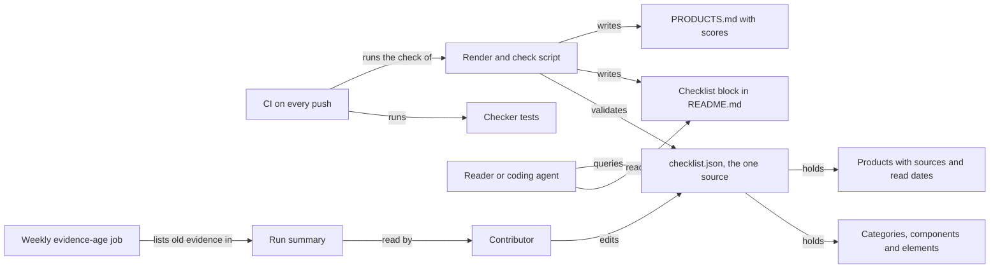

# How Agent Entity Checklist works

Agent Entity Checklist is a curated list of everything an agent entity needs. An agent entity is anything built around an agent: an agent employee, an app, an open-source project or a company. The list asks 16 questions and splits them into components and single decisions. Each decision names the leading open-source option, the leading closed-source option and a default pick with its reason. It is for founders, builders and coding agents who want the whole map before they build.

## The parts



[checklist.json](../checklist.json) is the one source. It holds 16 categories in 5 layers, from the entity itself down to the compute below it. Each category is a question, such as "What is it made of?". Its components are the things you choose, and its elements are single decisions with their open, closed and default options. The `tools` section holds every product a pick names. Each product carries a public source for every verdict and the date the sources were read.

[scripts/render.py](../scripts/render.py) validates the record and renders two views. One is the block between the `checklist` markers in [README.md](../README.md). The other is all of [PRODUCTS.md](../PRODUCTS.md), which scores each product. [tests/test_render.py](../tests/test_render.py) proves the record is valid and that the checker catches each fault. [.github/workflows/ci.yml](../.github/workflows/ci.yml) and [.github/workflows/stale.yml](../.github/workflows/stale.yml) run the checks. [AGENTS.md](../AGENTS.md) and [llms.txt](../llms.txt) tell an agent how to read the JSON. [identity/SOUL.md](../identity/SOUL.md) gives the list a persona, Atlas, the keeper of the map.

## What happens when you run it

The main flow is the check that every change to the record passes.

1. A contributor edits [checklist.json](../checklist.json), for example a pick or a product's verdict.
2. `python3 scripts/render.py` loads the record and runs `problems`. It checks that every id is lowercase, unique and nested under its parent, such as `harness.memory.long-term`.
3. Every element needs a name, a description, an open option, a closed option, a pick and a reason. Every link must be `https`, and every product an element names must exist in `tools`.
4. Every product needs an `https` address and a read date. Each route verdict must be yes, partial, no, unknown or not applicable. A yes or a partial needs an `https` source.
5. The record may hold no em or en dashes. Price, adoption and openness must use known tiers.
6. On any problem, the script prints the list and exits 1. Otherwise it rewrites the README block and PRODUCTS.md.
7. Each product's score weights access 30%, adoption 25%, quality 20%, cost 15% and openness 10%. A part without evidence is left out, and the weights are rescaled over the rest.
8. With `--check`, the script writes nothing and fails when either view is stale. CI runs the tests and then the check on every push to main and every pull request.
9. Every Monday at 09:23 UTC, the weekly job runs the check and lists products whose sources were read more than 90 days ago.

## Extending it

- **A decision.** Add an element under its component in [checklist.json](../checklist.json). Give it an id under the component's id, a name, a description, the open and closed options, a pick and a reason. Add its `https` links and the product slugs in `tools` and `alts`.
- **A product.** Add an entry under `tools` with a name, an `https` address and the date you read its sources. Give each route a verdict, with an `https` source for every yes or partial. Add its price, adoption and openness tiers.
- **A category or component.** Open an issue first, as [CONTRIBUTING.md](../CONTRIBUTING.md) asks. Categories are the questions every entity must answer, and they change rarely.
- **A check.** Add a rule to `problems` in [scripts/render.py](../scripts/render.py), and a test to the `Checker` class in [tests/test_render.py](../tests/test_render.py).

Then run `python3 scripts/render.py && python3 -m unittest discover -s tests -v`. Commit `checklist.json`, `README.md` and `PRODUCTS.md` together.

## Questions

**Does it need an API key or cost money?**
No. The script needs Python 3.10 or later and its standard library. The example queries in [AGENTS.md](../AGENTS.md) use `jq`. Some of the products the list picks cost money, and PRODUCTS.md shows each one's price tier.

**Does any data leave the machine?**
No. The script reads and writes local files and never fetches a link. The weekly job runs on GitHub and reads only the checkout.

**How does it improve itself?**
It has no `dsip.json` self-improvement contract, because a list is not an agent employee. The weekly evidence-age job is its loop. It lists every product whose sources are more than 90 days old, and a person reads those sources again and updates the record.

**How do I run its tests or checks?**

```bash
python3 -m unittest discover -s tests -v   # the record is valid and the checker catches each fault
python3 scripts/render.py --check          # README.md and PRODUCTS.md match checklist.json
python3 scripts/render.py --stale 90       # products whose sources are more than 90 days old
```

**What does it not do?**
The checker reads the record's shape, not its truth. It cannot tell whether a source says what a verdict claims, so every verdict needs a public source a person opened. A pick is a default, not a claim about who uses it. The score compares products but does not choose. No product has a quality check with a public source yet, so quality is left out of every score.
